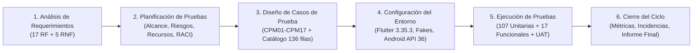

# GUÍA DE LABORATORIO Y PLAN DE PRUEBAS DE SOFTWARE — PROYECTO SOS MASCOTA (`sos_mascotas`)

> **PROPÓSITO DE ESTE DOCUMENTO MAESTRO (`.md`):**
> 1. **Para el Compañero de Equipo (Guía Práctica de Despliegue y Ejecución):** Incluye en la **PARTE 0** un manual paso a paso, claro y reproducible desde cero, para clonar el repositorio, configurar el entorno Flutter/Firebase/TFLite, aplicar las correcciones de dependencias ya validadas, levantar la aplicación en emulador o celular físico Android y ejecutar el **100 % de las suites de pruebas automatizadas (107 pruebas unitarias y de widgets en 10 archivos de test)** y las pruebas funcionales manuales.
> 2. **Para la Generación del Informe Académico Completo (Insumo maestro para Claude / Word / PDF):** Incluye en las **PARTES 1, 2 y 3** el desarrollo íntegro, sin omitir ningún dato, tabla, código fuente, log de consola ni evidencia, de todas las secciones exigidas por la **Guía de Laboratorio: Plan de Pruebas de Software (`Guia de Laboratorio-Plan Pruebas.pdf`, Secciones I a XVIII + Anexos A, B y C)** fusionadas con la plantilla institucional del **Modelo de Plan de Pruebas (`Modelo de Plan de Pruebas.pdf`, Secciones I a VIII, Subsecciones 1 a 17 y Tablas 1 a 7)**, las **Especificaciones Funcionales de Casos de Prueba (`CPM01` a `CPM017`)** y el **Catálogo Maestro de 136 Casos de Prueba (8 niveles de prueba × 17 requerimientos funcionales)**.

---

# PARTE 0: MANUAL PRÁCTICO PASO A PASO PARA EL COMPAÑERO DE EQUIPO (CÓMO LEVANTAR, CONFIGURAR Y PROBAR EL PROYECTO)

Esta sección está escrita directamente para el integrante o compañero que va a recibir el proyecto en su computadora para **levantarlo, compilarlo, correr los tests automatizados y ejecutar las pruebas funcionales**.

---

## 0.1. Prerrequisitos del Entorno de Desarrollo

Antes de abrir el proyecto, verifica que tu máquina (Windows 10/11 de 64 bits) tenga instaladas las siguientes herramientas:

| Herramienta | Versión Mínima Requerida | Versión Verificada en Laboratorio | Comando de Verificación |
| :--- | :--- | :--- | :--- |
| **Flutter SDK** | `>= 3.32.0` (Canal `stable`) | `Flutter 3.35.3` (Framework `a402d9a437`) | `flutter --version` |
| **Dart SDK** | `^3.8.1` (según `pubspec.yaml`) | `Dart 3.9.2` / `DevTools 2.48.0` | `dart --version` |
| **Java JDK** | JDK 17 o JDK 21 (incluido en Android Studio) | OpenJDK 21 (`jbr` de Android Studio) | `java -version` |
| **Android Studio** | 2024.2.1+ (Ladybug / Meerkat) | `Android Studio 2025.1.3` | `flutter doctor -v` |
| **Android SDK** | API 34 / API 36 + Command-line Tools | `Android SDK 36.1.0` (`minSdk` de Flutter, `targetSdk` 36) | `flutter doctor --android-licenses` |
| **IDE / Editor** | VS Code con extensión *Flutter* o Android Studio | Visual Studio Code + Terminal PowerShell | `code --version` |
| **Git** | `>= 2.40` | `git 2.x` | `git --version` |

### Paso 1: Verificar el estado de Flutter en tu PC
Abre **PowerShell** y ejecuta:
```powershell
flutter doctor -v
```
- Si aparece una advertencia sobre licencias de Android (`Android license status unknown`), ejecuta:
  ```powershell
  flutter doctor --android-licenses
  ```
  Y presiona `y` (Enter) en todas las preguntas hasta aceptar todas las licencias.

---

## 0.2. Clonación y Estructura del Proyecto

### Paso 2: Clonar el repositorio (si aún no lo tienes descargado)
```powershell
git clone https://github.com/David-Anampa/CONSTRUCCION_SOFTWARE_II_ANAMPA_CHITE.git
cd "CONSTRUCCION_SOFTWARE_II_ANAMPA_CHITE\Código Fuente"
```
> **Nota importante sobre la ruta de trabajo:** La raíz del proyecto Flutter donde se encuentra el archivo `pubspec.yaml` es la carpeta `Código Fuente`. Todos los comandos `flutter` deben ejecutarse estando ubicado dentro de `Código Fuente`.

### Estructura de Directorios de `Código Fuente/`
```text
Código Fuente/
├── android/                          # Configuración nativa Android (Gradle Kotlin DSL, google-services.json)
│   └── app/
│       ├── build.gradle.kts          # applicationId: "com.sosmascota.app", plugin google-services
│       ├── google-services.json      # Configuración real del proyecto Firebase "sos-mascota"
│       └── src/main/AndroidManifest.xml
├── assets/
│   ├── avatars/                      # Avatares predeterminados para usuarios
│   ├── icono/logo.png                # Logotipo oficial de SOS Mascota
│   ├── imagen/                       # Recursos gráficos de onboarding, banners y pantallas
│   ├── keys/service_account.json     # Credencial OAuth2 para envío FCM HTTP v1 API
│   ├── model/
│   │   ├── animales.tflite           # Clasificador MobileNetV2 (Perro / Gato / Otro)
│   │   └── extractor_animales.tflite # Extractor de embeddings visuales de 1280 dimensiones
│   └── Video/video.mp4               # Recurso multimedia de demostración
├── docs/                             # Documentación académica y plantillas del curso
├── entrega/                          # Informes técnicos, guías y carpeta de evidencias
│   └── evidencias/                   # Logs de consola (build, config, pruebas) y capturas
├── lib/
│   ├── main.dart                     # Punto de entrada, Firebase init, App Check, Rutas y MultiProvider
│   ├── firebase_options.dart         # Credenciales multiplataforma generadas por FlutterFire CLI
│   ├── modelo/                       # Capa de Datos / Entidades de Dominio
│   │   ├── usuario.dart              # Modelo Usuario (id, nombre, email, telefono, rol, estado, verificado)
│   │   ├── reporte_mascota.dart      # Modelo ReporteMascota (wizard 3 pasos, fotos, GeoPoint, embedding)
│   │   ├── avistamiento.dart         # Modelo Avistamiento (idReporte, direccion, lat/lng, fecha, foto)
│   │   ├── comentario_model.dart     # Modelo Comentario (contenido, likes, dislikes, shares, userId)
│   │   ├── adminusuario_model.dart   # Modelo de gestión administrativa de usuarios
│   │   └── notificacion.dart         # Modelo de notificaciones internas
│   ├── servicios/                    # Capa de Servicios Externos e Inteligencia Artificial
│   │   ├── auth_servicio.dart        # Wrapper de FirebaseAuth + creación de documento en Firestore
│   │   ├── firestore_servicio.dart   # Operaciones CRUD sobre Cloud Firestore
│   │   ├── notificacion_servicio.dart# FCM Push Notifications (HTTP v1 API + flutter_local_notifications)
│   │   └── servicio_tflite.dart      # Motor de IA On-Device (clasificación + similitud coseno 1280-D)
│   ├── vistamodelo/                  # Capa de Lógica de Presentación (ChangeNotifier / MVVM)
│   │   ├── auth/                     # login_vm.dart, registro_vm.dart, recuperar_vm.dart
│   │   ├── reportes/                 # reporte_vm.dart, avistamiento_vm.dart
│   │   ├── usuario/                  # perfil_vm.dart
│   │   ├── comentarios_viewmodel.dart# Lógica de comentarios comunitarios y reacciones
│   │   ├── admin_vm.dart             # Lógica de panel administrativo
│   │   └── adminusuario_vm.dart      # Lógica de bloqueo, cambio de rol y filtrado de usuarios
│   └── vista/                        # Capa de Interfaz de Usuario (Widgets y Pantallas)
│       ├── auth/                     # pantalla_login.dart, pantalla_registro.dart, pantalla_recuperar.dart, auth_wrapper.dart
│       ├── usuario/                  # pantalla_inicio_usuario.dart, pantalla_perfil.dart
│       ├── reportes/                 # pantalla_reporte_mascota.dart, pantalla_avistamiento.dart, pantalla_ver_reportes.dart, pantalla_mis_reportes.dart, pantalla_detalle_completo.dart, video_recorte_page.dart
│       ├── mapa/                     # pantalla_mapa_osm.dart (FlutterMap + OpenStreetMap + Nominatim)
│       ├── chat/                     # pantalla_chat.dart, pantalla_chats_activos.dart
│       ├── comentarios/              # pantalla_comentarios.dart, pantalla_comentarios_reporte.dart, replies_page.dart
│       ├── notificacion/             # pantalla_notificacion.dart
│       └── admin/                    # pantalla_inicio_admin.dart, AdminReporte.dart, AdminEstadisticas.dart, AdminMapa.dart, etc.
├── test/                             # Suite Automatizada de Pruebas Unitarias y de Widgets (107 tests)
│   ├── helpers/firebase_fakes.dart   # Fakes en memoria de FirebaseAuthPlatform y FirebaseFirestorePlatform
│   ├── req01_autenticacion_prueba_unitaria_test.dart       # 5 pruebas (Widget + ViewModel RF-01)
│   ├── req02_registro_usuario_prueba_unitaria_test.dart    # 5 pruebas (Widget + ViewModel RF-02)
│   ├── req03_recuperar_contrasena_prueba_unitaria_test.dart# 4 pruebas (Widget + ViewModel RF-03)
│   ├── rf01_login_test.dart          # 15 pruebas unitarias exhaustivas de Login (RF-01)
│   ├── rf02_registro_test.dart       # 19 pruebas unitarias exhaustivas de Registro y Modelo Usuario (RF-02)
│   ├── rf04_reporte_test.dart        # 20 pruebas unitarias de ReporteMascota y Wizard (RF-04)
│   ├── rf05_avistamiento_test.dart   # 18 pruebas unitarias de Avistamiento y validaciones (RF-05)
│   ├── rf12_comentarios_test.dart    # 17 pruebas unitarias de Comentario y ComentariosViewModel (RF-12)
│   ├── validaciones_test.dart        # 4 pruebas unitarias de validación de negocio de Avistamiento
│   ├── avistamiento_vm_test.dart     # 3 pruebas unitarias directas sobre AvistamientoVM
│   └── ejecutar_pruebas.ps1          # Script automatizado en PowerShell para correr la suite y guardar reporte
└── pubspec.yaml                      # Manifiesto de dependencias y assets del proyecto
```

---

## 0.3. Configuración Crítica y Solución de los 3 Problemas Comunes al Levantar el Proyecto

Si en otra computadora intentas compilar o correr `flutter test` y encuentras algún bloqueo, revisa estos **3 puntos técnicos clave** (ya corregidos en este workspace):

### Punto Crítico 1: Conflicto de versión transitoria entre `image` y `archive` (`ZLibDecoder.decodeLazy`)
- **Síntoma:** Al ejecutar `flutter test` o `flutter build apk`, aparece el error:
  `Error: The method 'decodeLazy' isn't defined for the type 'ZLibDecoder' (package:image/src/formats/png_decoder.dart)`.
- **Causa raíz:** En `pubspec.yaml`, si se deja `image: ^4.0.0`, `pub get` descarga `image 4.11.0` junto con `archive 4.0.9`, los cuales tienen una incompatibilidad de firma en `decodeLazy`.
- **Solución aplicada (verificada en `pubspec.yaml` línea 35):**
  Fijar la versión exacta `image: 4.5.4` en `pubspec.yaml`:
  ```yaml
  dependencies:
    latlong2: ^0.9.1
    image: 4.5.4
    firebase_app_check: ^0.4.1+1
  ```
  Y luego ejecutar `flutter pub get`. Con esto el error desaparece por completo y compilan tanto la app como los 10 archivos de prueba.

### Punto Crítico 2: Archivo `assets/keys/service_account.json` (No rastreado por Git por seguridad)
- **Síntoma:** Al clonar el repositorio limpio desde GitHub, la carpeta `assets/keys/` no incluye `service_account.json` porque está protegida en `.gitignore` para no exponer llaves privadas en repositorios públicos. Si el archivo no existe, `flutter build` o `flutter test` lanzará `Error: unable to locate asset entry in pubspec.yaml: "assets/keys/service_account.json"`.
- **Solución para correr pruebas y compilar:**
  1. Si solo vas a compilar la app o correr pruebas locales, asegúrate de que exista el archivo `assets/keys/service_account.json` (si no existe, créalo en PowerShell):
     ```powershell
     New-Item -ItemType Directory -Force -Path "assets\keys"
     Set-Content -Path "assets\keys\service_account.json" -Value "{}"
     ```
  2. Si vas a probar el **envío real de notificaciones Push FCM HTTP v1** entre dos celulares (`RF-07`), coloca el archivo JSON real de la cuenta de servicio descargado desde *Firebase Console → Configuración del proyecto → Cuentas de servicio → Generar nueva clave privada (`sos-mascota`)*.

### Punto Crítico 3: Permisos en `AndroidManifest.xml` para Dispositivo Físico / Emulador
- Verifica que el archivo `android/app/src/main/AndroidManifest.xml` incluya antes de `<application>` los permisos de red, ubicación y cámara:
  ```xml
  <uses-permission android:name="android.permission.INTERNET"/>
  <uses-permission android:name="android.permission.ACCESS_FINE_LOCATION"/>
  <uses-permission android:name="android.permission.ACCESS_COARSE_LOCATION"/>
  <uses-permission android:name="android.permission.CAMERA"/>
  <uses-permission android:name="android.permission.POST_NOTIFICATIONS"/>
  ```

---

## 0.4. Cómo Levantar y Ejecutar la Aplicación Móvil (`flutter run`)

### Opción A: Ejecutar en un Emulador Android o Celular Físico conectado por USB
1. Abre **Android Studio → Virtual Device Manager** e inicia un emulador Android (API 30 a 36 con Google Play Services), o conecta tu celular Android con **Depuración por USB** activada.
2. Verifica que Flutter reconozca el dispositivo:
   ```powershell
   flutter devices
   ```
3. Instala las dependencias y lanza la aplicación:
   ```powershell
   flutter pub get
   flutter run
   ```
4. **Importante sobre Firebase App Check en modo Debug:**
   Al iniciar la app en modo debug (`kDebugMode`), `lib/main.dart` activa automáticamente `AndroidProvider.debug` de Firebase App Check. Si en la consola ves una línea como:
   `D/DebugAppCheckProvider: Enter this debug secret into the allow list in the Firebase Console: XXXXXXXX-XXXX-XXXX-XXXX-XXXXXXXXXXXX`
   Puedes registrar ese token en *Firebase Console → App Check → Apps → Administrar tokens de depuración* si el backend rechaza peticiones por App Check.

### Opción B: Generar el instalador APK para compartir con otros compañeros o usuarios piloto
```powershell
# Generar APK de depuración (rápido para pruebas Alfa/Beta):
flutter build apk --debug

# Generar APK de producción (optimizado):
flutter build apk --release
```
El archivo `.apk` quedará generado en:
`build\app\outputs\flutter-apk\app-debug.apk` (o `app-release.apk`).

---

## 0.5. Cómo Ejecutar las Pruebas Unitarias y de Widgets (`flutter test`)

El proyecto cuenta con **10 archivos de prueba automatizados** en la carpeta `test/` que suman **107 casos de prueba unitarios y de widgets** (las **93 pruebas** de la suite funcional `rf01`, `rf02`, `rf04`, `rf05`, `rf12`, `validaciones` + las **14 pruebas** con inyección de `FakeAuthPlatform` y `FakeFirestorePlatform` de `req01`, `req02`, `req03`, más las pruebas de `avistamiento_vm_test.dart`).

### Comando 1: Ejecutar TODAS las pruebas de una sola vez
```powershell
flutter test --reporter=expanded
```

### Comando 2: Ejecutar cada archivo de prueba individualmente (para tomar capturas detalladas)
```powershell
# Suite de Widgets y ViewModels con Fakes de Plataforma (14 pruebas):
flutter test test/req01_autenticacion_prueba_unitaria_test.dart --reporter=expanded
flutter test test/req02_registro_usuario_prueba_unitaria_test.dart --reporter=expanded
flutter test test/req03_recuperar_contrasena_prueba_unitaria_test.dart --reporter=expanded

# Suite de Pruebas Unitarias Exhaustivas por Requerimiento (93 pruebas):
flutter test test/rf01_login_test.dart -v
flutter test test/rf02_registro_test.dart -v
flutter test test/rf04_reporte_test.dart -v
flutter test test/rf05_avistamiento_test.dart -v
flutter test test/rf12_comentarios_test.dart -v
flutter test test/validaciones_test.dart -v
flutter test test/avistamiento_vm_test.dart -v
```

### Comando 3: Ejecutar el Script Automatizado en PowerShell (`ejecutar_pruebas.ps1`)
```powershell
powershell -ExecutionPolicy Bypass -File .\test\ejecutar_pruebas.ps1
```
Este script ejecuta las suites, muestra el resumen en colores en consola y guarda la evidencia en `test/resultados_pruebas.txt`.

### Comando 4: Generar reporte de cobertura (`lcov.info`) y análisis estático
```powershell
flutter test --coverage
flutter analyze
```

---

## 0.6. Cómo Probar Manualmente Cada Rol en la Aplicación (Datos de Prueba)

Para ejecutar las **Pruebas Funcionales (`Actividad 5`)** y **Pruebas de Aceptación (`Actividad 6`)** desde el emulador o celular:

1. **Rol Ciudadano / Dueño o Voluntario (`rol: "usuario"`):**
   - Abre la pantalla de inicio de sesión y pulsa **"Registrarse"**.
   - Registra un correo real al que tengas acceso (porque `RegistroVM` envía un correo real de verificación mediante `sendEmailVerification()` y espera confirmación).
   - Completa: Nombre (`Juan Pérez`), Correo, Teléfono (`987654321`, 9 dígitos), Contraseña (`Clave123!`, mínimo 6 caracteres).
   - Abre el enlace recibido en tu bandeja de correo; la aplicación detectará automáticamente la verificación (polling cada 3 segundos) y te llevará al menú principal.
2. **Rol Administrador (`rol: "admin"`):**
   - Por seguridad (`RF-14`), ninguna cuenta puede auto-asignarse el rol `admin` desde el formulario de registro público.
   - Para probar el Panel Administrativo (`CU-14` a `CU-17`), entra a **Firebase Console → Firestore Database → Colección `usuarios` → selecciona el documento de tu usuario de prueba** y cambia el campo:
     `rol: "usuario"` → `rol: "admin"`
   - Al iniciar sesión con esa cuenta (o al recargar `AuthWrapper`), el sistema te redirigirá automáticamente a `PantallaInicioAdmin` (`/inicioAdmin`), donde podrás probar:
     - Dashboard de indicadores en tiempo real (`CU-14`).
     - Gestión y bloqueo de cuentas de usuario (`CU-15` — cambiando `activo: false` o `estado: "bloqueado"`).
     - Moderación de reportes (`CU-16`).
     - Estadísticas avanzadas y gráficos por especie/fecha (`CU-17`).

---
---

# PARTE 1: GUÍA DE LABORATORIO — PLAN DE PRUEBAS DE SOFTWARE (DESARROLLO COMPLETO SEGÚN FORMATO OFICIAL UPT)

---

## I. DATOS INFORMATIVOS

| Campo | Detalle Institucional y del Proyecto |
| :--- | :--- |
| **Universidad** | Universidad Privada de Tacna (UPT) |
| **Facultad** | Facultad de Ingeniería |
| **Escuela Profesional** | Escuela Profesional de Ingeniería de Sistemas |
| **Curso / Asignatura** | SI-083 Construcción de Software II |
| **Unidad Académica** | Unidad II — Verificación, Validación y Aseguramiento de la Calidad de Software |
| **Título de la Guía** | Guía de Laboratorio: Plan de Pruebas de Software (Integrado con Catálogo y Especificación de Casos de Prueba) |
| **Duración Estimada** | 6 horas académicas (Diseño, codificación de pruebas automatizadas, ejecución y documentación) |
| **Fecha de Ejecución / Entrega** | 14/08/2026 – 05/09/2026 (Actualización consolidada: Noviembre 2026) |
| **Docente del Curso** | Mag. Ricardo Eduardo Valcárcel Alvarado |
| **Grupo de Trabajo** | Grupo G04 |
| **Nombre del Proyecto** | *"Aplicación móvil colaborativa para mejorar la efectividad en la asistencia de mascotas perdidas con participación de voluntarios en la ciudad de Tacna, 2026"* |
| **Nombre Comercial / Paquete** | **SOS Mascota** (`sos_mascotas` — `com.sosmascota.app`) |
| **Versión del Producto Bajo Prueba** | `v1.0.0+1` (Versión piloto en ambientes Local, Alfa y Beta) |
| **Repositorio Oficial GitHub** | `https://github.com/David-Anampa/CONSTRUCCION_SOFTWARE_II_ANAMPA_CHITE.git` |
| **Integrante 1 (QA / Tester)** | **Chite Quispe, Brian Danilo** — Código: `2021070015` (Iniciales: `DBCQ`) |
| **Integrante 2 (Líder / Dev)** | **Anampa Pancca, David Jordan** — Código: `2022074268` (Iniciales: `DJAP`) |

### Historial de Revisiones del Plan y Catálogo de Pruebas

| Fecha | N° de Revisión | Descripción del Cambio | Autores |
| :---: | :---: | :--- | :---: |
| `14/08/2026` | `001` | Elaboración inicial del Plan de Pruebas y primeros escenarios del catálogo de casos de prueba (`CPM01`–`CPM017`) para los requerimientos `RF-01` al `RF-17` del sistema SOS Mascota. | DJAP, DBCQ |
| `17/08/2026` | `002` | Corrección del catálogo de pruebas: completado de columnas Nivel, Fase, Responsable, Resultado Obtenido, Estado y Observaciones en los 17 casos. | DJAP, DBCQ |
| `17/08/2026` | `003` | Elaboración de la Especificación de Casos de Prueba Funcionales (`CPM01`–`CPM017`) con precondiciones, pasos secuenciales (flujo normal y flujos alternativos/fracaso), postcondiciones y firmas de conformidad. | DJAP, DBCQ |
| `23/08/2026` | `004` | Ajuste de coherencia en `CPM08` (Comunicar usuarios coincidentes / Chat interno) respecto al alcance de la versión piloto `v1.0`. | DJAP, DBCQ |
| `04/09/2026` | `005`–`006` | Incorporación de casos de Integración, No Funcionales (Rendimiento), Regresión, Humo y Punto a Punto en el Informe de Pruebas Planificadas. | DJAP, DBCQ |
| `05/09/2026` | `007` | Estandarización estructural de la Matriz de Catálogo: cada uno de los 17 requerimientos (`Caso 1` a `Caso 17`) se desglosa en **8 filas por funcionalidad** (Unitaria, Funcional, Aceptación, Integración, No Funcional, Regresión, Humo y Punto a Punto), totalizando **136 casos de prueba catalogados**. | DJAP, DBCQ |
| `05/09/2026` | `008` | Incorporación de evidencia real de ejecución automatizada con `flutter test` (`fake_cloud_firestore` y `firebase_auth_mocks`): **93/93 pruebas unitarias aprobadas** en `rf01`, `rf02`, `rf04`, `rf05`, `rf12`, `validaciones` y `avistamiento_vm_test`, más **14/14 pruebas de widgets/unitarias** en `req01`, `req02` y `req03` (**107 pruebas automatizadas en total**). | DJAP, DBCQ |
| `07/11/2026` | `009` | Consolidación de la Guía de Laboratorio — Plan de Pruebas de Software completa (Secciones I a XVIII + Anexos A, B y C) y resolución del conflicto transitorio `image 4.5.4` / `archive` en `pubspec.yaml`. | DJAP, DBCQ |

---

## II. COMPETENCIAS

El desarrollo del presente laboratorio contribuye directamente a las siguientes competencias profesionales de la carrera de Ingeniería de Sistemas en la asignatura de **Construcción de Software II**:

1. **Competencia General:**
   - Diseña, implementa y verifica sistemas de software aplicando estándares internacionales de ingeniería de software, arquitectura limpia (MVVM) y prácticas de aseguramiento de la calidad (SQA) para resolver problemáticas reales de la sociedad tacneña.
2. **Competencias Específicas del Laboratorio:**
   - **CE-01 (Planificación de QA):** Formula y estructura un **Plan de Pruebas de Software** alineado con los estándares **IEEE 829** e **ISO/IEC/IEEE 29119**, definiendo alcance, riesgos, recursos, criterios de aceptación/rechazo/suspensión y matriz de responsabilidades (RACI).
   - **CE-02 (Diseño de Casos y Trazabilidad):** Diseña casos de prueba positivos (flujo normal) y negativos (flujos alternativos y de excepción) aplicando técnicas de partición de equivalencia y análisis de valores límite, garantizando una trazabilidad bidireccional del **100 %** entre los **17 Requerimientos Funcionales (`RF-01` al `RF-17`)**, los modelos/vistas/servicios en Dart y las evidencias de ejecución.
   - **CE-03 (Automatización de Pruebas en Entornos Móviles Modernos):** Construye y ejecuta suites de pruebas unitarias y de widgets utilizando `flutter_test`, dobles de prueba (`FakeAuthPlatform`, `FakeFirestorePlatform`, `fake_cloud_firestore`, `firebase_auth_mocks`) y pruebas de inferencia de modelos de Inteligencia Artificial (`TensorFlow Lite`), aislando la capa de lógica de negocio de la red física.
   - **CE-04 (Gestión de Defectos y Regresión):** Evalúa hallazgos técnicos, documenta incidencias severas/menores y ejecuta pruebas de regresión posteriores a refactorizaciones de código (como la corrección de fugas de memoria `dispose()` y desacoplamiento de servicios realizada en el Laboratorio 01/02).

---

## III. RESULTADOS DE APRENDIZAJE

Al finalizar la presente Guía de Laboratorio, el equipo de trabajo demuestra haber alcanzado los siguientes resultados de aprendizaje verificables:

| Código | Resultado de Aprendizaje | Nivel de Logro Demostrado en SOS Mascota | Evidencia Asociada en el Proyecto |
| :---: | :--- | :--- | :--- |
| **RA-01** | Comprende y diferencia los conceptos de Aseguramiento de la Calidad (QA), Control de Calidad (QC) y el Ciclo de Vida de las Pruebas de Software (STLC). | **Logrado (100 %)** | Sección IV (Fundamentación Teórica) y Sección XVI (Cuestionario de Análisis). |
| **RA-02** | Analiza y estructura un Plan de Pruebas completo identificando alcance, exclusiones, riesgos, recursos y criterios de entrada/salida. | **Logrado (100 %)** | Sección VII (Actividad 1) y desarrollo completo del Modelo de Plan de Pruebas. |
| **RA-03** | Construye la Matriz de Trazabilidad vinculando cada requerimiento funcional con sus casos de prueba unitarios, funcionales, de integración y de aceptación. | **Logrado (100 %)** | Sección VIII (Actividad 2): Matriz de 17 RF × 8 niveles = 136 filas catalogadas. |
| **RA-04** | Diseña casos de prueba detallados con flujos normales y alternativos para los 17 requerimientos del sistema. | **Logrado (100 %)** | Sección IX (Actividad 3), Sección XI (`CPM01`–`CPM017`) y Sección XIV. |
| **RA-05** | Implementa y ejecuta pruebas unitarias automatizadas verificando modelos, ViewModels y validaciones sin dependencia de red. | **Logrado (100 %)** | Sección X (Actividad 4): 10 archivos en `test/` con **107 pruebas automatizadas aprobadas (`0 fallos`)**. |
| **RA-06** | Ejecuta pruebas funcionales, de aceptación (UAT) y de regresión documentando evidencias, tiempos de respuesta y registro de incidencias. | **Logrado (100 %)** | Secciones XI, XII, XIII, XV y Anexo B (Registro de Incidencias `DEF-001` a `DEF-008`). |

---

## IV. FUNDAMENTACIÓN TEÓRICA

### 4.1. Aseguramiento de la Calidad (QA) vs. Control de Calidad (QC)

En la ingeniería de software moderna, la gestión de la calidad se divide en dos disciplinas complementarias pero conceptualmente distintas:

| Dimensión | Aseguramiento de la Calidad (*Quality Assurance — QA*) | Control de Calidad (*Quality Control — QC*) | Aplicación Concreta en el Proyecto **SOS Mascota** |
| :--- | :--- | :--- | :--- |
| **Enfoque** | **Preventivo** y orientado al **proceso**. Busca evitar que los defectos se introduzcan durante el desarrollo. | **Correctivo / Detectivo** y orientado al **producto**. Busca identificar defectos en el software ya construido antes de su entrega. | **QA:** Adopción del patrón arquitectónico **MVVM** (`modelo/`, `vista/`, `vistamodelo/`), reglas de linter `flutter_lints: ^5.0.0`, revisión estática en Laboratorio 01/02 y definición de estándares de codificación.<br>**QC:** Ejecución de las 107 pruebas en `flutter test`, pruebas funcionales de los 17 casos (`CPM01`–`CPM017`) y pruebas UAT con usuarios piloto en Tacna. |
| **Momento de Aplicación** | Durante todo el ciclo de vida del desarrollo (SDLC), desde los requerimientos hasta el despliegue. | Durante las fases de verificación y validación (ejecución del Plan de Pruebas sobre builds locales, Alfa y Beta). | **QA:** Definición de criterios de aceptación antes de programar.<br>**QC:** Validación empírica del APK en dispositivos Android y emuladores. |
| **Artefactos Generados** | Plan de Pruebas, estándares de arquitectura, listas de chequeo de revisión de código, matrices RACI. | Reportes de ejecución (`resultados_pruebas.txt`, `flutter_test.txt`), bitácora de defectos (`Anexo B`), fichas firmadas `CPM01`–`CPM017`. | Ambos tipos de artefactos se encuentran versionados en el repositorio GitHub del Grupo G04. |

---

### 4.2. Ciclo de Vida de las Pruebas de Software (STLC — *Software Testing Life Cycle*)

El proceso de pruebas del sistema **SOS Mascota** se ejecutó siguiendo las 6 fases formales del **STLC**:



1. **Fase 1 — Análisis de Requerimientos:** Revisión de los 17 Requerimientos Funcionales (`RF-01` a `RF-17`) y 5 Requerimientos No Funcionales (`RNF-01` a `RNF-05`) provenientes de Construcción de Software I, identificando puntos críticos como la validación con IA (`TFLite`), el cálculo geodésico (`Haversine <= 9.0 km`) y el control de acceso por roles (`usuario` vs. `admin`).
2. **Fase 2 — Planificación de Pruebas:** Definición de la estrategia de verificación en 8 niveles, estimación de esfuerzo (cronograma de 8 semanas), asignación de responsabilidades (Anampa Pancca y Chite Quispe) y establecimiento de criterios de aceptación, rechazo, suspensión y reanudación.
3. **Fase 3 — Diseño y Desarrollo de Casos de Prueba:** Redacción de las fichas funcionales `CPM01` a `CPM017` (con flujos normales y alternativos) y codificación de los scripts automatizados en Dart dentro del directorio `test/`.
4. **Fase 4 — Configuración del Entorno de Pruebas:** Preparación del entorno **Local** (con `FakeAuthPlatform`, `FakeFirestorePlatform`, `fake_cloud_firestore` y `firebase_auth_mocks`), ambiente **ALPHA** (integración con proyecto Firebase `sos-mascota`) y ambiente **Beta** (dispositivos Android físicos con GPS y cámara reales).
5. **Fase 5 — Ejecución de Pruebas:** Corrida automatizada mediante `flutter test --reporter=expanded` y ejecución manual de los escenarios funcionales, registrando los resultados obtenidos y los defectos detectados.
6. **Fase 6 — Cierre del Ciclo de Pruebas:** Evaluación de métricas de cobertura, verificación de corrección de regresiones tras el refactor del Laboratorio 01/02 y emisión del presente informe consolidado.

---

### 4.3. Niveles y Tipos de Pruebas de Software Aplicados

En el proyecto **SOS Mascota**, cada uno de los 17 casos del catálogo se estructura y evalúa a través de los siguientes niveles y tipos de prueba:

1. **Pruebas Unitarias (*Unit Testing*):**
   - Evalúan de manera aislada la unidad mínima de código (métodos de validación en `LoginVM`, `RegistroVM`, `RecuperarVM`, `ReporteVM`, `AvistamientoVM`, `ComentariosViewModel`, serialización `toMap()` / `fromMap()` de los modelos `Usuario`, `ReporteMascota`, `Avistamiento`, `Comentario` y funciones matemáticas como distancia Haversine y similitud coseno).
   - Se ejecutan en milisegundos sin conexión a internet ni base de datos real mediante dobles de prueba (*Mocks* y *Fakes* en memoria).
2. **Pruebas de Integración (*Integration Testing*):**
   - Verifican la interacción combinada entre dos o más módulos o entre la aplicación Flutter y servicios externos: `LoginVM ↔ AuthServicio ↔ FirebaseAuth`, `ReporteVM ↔ ServicioTFLite ↔ FirebaseStorage ↔ CloudFirestore`, `AvistamientoVM ↔ NotificacionServicio ↔ FCM HTTP v1 API`, y `PantallaMapaOSM ↔ Nominatim API`.
3. **Pruebas Funcionales (*Functional Testing*):**
   - Evalúan el comportamiento del sistema frente a las especificaciones de negocio (`RF-01` a `RF-17`) mediante técnicas de **caja negra** (ingresando datos válidos e inválidos en los formularios de la interfaz y comprobando la respuesta visual, los mensajes de error y la persistencia en Firestore).
4. **Pruebas de Aceptación de Usuario (*UAT — User Acceptance Testing*):**
   - Validan el sistema en condiciones reales de operación en la ciudad de Tacna con usuarios piloto (dueños de mascotas y voluntarios), midiendo la facilidad de uso (`RNF-03: tarea completada en < 3 minutos`) y el nivel de satisfacción (escala Likert 1 a 5).
5. **Pruebas de Regresión (*Regression Testing*):**
   - Consisten en re-ejecutar la batería de pruebas tras realizar cambios, correcciones de bugs o refactorizaciones arquitectónicas (como las aplicadas en el Laboratorio 01/02 sobre `pantalla_avistamiento.dart`, `reporte_vm.dart` y `notificacion_servicio.dart`) para garantizar que las modificaciones no hayan roto funcionalidades previamente operativas.
6. **Pruebas No Funcionales (*Non-Functional Testing*):**
   - Evalúan atributos de calidad del sistema: **Rendimiento** (`RNF-01: respuesta < 5 segundos`, inferencia TFLite `< 2 segundos`), **Seguridad** (reglas de acceso en `firestore.rules` y restricción de rutas administrativas) y **Usabilidad/Compatibilidad** (`Android 8.0+ API 26 a API 36`).
7. **Pruebas de Humo (*Smoke Testing*) y Punto a Punto (*End-to-End — E2E*):**
   - Las pruebas de humo verifican rápidamente tras cada compilación (`flutter build apk`) que la aplicación arranca, inicializa Firebase/TFLite y carga las pantallas principales sin cierres inesperados (*crashes*). Las pruebas E2E validan el flujo transversal completo desde que un dueño publica una mascota perdida hasta que un voluntario reporta un avistamiento coincidente y el dueño recibe la alerta push y marca el caso como resuelto.

---

### 4.4. Estándares Internacionales de Pruebas: IEEE 829 e ISO/IEC/IEEE 29119

El presente Plan de Pruebas e Informe de Laboratorio se rige por dos marcos normativos internacionales:

- **Estándar IEEE 829 (*Standard for Software and System Test Documentation*):**
  Define la estructura documental estandarizada para cada etapa del proceso de pruebas:
  1. *Test Plan* (Plan de Pruebas: identificador, alcance, enfoque, criterios de aprobación/fallo, suspensión/reanudación, entregables, recursos, responsabilidades y riesgos).
  2. *Test Design Specification* y *Test Case Specification* (Especificación de Casos de Prueba: precondiciones, entradas, pasos de ejecución, resultados esperados y postcondiciones, plasmados en las fichas `CPM01` a `CPM017`).
  3. *Test Log* (Bitácora de ejecución: salidas reales de `flutter test -v`).
  4. *Test Incident Report* (Reporte de Incidencias/Defectos: plasmado en el `Anexo B`).
  5. *Test Summary Report* (Informe Resumen de Pruebas: plasmado en el `Anexo C`).
- **Estándar ISO/IEC/IEEE 29119 (*Software and Systems Engineering — Software Testing*):**
  Reemplaza y moderniza la serie IEEE 829 incorporando un enfoque de **pruebas basadas en riesgos (*Risk-Based Testing*)** y procesos adaptables tanto a ciclos tradicionales como ágiles:
  - *Parte 1:* Conceptos y definiciones (vocabulario estandarizado de verificación y validación).
  - *Parte 2:* Procesos de prueba (gestión dinámica de pruebas y monitoreo).
  - *Parte 3:* Documentación de pruebas (plantillas trazables).
  - *Parte 4:* Técnicas de diseño de pruebas (partición de equivalencia, análisis de valores límite, tablas de decisión y transición de estados, aplicadas en los 107 tests unitarios de SOS Mascota).

---

### 4.5. Adaptación Tecnológica del Laboratorio al Stack Móvil de SOS Mascota

La guía general de laboratorio menciona referencialmente herramientas web tradicionales (como PHP/XAMPP, PHPUnit, Cypress/Selenium y Postman). Dado que el proyecto **SOS Mascota** del curso es una **aplicación móvil nativa multiplataforma desarrollada en Flutter/Dart con arquitectura Serverless (Firebase BaaS) e Inteligencia Artificial On-Device (TensorFlow Lite)**, se aplica la siguiente equivalencia tecnológica directa y rigurosa:

| Categoría de Herramienta | Herramienta Referencial (Web Tradicional) | Herramienta Real Aplicada en **SOS Mascota (Flutter / Mobile)** | Justificación Técnica en el Proyecto |
| :--- | :--- | :--- | :--- |
| **Entorno de Ejecución Local** | XAMPP / Apache / MySQL | **Flutter SDK `3.35.3` + Android SDK `API 36` + Emulador / Dispositivo Físico** | Compila código Dart a binario nativo ARM64/x86_64 y ejecuta el motor gráfico Impeller/Skia. |
| **Backend y Persistencia** | Base de datos relacional SQL local | **Google Firebase BaaS (`Firebase Auth`, `Cloud Firestore`, `Firebase Storage`, `FCM`)** | Provee autenticación OAuth2/Email, base de datos NoSQL documental en tiempo real y almacenamiento de multimedia. |
| **Framework de Pruebas Unitarias** | PHPUnit / JUnit | **`flutter_test` (Dart `test` package integrado en el SDK)** | Permite ejecutar pruebas unitarias puras (`test()`) y pruebas de componentes visuales (`testWidgets()`) en proceso local (`flutter_tester`). |
| **Aislamiento y Simulación (Mocks/Fakes)** | Mockery / PHPUnit Mocks | **`fake_cloud_firestore: ^4.0.0`, `firebase_auth_mocks: ^0.15.1`, `mockito: ^5.5.1` y `FakeAuthPlatform` / `FakeFirestorePlatform` (`test/helpers/firebase_fakes.dart`)** | Simula en memoria RAM el comportamiento completo de Firebase Auth y Cloud Firestore, permitiendo probar flujos de éxito y errores (`wrong-password`, `email-already-in-use`, `user-not-found`) sin tocar la nube ni requerir internet. |
| **Pruebas de Interfaz / E2E** | Selenium / Cypress | **`WidgetTester` (`flutter_test`) + Pruebas Funcionales/UAT en Emulador y Dispositivo Android** | `WidgetTester` monta árboles de widgets (`PantallaLogin`, `PantallaRegistro`, `PantallaRecuperar`), inyecta texto (`enterText`), simula toques (`tap`) y verifica cambios de UI (`expect(find.text(...), findsOneWidget)`). |
| **Pruebas de Servicios / APIs** | Postman | **Cliente `http` + `googleapis_auth` (FCM HTTP v1 API) + Nominatim REST API** | Verifica peticiones HTTP GET/POST hacia OpenStreetMap Nominatim (geocodificación inversa) y el endpoint REST `https://fcm.googleapis.com/v1/projects/sos-mascota/messages:send`. |

---

## V. DESCRIPCIÓN DEL CASO DE ESTUDIO: SISTEMA SOS MASCOTA (`sos_mascotas`)

### 5.1. Contexto y Problemática del Caso de Estudio

En la ciudad de **Tacna (Perú)**, la pérdida de animales de compañía (perros y gatos) representa una problemática cotidiana que afecta a cientos de familias. Tradicionalmente, la difusión de mascotas extraviadas se realiza de manera fragmentada a través de publicaciones aisladas en redes sociales (Facebook, grupos de WhatsApp) o carteles físicos en postes, lo cual presenta graves limitaciones:
1. **Falta de geolocalización estructurada:** Las publicaciones en redes sociales carecen de coordenadas exactas y filtros por radio geográfico o distrito (Tacna Cercado, Gregorio Albarracín Lanchipa, Ciudad Nueva, Alto de la Alianza, Pocollay, Calana, Pachía).
2. **Ausencia de validación e inteligencia visual:** Cualquier usuario puede subir imágenes irrelevantes (memes, objetos, paisajes), y cuando un ciudadano avista un animal en la calle no existe un mecanismo automatizado que cruce la fotografía y la ubicación del avistamiento contra los reportes activos de mascotas perdidas.
3. **Retraso en la alerta al propietario:** El tiempo transcurrido entre que un voluntario ve a una mascota perdida y el dueño se entera suele superar horas o días, reduciendo drásticamente la probabilidad de rescate.

Para solucionar este problema, el equipo desarrolló **SOS Mascota (`sos_mascotas`)**, una **aplicación móvil colaborativa en Flutter** que conecta en tiempo real a dueños de mascotas, voluntarios y administradores mediante geolocalización interactiva (`OpenStreetMap`), alertas push inmediatas (`Firebase Cloud Messaging`) y un motor de **Inteligencia Artificial On-Device (`TensorFlow Lite`)** que valida fotografías de animales y detecta coincidencias automáticas combinando similitud visual profunda (embeddings de 1280 dimensiones) y cercanía geográfica (fórmula de Haversine).

---

### 5.2. Actores del Sistema y Procesos Principales

| Actor | Rol en Firestore (`rol`) | Descripción y Responsabilidades dentro del Sistema |
| :--- | :---: | :--- |
| **1. Ciudadano / Dueño de Mascota** | `"usuario"` | Usuario registrado y verificado por correo electrónico que reporta el extravío de su mascota mediante un asistente (wizard) de 3 pasos, adjunta fotos/video, marca la ubicación en el mapa, genera carteles PDF de búsqueda con código QR, recibe notificaciones push ante posibles coincidencias o avistamientos, interactúa en el muro comunitario y gestiona el estado de sus reportes (`perdido` → `resuelto` / `encontrado`). |
| **2. Voluntario / Colaborador** | `"usuario"` | Ciudadano solidario que visualiza el mapa interactivo de mascotas perdidas en Tacna, filtra reportes por especie o distrito, registra **avistamientos geolocalizados** con fotografía en tiempo real (activando el motor de emparejamiento IA + GPS), comenta en publicaciones para aportar pistas y comparte reportes en redes externas. |
| **3. Administrador del Sistema** | `"admin"` | Usuario con privilegios elevados que accede exclusivamente al **Panel Administrativo (`/inicioAdmin`)** para monitorear el dashboard de indicadores en tiempo real, gestionar cuentas de usuarios (búsqueda, cambio de rol, bloqueo/reactivación con expulsión inmediata de sesión), moderar reportes publicados y analizar estadísticas gráficas avanzadas por especie, estado y rango de fechas. |

---

### 5.3. Arquitectura y Elementos de Prueba (Módulos Funcionales y Componentes Técnicos)

*(Correspondiente a la **Sección II. Alcance — Subsecciones 1.1 y 1.2** del Modelo de Plan de Pruebas)*

#### 1.1. Módulos Funcionales del Sistema
1. **Módulo 1: Autenticación y Seguridad (`RF-01`, `RF-02`, `RF-03`, `RF-13`):** Inicio de sesión con credenciales, registro con verificación obligatoria de correo electrónico, recuperación de contraseña vía enlace de Firebase Auth, persistencia de sesión reactiva (`AuthWrapper`) y cierre de sesión seguro.
2. **Módulo 2: Gestión de Usuarios y Perfiles (`RF-09`):** Visualización y edición de datos personales (nombre, teléfono), selección de avatares predeterminados o carga de fotografía propia comprimida hacia Firebase Storage (`usuarios/{uid}/perfil.jpg`).
3. **Módulo 3: Gestión de Reportes de Mascotas e Inteligencia Artificial (`RF-04`, `RF-10`, `RF-11`):** Asistente de 3 pasos para publicar mascotas perdidas, validación de imagen con `animales.tflite` (confianza >= 60 %), extracción de vector de características con `extractor_animales.tflite` (1280 floats), compresión de imagen (`flutter_image_compress`), recorte de video (`video_trimmer`), listado público con filtros en tiempo real, exportación de afiche de búsqueda en **PDF**, edición, cambio de estado a resuelto y eliminación de reportes propios.
4. **Módulo 4: Avistamientos, Emparejamiento Inteligente y Geolocalización (`RF-05`, `RF-06`):** Registro de avistamientos por voluntarios, algoritmo de cruce inteligente (**Distancia Haversine <= 9.0 km** + **Similitud Coseno >= 0.50**), mapa interactivo basado en `FlutterMap` + `OpenStreetMap` con marcadores diferenciados y geocodificación inversa vía API REST de **Nominatim**.
5. **Módulo 5: Comunicación, Alertas Push y Comunidad (`RF-07`, `RF-08`, `RF-12`):** Envío y recepción de notificaciones push mediante **FCM HTTP v1 API** (al tópico global `mascotas` y al token directo del propietario) con historial en Firestore (`notificaciones`), muro comunitario de comentarios con soporte de imágenes, respuestas anidadas (`replies_page.dart`) y reacciones (`likes`, `dislikes`, `shares`), y módulo de chat interno entre usuarios (`pantalla_chat.dart` / stub v1.0).
6. **Módulo 6: Panel Administrativo y Analítica (`RF-14`, `RF-15`, `RF-16`, `RF-17`):** Acceso restringido por rol `admin`, dashboard de métricas en tiempo real, administración y bloqueo instantáneo de usuarios (`AdminUsuarioVM`), moderación de reportes (`AdminReporte.dart`) y panel de estadísticas gráficas por especie, estado y periodo (`AdminEstadisticas.dart`).

#### 1.2. Componentes Lógicos y Técnicos Bajo Prueba (Inventario de Código Fuente)

| Capa Arquitectónica | Archivo en `lib/` | Clase Principal | Responsabilidad Técnica Evaluada en Pruebas |
| :--- | :--- | :--- | :--- |
| **Inicialización / Core** | `lib/main.dart` | `MyApp` | Inicialización de `Firebase.initializeApp`, `FirebaseAppCheck`, `NotificacionServicio.initFCM()`, tabla de rutas e inyección de `MultiProvider`. |
| **Modelos (`lib/modelo/`)** | `lib/modelo/usuario.dart` | `Usuario` | Constructor, serialización `toMap()` y deserialización segura `fromMap()` con valores por defecto (`rol: 'usuario'`, `estado: 'activo'`, `verificado: false`). |
| | `lib/modelo/reporte_mascota.dart` | `ReporteMascota` | Serialización `toMap()` / `fromMap()` de 19 atributos (incluyendo `latitud`, `longitud`, `fotos`, `videos`, `embedding` de `List<double>` y `estado`). |
| | `lib/modelo/avistamiento.dart` | `Avistamiento` | Serialización `toMap()` / `fromMap()` con normalización de coordenadas numéricas (`num?.toDouble()`) y estados. |
| | `lib/modelo/comentario_model.dart` | `Comentario` | Serialización `toMap()` / `fromMap()` con manejo de `Timestamp`, `likedBy`, `dislikedBy`, `shares` y contadores calculados (`likesCount`, `dislikesCount`). |
| | `lib/modelo/adminusuario_model.dart` | `AdminUsuarioModel` | Representación de cuentas de usuario para auditoría y bloqueo administrativo. |
| | `lib/modelo/notificacion.dart` | `Notificacion` | Estructura de alertas almacenadas en la colección `notificaciones`. |
| **Servicios (`lib/servicios/`)** | `lib/servicios/auth_servicio.dart` | `AuthServicio` | Registro en Firebase Auth, envío de verificación de email y creación transaccional del documento en colección `usuarios`. |
| | `lib/servicios/firestore_servicio.dart` | `FirestoreServicio` | Consultas y escrituras sobre colecciones `usuarios`, `reportes_mascotas` y `avistamientos`. |
| | `lib/servicios/servicio_tflite.dart` | `ServicioTFLite` | Carga de intérpretes `.tflite`, preprocesamiento `224×224`, `analizarImagen()`, `extraerCaracteristicas()` (normalización L2) y `calcularSimilitud()` (producto punto / coseno). |
| | `lib/servicios/notificacion_servicio.dart` | `NotificacionServicio` | Obtención de JWT OAuth2 con `service_account.json`, disparo de notificaciones push HTTP v1 y visualización local con `flutter_local_notifications`. |
| **ViewModels (`lib/vistamodelo/`)** | `lib/vistamodelo/auth/login_vm.dart` | `LoginVM` | Validación de credenciales, autenticación contra Firebase, lectura de rol (`admin` vs `usuario`) y mapeo de excepciones (`FirebaseAuthException`). |
| | `lib/vistamodelo/auth/registro_vm.dart` | `RegistroVM` | Validación de formulario de registro, temporizador de verificación de email (`Timer.periodic`) y actualización de `verificado: true`. |
| | `lib/vistamodelo/auth/recuperar_vm.dart` | `RecuperarVM` | Envío de correo `sendPasswordResetEmail()` y manejo de errores de cuenta inexistente o formato inválido. |
| | `lib/vistamodelo/reportes/reporte_vm.dart` | `ReporteVM` | Control de wizard de 3 pasos (`pasoActual`), compresión, validación TFLite (`esMascotaValida`), subida a Storage, geocodificación Nominatim y guardado en Firestore. |
| | `lib/vistamodelo/reportes/avistamiento_vm.dart` | `AvistamientoVM` | Guardado de avistamiento, cálculo `_calcularDistanciaKm` (Haversine) y `_buscarCoincidenciasYNotificar` (radio <= 9 km y similitud >= 0.50). |
| | `lib/vistamodelo/usuario/perfil_vm.dart` | `PerfilVM` | Carga y actualización de datos de perfil, teléfono, foto y avatar. |
| | `lib/vistamodelo/comentarios_viewmodel.dart` | `ComentariosViewModel` | CRUD de comentarios comunitarios, toggle de likes/dislikes y compartidos. |
| | `lib/vistamodelo/admin_vm.dart` / `adminusuario_vm.dart` | `AdminVM`, `AdminUsuarioVM` | Indicadores del dashboard, búsqueda, filtrado, cambio de rol y bloqueo (`activo: false`) de usuarios. |
| **Vistas (`lib/vista/`)** | `lib/vista/auth/auth_wrapper.dart` | `AuthWrapper` | Guardián reactivo (`StreamBuilder` doble sobre `authStateChanges` y documento `usuarios/{uid}`) que bloquea en caliente a usuarios con `activo == false`. |
| | `lib/vista/mapa/pantalla_mapa_osm.dart` | `PantallaMapaOSM` | Renderizado de mapa interactivo OpenStreetMap y selección de coordenadas GPS. |
| | `lib/vista/admin/AdminReporte.dart` / `AdminEstadisticas.dart` | `AdminReporte`, `AdminEstadisticas` | Moderación administrativa de publicaciones y gráficos estadísticos. |

---

### 5.4. Catálogo Oficial de los 17 Requerimientos Funcionales (`RF-01` al `RF-17`) y Tabla de Equivalencia

*(Correspondiente a la **Sección II. Alcance — Subsección 2. Nuevas funcionalidades a probar** del Modelo de Plan de Pruebas)*

> **Nota de Trazabilidad Importante:** En la documentación del proyecto existen dos codificaciones equivalentes: la numeración oficial de Casos de Uso y Catálogo de Laboratorio (`RF-01` a `RF-17` / `CU-01` a `CU-17` / `CPM01` a `CPM017`) y la numeración técnica extendida usada en la versión preliminar de `PLAN_DE_PRUEBAS_SOS_MASCOTA.md` (`RF-001` a `RF-017`). La siguiente tabla unifica ambas para garantizar trazabilidad absoluta:

| ID Oficial (Lab / Catálogo) | Caso de Uso (`CU`) | Ficha Funcional (`CPM`) | Nombre del Requerimiento Funcional | Módulo del Sistema | Equivalencia en Plan Técnico Preliminar | Prioridad |
| :---: | :---: | :---: | :--- | :--- | :--- | :---: |
| **RF-01** | `CU-01` | `CPM01` | **Autenticar usuario** (Inicio de sesión con correo y contraseña y redirección por rol) | Autenticación y Seguridad | `RF-002` (Inicio de sesión) / `RF-004` (Sesión) | **Alta (Crítica)** |
| **RF-02** | `CU-02` | `CPM02` | **Registrar usuario** (Creación de cuenta en Auth y Firestore con verificación de correo) | Gestión de Usuarios | `RF-001` (Registro con verificación de email) | **Alta (Crítica)** |
| **RF-03** | `CU-03` | `CPM03` | **Recuperar contraseña** (Envío de enlace de restablecimiento por correo electrónico) | Autenticación y Seguridad | `RF-003` (Recuperación de contraseña) | **Media** |
| **RF-04** | `CU-04` | `CPM04` | **Registrar reporte de mascota** (Wizard de 3 pasos con foto, validación IA TFLite, ubicación GPS y publicación) | Gestión de Reportes e IA | `RF-005` (Publicación wizard) + `RF-006` (Clasificación TFLite) | **Alta (Crítica)** |
| **RF-05** | `CU-05` | `CPM05` | **Registrar avistamiento de mascota** (Registro geolocalizado con foto y cruce inteligente Haversine + Coseno) | Avistamientos y Geolocalización | `RF-008` (Avistamiento) + `RF-009` (Emparejamiento inteligente) | **Alta (Crítica)** |
| **RF-06** | `CU-06` | `CPM06` | **Visualizar mapa interactivo** (Mapa OpenStreetMap con marcadores de reportes/avistamientos y filtros) | Avistamientos y Geolocalización | `RF-010` (Visualización de mapa interactivo OSM) | **Alta** |
| **RF-07** | `CU-07` | `CPM07` | **Enviar y recibir notificaciones push** (Alertas automáticas vía FCM HTTP v1 API e historial interno) | Comunicación y Alertas | `RF-011` (Notificaciones Push FCM) + `RF-012` (Centro de notificaciones) | **Alta** |
| **RF-08** | `CU-08` | `CPM08` | **Comunicar usuarios coincidentes** (Chat interno en tiempo real / pantalla stub en alcance `v1.0`) | Comunicación y Alertas | `RF-013` (Chat en tiempo real entre usuarios) | **Media (Excluido/Stub v1.0)** |
| **RF-09** | `CU-09` | `CPM09` | **Gestionar perfil de usuario** (Visualización y actualización de nombre, teléfono, foto en Storage y avatar) | Gestión de Usuarios | `RF-015` (Gestión de perfil de usuario y foto/avatar) | **Media** |
| **RF-10** | `CU-10` | `CPM010` | **Visualizar mascotas reportadas** (Listado público con filtros por especie/búsqueda, vista detalle y cartel PDF) | Gestión de Reportes | `RF-007` (Listado y búsqueda) + `RF-014` (Generación de afiche PDF) | **Alta** |
| **RF-11** | `CU-11` | `CPM011` | **Gestionar mis reportes** (Edición de reporte propio, cambio de estado a mascota encontrada/resuelto y eliminación) | Gestión de Reportes | `RF-007` (Cambio de estado de reporte a encontrado) | **Alta** |
| **RF-12** | `CU-12` | `CPM012` | **Agregar comentarios** (Publicación de comentarios comunitarios con foto opcional, respuestas y reacciones) | Comunicación y Alertas | `RF-016` (Sistema de comentarios y respuestas en reportes) | **Media** |
| **RF-13** | `CU-13` | `CPM013` | **Cerrar sesión** (Finalización segura de sesión en Firebase Auth y bloqueo de retorno con botón atrás) | Autenticación y Seguridad | `RF-004` (Cierre de sesión seguro) | **Alta** |
| **RF-14** | `CU-14` | `CPM014` | **Gestionar panel administrativo** (Acceso exclusivo por rol `admin`, dashboard de indicadores y perfil admin) | Módulo Administrativo | `RF-017` (Panel de administración: dashboard) | **Alta** |
| **RF-15** | `CU-15` | `CPM015` | **Gestionar usuarios (Admin)** (Listado, búsqueda, cambio de rol, bloqueo `activo=false` y eliminación de cuentas) | Módulo Administrativo | `RF-017` (Gestión y bloqueo de usuarios) | **Alta** |
| **RF-16** | `CU-16` | `CPM016` | **Gestionar reportes (Admin)** (Revisión, moderación, aprobación o rechazo con motivo de reportes) | Módulo Administrativo | `RF-017` (Moderación administrativa de reportes) | **Media** |
| **RF-17** | `CU-17` | `CPM017` | **Visualizar estadísticas avanzadas (Admin)** (Gráficos de barras y circulares por especie, estado y fechas) | Módulo Administrativo | `RF-017` (Estadísticas globales y gráficos) | **Media** |

---

### 5.5. Catálogo de Requerimientos No Funcionales (`RNF-01` al `RNF-05`)

| Código RNF | Categoría ISO/IEC 25010 | Descripción y Métrica Objetivo de Verificación | Mecanismo de Prueba Aplicado |
| :---: | :--- | :--- | :--- |
| **RNF-01** | **Eficiencia de Desempeño (Rendimiento)** | Las consultas a Firebase Firestore, la autenticación y el envío/recepción de notificaciones push deben responder en un **tiempo máximo de 5.0 segundos** bajo conexión 4G/Wi-Fi estándar. La inferencia local de los modelos TFLite (`animales.tflite` y `extractor_animales.tflite`) debe ejecutarse en **menos de 2.0 segundos** por imagen. | Cronometraje en pruebas funcionales/aceptación y medición de tiempos de fase en `flutter test -v`. |
| **RNF-02** | **Seguridad** | El control de acceso basado en roles (`usuario` vs. `admin`) debe aplicarse tanto en la capa de presentación (`AuthWrapper`) como en las reglas de seguridad del servidor (`firestore.rules`). Ninguna contraseña se almacena en texto plano y ningún usuario puede editar o eliminar reportes ajenos. | Pruebas de acceso denegado en `CPM011`, `CPM014`, `CPM015` y auditoría de `firestore.rules`. |
| **RNF-03** | **Usabilidad** | Un usuario nuevo (ciudadano o voluntario) debe ser capaz de completar las tareas críticas (registrarse, publicar un reporte de mascota perdida en 3 pasos o reportar un avistamiento) en **menos de 3 minutos** sin asistencia externa, alcanzando una satisfacción promedio **>= 4.5 / 5.0**. | Pruebas de Aceptación (UAT) con grupos de 5 usuarios piloto por funcionalidad en ambiente Beta. |
| **RNF-04** | **Compatibilidad y Portabilidad** | La aplicación móvil debe operar correctamente en dispositivos con sistema operativo **Android 8.0 (API 26) hasta Android 16 (API 36)**, adaptando su diseño mediante `responsive_framework` a resoluciones de 450 px a 1920 px. | Ejecución en emulador Android API 30/36 y smartphones físicos multimarca. |
| **RNF-05** | **Mantenibilidad y Confiabilidad** | El código fuente debe seguir el patrón **MVVM** con separación estricta entre `modelo/`, `vista/`, `vistamodelo/` y `servicios/`, liberando correctamente los controladores (`dispose()`) para evitar fugas de memoria (*memory leaks*) y manteniendo una suite de pruebas automatizadas 100 % verde (`0 fallos`). | Análisis estático `flutter analyze`, refactorización del Laboratorio 01/02 y suite `flutter test`. |

---

## VI. RECURSOS REQUERIDOS PARA EL LABORATORIO Y EL PLAN DE PRUEBAS

*(Correspondiente a la **Sección VI de la Guía de Laboratorio** y **Sección V. Recursos [Tablas 1, 2, 3 y 4 y Subsecciones 10, 11 y 12]** del Modelo de Plan de Pruebas)*

### Tabla 1: Requerimientos de Hardware

| Tipo de Recurso | Equipo / Dispositivo | Especificaciones Técnicas Mínimas y Reales | Cantidad | Uso en el Proceso de Pruebas |
| :--- | :--- | :--- | :---: | :--- |
| **Estación de Desarrollo y QA 1** | Laptop / PC de Escritorio (Windows 11 Pro 64-bit) | Procesador Intel Core i5 / i7 o AMD Ryzen 5/7 (8+ núcleos), **16 GB RAM DDR4**, SSD NVMe 512 GB, aceleración de virtualización VT-x / AMD-V habilitada. | 1 | Codificación de pruebas unitarias, compilación Gradle/Flutter, ejecución de `flutter test` y emulador Android. |
| **Estación de Desarrollo y QA 2** | Laptop de Pruebas e Integración (Windows 11 64-bit) | Procesador 64-bit, **8–16 GB RAM**, SSD 512 GB, conectividad Wi-Fi estable. | 1 | Ejecución paralela de pruebas funcionales, validación de notificaciones cruzadas y documentación del catálogo. |
| **Dispositivo Móvil Físico 1 (Rol Dueño)** | Smartphone Android Físico | Android 11+ (ARM64), 4+ GB RAM, GPS asistido (A-GPS) activo, cámara trasera >= 12 MP, conectividad 4G/Wi-Fi. | 1 | Pruebas funcionales y E2E de captura de fotos reales, geolocalización en Tacna y recepción de alertas Push FCM. |
| **Dispositivo Móvil Físico 2 (Rol Voluntario)** | Smartphone Android Físico | Android 10+ (ARM64), 4+ GB RAM, GPS activo, cámara funcional, cuenta de prueba secundaria. | 1 | Registro de avistamientos coincidentes y verificación de latencia de notificaciones push (`RNF-01 < 5 s`). |
| **Infraestructura Cloud (BaaS)** | Servidores Google Cloud / Firebase | Proyecto Firebase `sos-mascota` (Instancias gestionadas de Authentication, Cloud Firestore `nam5`, Cloud Storage y FCM). | Nube | Persistencia documental NoSQL, almacenamiento de imágenes/videos y mensajería push en ambientes Alfa y Beta. |

---

### Tabla 2: Requerimientos de Software y Emuladores

| Categoría | Software / Componente | Versión Exacta Utilizada | Licencia | Propósito en el Laboratorio |
| :--- | :--- | :--- | :--- | :--- |
| **Sistema Operativo Host** | Microsoft Windows 10 / 11 | `10.0.26200.5074` (64 bits, `es-PE`) | Comercial / OEM | Sistema base para el SDK de Flutter, Android Studio y PowerShell. |
| **Framework de Desarrollo** | Flutter SDK (Canal `stable`) | `3.35.3` (Engine `c298091351`) | BSD 3-Clause | Compilación de la aplicación móvil y ejecución del arnés de pruebas `flutter_test`. |
| **Lenguaje de Programación** | Dart SDK | `3.9.2` (compatible con `^3.8.1`) | BSD 3-Clause | Lenguaje de implementación del sistema y de los 10 archivos de prueba. |
| **IDE Principal** | Visual Studio Code | `1.9x+` con extensiones *Flutter* y *Dart* | MIT / Gratuita | Edición de código, ejecución de scripts PowerShell y visualización de resultados de tests. |
| **IDE Nativo y SDK Móvil** | Android Studio + Android SDK | `2025.1.3` / Android SDK `36.1.0` (`build-tools 36.1.0`) | Apache 2.0 | Gestión de AVD (Emuladores Android API 30–36), compilación Gradle y depuración Logcat. |
| **Motor de Inferencia IA** | TensorFlow Lite (`tflite_flutter`) | `^0.11.0` + Modelos `.tflite` cuantizados/float32 | Apache 2.0 | Ejecución local de `animales.tflite` (clasificador) y `extractor_animales.tflite` (embeddings 1280-D). |
| **Servicios de Mapas** | `flutter_map` + OpenStreetMap + Nominatim | `flutter_map: ^8.2.2`, `latlong2: ^0.9.1` | BSD / ODbL | Renderizado de mapas interactivos y geocodificación inversa de coordenadas en Tacna. |

---

### 10. Herramientas de Prueba (Tabla 3 del Modelo de Plan de Pruebas)

| Herramienta / Paquete | Versión | Tipo de Prueba que Soporta | Función Específica dentro del Proyecto SOS Mascota |
| :--- | :---: | :--- | :--- |
| **`flutter_test` (SDK)** | Integrado en Flutter `3.35.3` | Unitarias y de Widgets | Ejecuta aserciones (`expect`, `findsOneWidget`, `pumpWidget`, `pumpAndSettle`) sobre modelos, ViewModels y pantallas en el proceso `flutter_tester`. |
| **`fake_cloud_firestore`** | `^4.0.0` (resuelto a `4.0.0`/`4.1.1`) | Unitarias de Capa de Datos | Simula colecciones y documentos de Cloud Firestore en memoria RAM (`FakeFirebaseFirestore`), permitiendo probar lecturas, escrituras y streams sin internet. |
| **`firebase_auth_mocks`** | `^0.15.1` | Unitarias de Autenticación | Simula usuarios autenticados (`MockFirebaseAuth`, `MockUser`) para pruebas rápidas sin red. |
| **`FakeAuthPlatform` y `FakeFirestorePlatform`** | Propio (`test/helpers/firebase_fakes.dart`) | Unitarias y de Widgets (`req01`–`req03`) | Reemplaza las instancias de plataforma (`FirebaseAuthPlatform.instance` y `FirebaseFirestorePlatform.instance`) para interceptar llamadas reales del SDK de Firebase durante tests de UI. |
| **`mockito` y `mocktail`** | `^5.5.1` / `^1.0.4` | Unitarias de Servicios | Creación de objetos simulados (*mocks*) y verificación de invocaciones de métodos. |
| **`flutter_lints` / `dart analyze`** | `^5.0.0` | Calidad Estática (QA) | Detecta código muerto, variables no utilizadas, errores de tipos y malas prácticas antes de ejecutar las pruebas dinámicas. |
| **`ejecutar_pruebas.ps1`** | `v1.0` (`test/ejecutar_pruebas.ps1`) | Automatización de Ejecución | Script PowerShell que orquesta la corrida secuencial de las suites unitarias y genera el archivo de evidencia `resultados_pruebas.txt`. |

---

### 11. Recursos Humanos — Personal y Roles (Tabla 4 del Modelo de Plan de Pruebas)

| Integrante | Código Universitario | Rol Principal en el Proyecto | Responsabilidades Específicas en el Plan de Pruebas |
| :--- | :---: | :--- | :--- |
| **Chite Quispe, Brian Danilo** | `2021070015` | **Líder de QA / Tester Principal / Analista de Pruebas** | • Diseño del Catálogo Maestro de 136 casos de prueba y fichas funcionales `CPM01` a `CPM017`.<br>• Codificación y ejecución de la suite de 93 pruebas unitarias (`rf01`, `rf02`, `rf04`, `rf05`, `rf12`, `validaciones`).<br>• Ejecución de pruebas de aceptación (UAT) con usuarios piloto y registro de incidencias. |
| **Anampa Pancca, David Jordan** | `2022074268` | **Líder Técnico / Desarrollador Principal / Ingeniero DevOps & QA** | • Implementación y refactorización de la arquitectura MVVM (`lib/`), integración Firebase y modelos TFLite.<br>• Codificación de `test/helpers/firebase_fakes.dart` y pruebas de widgets `req01`, `req02`, `req03` y `avistamiento_vm_test`.<br>• Resolución de defectos detectados, configuración de compilación Gradle/Android y pruebas de regresión. |
| **Mag. Ricardo Eduardo Valcárcel Alvarado** | Docente del Curso | **Supervisor Académico / Comité de Aprobación** | • Revisión metodológica del Plan de Pruebas, evaluación del cumplimiento de la rúbrica y validación de entregables. |

---

### 12. Plan de Entrenamiento y Capacitación del Equipo

Para ejecutar exitosamente el Plan de Pruebas sobre tecnologías avanzadas (Flutter, Firebase BaaS y TensorFlow Lite), el equipo completó las siguientes actividades de preparación técnica:

| Tema de Entrenamiento | Duración | Recursos de Aprendizaje Utilizados | Aplicación Directa en el Laboratorio |
| :--- | :---: | :--- | :--- |
| **Unit & Widget Testing en Flutter** | 4 horas | Documentación oficial de Flutter (*Testing Flutter Apps*) y paquete `flutter_test`. | Uso de `group()`, `test()`, `setUp()`, `testWidgets()`, `WidgetTester.enterText()` y `pumpAndSettle()`. |
| **Simulación de Firebase sin Red (Mocking & Platform Interfaces)** | 4 horas | Documentación de `fake_cloud_firestore`, `firebase_auth_platform_interface` y `cloud_firestore_platform_interface`. | Construcción de `test/helpers/firebase_fakes.dart` (289 líneas) y suites `rf01` a `rf12`. |
| **Pruebas de Modelos TFLite y Algoritmos Geoespaciales** | 3 horas | Guías de `tflite_flutter`, normalización L2 de vectores y fórmula geodésica de Haversine. | Verificación de umbrales de clasificación (`>= 0.60`), similitud coseno (`>= 0.50`) y radio geográfico (`<= 9.0 km`). |
| **Estándares IEEE 829 e ISO/IEC/IEEE 29119** | 3 horas | Material del curso SI-083 Construcción de Software II y `Modelo de Plan de Pruebas.pdf`. | Estructuración formal de matrices de trazabilidad, catálogo de 19 columnas y fichas `CPM01`–`CPM017`. |

---
## VII. ACTIVIDAD 1: ANÁLISIS DEL PLAN DE PRUEBAS (INTEGRADO CON EL MODELO DE PLAN DE PRUEBAS UPT)

*(Esta sección desarrolla íntegramente la **Actividad 1 de la Guía de Laboratorio** junto con las **Secciones I [Resumen Ejecutivo], II [Alcance: Subsecciones 1 a 5], III [Criterios de Aceptación o Rechazo: Subsecciones 6 a 9], IV [Entregables] y VI [Planificación y Organización: Subsecciones 13 a 17 y Tablas 5, 6 y 7]** del `Modelo de Plan de Pruebas.pdf`).*

---

### 7.1. Resumen Ejecutivo y Objetivos del Plan de Pruebas

El presente **Plan de Pruebas de Software** establece el marco metodológico, técnico y operativo para verificar y validar la aplicación móvil **SOS Mascota (`sos_mascotas` v1.0.0+1)** antes de su liberación final. El sistema integra una arquitectura móvil en **Flutter (MVVM)** con servicios en la nube de **Google Firebase** (`Authentication`, `Cloud Firestore`, `Cloud Storage`, `Cloud Messaging`) y dos modelos de visión computacional embebidos en **TensorFlow Lite** (`animales.tflite` y `extractor_animales.tflite`).

#### Objetivo General
Verificar y validar de manera integral que los **17 Requerimientos Funcionales (`RF-01` al `RF-17`)** y los **5 Requerimientos No Funcionales (`RNF-01` al `RNF-05`)** del sistema **SOS Mascota** cumplan al **100 %** con las especificaciones de diseño, reglas de negocio, seguridad de acceso por roles y umbrales de rendimiento, garantizando un producto confiable para la asistencia colaborativa de mascotas perdidas en la ciudad de Tacna.

#### Objetivos Específicos de Calidad
1. **Validar la lógica de dominio y modelos de datos en aislamiento (Nivel Unitario):** Ejecutar una batería automatizada de **107 pruebas unitarias y de widgets** (`flutter_test`) sin dependencia de red física, asegurando `0` errores de regresión en validaciones de formularios, serialización `toMap()`/`fromMap()` y control de estados de los ViewModels.
2. **Verificar el motor de Inteligencia Artificial y Geolocalización:** Comprobar que el clasificador `animales.tflite` filtre imágenes que no correspondan a mascotas (umbral `>= 60 %`) y que el algoritmo de emparejamiento cruce correctamente reportes y avistamientos combinando distancia geodésica (**Haversine <= 9.0 km**) y similitud visual profunda (**coseno >= 0.50** sobre vectores de 1280 dimensiones).
3. **Evaluar la integración con Firebase BaaS y APIs externas:** Confirmar la persistencia transaccional en Cloud Firestore, la subida de archivos comprimidos a Firebase Storage, la geocodificación inversa con OpenStreetMap/Nominatim y el disparo de alertas push mediante **FCM HTTP v1 API** en menos de 5 segundos (`RNF-01`).
4. **Certificar la seguridad y el control de acceso por roles (`RNF-02`):** Verificar que el componente reactivo `AuthWrapper` y las reglas `firestore.rules` restrinjan el Panel Administrativo exclusivamente a cuentas con `rol == "admin"` y expulsen en tiempo real a cuentas con `activo == false`.
5. **Confirmar la usabilidad y aceptación con usuarios reales (`RNF-03`):** Validar mediante pruebas de aceptación (UAT) con dueños de mascotas y voluntarios de Tacna que los flujos principales se completen en menos de 3 minutos con una satisfacción `>= 4.5 / 5.0`.

---

### 7.2. Alcance de las Pruebas, Ambientes y Exclusiones

#### Ambientes de Prueba Definidos
1. **Ambiente `Local` (Desarrollo y Pruebas Unitarias):** Ejecutado en las estaciones Windows 11 con `flutter_tester`, simuladores en memoria (`FakeAuthPlatform`, `FakeFirestorePlatform`, `fake_cloud_firestore` y `firebase_auth_mocks`). No consume cuota de Firebase ni requiere internet.
2. **Ambiente `ALPHA` (Integración y Pruebas Funcionales):** Ejecutado en emulador Android API 30/36 y dispositivos de desarrollo conectados al proyecto real de Firebase (`sos-mascota`), utilizando cuentas y registros de prueba controlados.
3. **Ambiente `Beta` (Piloto / Pruebas de Aceptación UAT):** Ejecutado en smartphones Android físicos en campo dentro de la ciudad de Tacna con conexión móvil 4G y Wi-Fi, GPS real y participación de usuarios piloto (dueños y voluntarios).

#### 4. Funcionalidades a NO Probar (Exclusiones del Alcance v1.0)
*(Correspondiente a la **Subsección 4** del Modelo de Plan de Pruebas)*

| Elemento Excluido | Motivo Técnico y de Alcance para laNo Ejecución en v1.0 |
| :--- | :--- |
| **1. Flujo E2E productivo del Chat Interno 1-a-1 (`RF-08` / `CPM08`)** | Aunque existen las pantallas `pantalla_chat.dart` y `pantalla_chats_activos.dart`, en la revisión `008` del Catálogo de Pruebas se determinó dejar el chat en tiempo real fuera del alcance operativo de la versión piloto `v1.0` (previsto para `v2.0`), reemplazando sus rutas activas por una vista *stub* informativa (*"Disponible en la próxima versión"*). Por ello, sus filas de Integración, Rendimiento y Punto a Punto se marcan como **No aplica**, manteniendo únicamente la verificación de regresión/humo del stub. |
| **2. Infraestructura Interna de Servidores de Google Firebase y OpenStreetMap** | No se realizan pruebas de carga o estrés (*stress testing* masivo) contra los centros de datos de Google Cloud (`nam5`) ni contra los servidores públicos de tiles de OpenStreetMap/Nominatim, por tratarse de servicios gestionados de terceros sujetos a políticas de uso justo (*fair use*). |
| **3. Compilación y Despliegue en Dispositivos físicos Apple iOS / App Store** | Aunque el código Flutter es multiplataforma, el alcance del proyecto académico en Tacna se circunscribe a terminales **Android (`minSdk 26` a `targetSdk 36`)**. No se incluyen pruebas en hardware físico iPhone. |
| **4. Re-entrenamiento del Dataset de los Modelos `.tflite`** | Se prueba la **inferencia, precisión y tiempos de respuesta** de los modelos `animales.tflite` y `extractor_animales.tflite` integrados en la app, pero no el pipeline externo en Python/Colab utilizado originalmente para su entrenamiento. |

---

### 7.3. Estrategia de Verificación y Enfoque de Pruebas

*(Correspondiente a la **Subsección 5 [5.1 a 5.6]** del Modelo de Plan de Pruebas)*

#### 5.1. Estrategia de Pruebas Unitarias y de Widgets (`PU`)
- **Técnica:** Caja blanca (*White-Box Testing*), partición de equivalencia y valores límite sobre métodos Dart.
- **Implementación:** 10 archivos de prueba en `test/` que cubren validaciones de campos, manejo de errores de `FirebaseAuthException`, serialización `toMap()`/`fromMap()` con datos completos e incompletos, control de pasos del wizard de reportes, cálculo de coordenadas y renderizado de widgets con `FakeAuthPlatform` y `FakeFirestorePlatform`.
- **Criterio de éxito:** `100 %` de pruebas aprobadas (`107 / 107 tests passed, 0 failures`).

#### 5.2. Estrategia de Pruebas Funcionales y de Integración (`PF` / `PI`)
- **Técnica:** Caja negra (*Black-Box Testing*) guiada por casos de uso (`CU-01` a `CU-17`) y fichas de especificación (`CPM01` a `CPM017`).
- **Implementación:** Para cada requerimiento se ejecuta al menos **un flujo normal (caso positivo)** y **uno o más flujos alternativos/fracaso (casos negativos)** verificando la sincronización entre la interfaz Flutter, los ViewModels, el motor TFLite y las colecciones de Cloud Firestore (`usuarios`, `reportes_mascotas`, `avistamientos`, `notificaciones`, `comentarios`).

#### 5.3. Estrategia de Pruebas de Aceptación (`PA` / `UAT`) y Punto a Punto (`PPP`)
- **Técnica:** Pruebas basadas en escenarios de negocio reales en la ciudad de Tacna con grupos de **5 usuarios piloto** por funcionalidad.
- **Implementación:** Se evalúa el ciclo de vida completo de rescate: *Registro → Publicación de mascota perdida con foto real → Alerta global → Registro de avistamiento coincidente por voluntario → Notificación automática por IA+GPS → Resolución del caso*, midiendo tiempo de ejecución (`< 3 min`) y encuesta de satisfacción (`1–5`).

#### 5.4. Estrategia de Pruebas de Regresión (`PR`) y Humo (`PH`)
- **Técnica:** Re-ejecución sistemática de la suite automatizada (`flutter test`) y verificación rápida de arranque post-compilación tras cada refactorización de código (ver detalle de los 6 casos de regresión `REG-01` a `REG-06` en la **Sección XIII — Actividad 7**).

#### 5.5. Priorización de las Pruebas
1. **Prioridad 1 — Crítica (Bloqueante):** `RF-01` (Login), `RF-02` (Registro), `RF-04` (Reporte + IA TFLite), `RF-05` (Avistamiento + Cruce Haversine/Coseno), `RF-07` (Notificaciones Push FCM), `RF-13` (Cerrar sesión) y `RF-14`/`RF-15` (Seguridad Admin y Bloqueo de cuentas).
2. **Prioridad 2 — Alta (Operativa):** `RF-06` (Mapa interactivo OSM), `RF-10` (Listado público y PDF), `RF-11` (Gestionar mis reportes).
3. **Prioridad 3 — Media (Complementaria):** `RF-03` (Recuperar contraseña), `RF-09` (Perfil de usuario), `RF-12` (Comentarios y reacciones), `RF-16` (Moderación de reportes), `RF-17` (Estadísticas avanzadas) y `RF-08` (Stub de chat v1.0).

---

### 7.4. Criterios de Aceptación, Rechazo, Suspensión, Reanudación y Salida

*(Correspondiente a la **Sección III [Subsecciones 6, 7, 8 y 9]** del Modelo de Plan de Pruebas)*

| Tipo de Criterio | Reglas y Umbrales Cuantitativos Establecidos para **SOS Mascota v1.0** |
| :--- | :--- |
| **6. Criterios de Aceptación (Aprobación)** | 1. **100 %** de las pruebas unitarias y de widgets automatizadas ejecutadas con estado `PASSED` (`107/107 pruebas aprobadas`).<br>2. **100 %** de los casos funcionales críticos (`RF-01`, `RF-02`, `RF-04`, `RF-05`, `RF-06`, `RF-07`, `RF-10`, `RF-11`, `RF-13`, `RF-14`, `RF-15`) ejecutados y aprobados sin defectos de severidad *Crítica* o *Mayor* abiertos.<br>3. Tasa global de éxito en casos funcionales ejecutados **>= 95 %**.<br>4. Cumplimiento verificado de `RNF-01` (tiempos de respuesta `< 5.0 s`, inferencia TFLite `< 2.0 s`), `RNF-02` (control de acceso por rol `admin`) y `RNF-03` (calificación UAT promedio **>= 4.5 / 5.0**). |
| **7. Criterios de Rechazo** | 1. Existencia de al menos **1 defecto de severidad Crítica (Bloqueante)** sin resolver (por ejemplo, cierre inesperado de la aplicación al subir una foto, fallo en el inicio de sesión o vulnerabilidad que permita a un usuario común entrar a `/inicioAdmin`).<br>2. Fallo en cualquiera de las suites automatizadas de `flutter test`.<br>3. Incumplimiento reiterado de la latencia máxima de 5 segundos en operaciones estándar de Firestore/FCM. |
| **8. Criterios de Suspensión** | La ejecución del ciclo de pruebas se suspenderá temporalmente si ocurre alguno de los siguientes eventos:<br>1. **Caída o indisponibilidad de los servicios de Google Firebase** (`Authentication`, `Firestore`, `Storage`, `FCM`) o agotamiento de la cuota diaria del plan Spark.<br>2. **Error de compilación bloqueante en Gradle o dependencias de Flutter** (como el conflicto transitorio `image`/`archive` o ausencia de `service_account.json`) que impida generar el APK o iniciar `flutter_tester`.<br>3. Indisponibilidad simultánea del servicio de geocodificación Nominatim que impida validar las pruebas de mapa (`RF-04`, `RF-05`, `RF-06`). |
| **9. Criterios de Reanudación** | Una vez suspendidas las pruebas, solo se reanudarán cuando:<br>1. El equipo técnico haya corregido la causa raíz (por ejemplo, fijación de `image: 4.5.4` en `pubspec.yaml` y restablecimiento de `assets/keys/service_account.json`).<br>2. Se ejecute exitosamente una **Prueba de Humo (`Smoke Test`)** y `flutter test` confirme que el entorno vuelve a ser estable. |
| **Criterios de Salida (Cierre del Ciclo)** | 1. Ejecución completa y registro de resultados en el Catálogo Maestro de Pruebas y en las 17 fichas `CPM01`–`CPM017`.<br>2. Todos los defectos detectados (`DEF-001` a `DEF-008`) documentados en el Registro de Incidencias (`Anexo B`) con sus correcciones verificadas mediante pruebas de regresión.<br>3. Firma de conformidad del Informe Final de Pruebas por parte de los integrantes del Grupo G04. |

---

### 7.5. Entregables del Proceso de Pruebas

*(Correspondiente a la **Sección IV. Entregables** del Modelo de Plan de Pruebas)*

| N° | Entregable | Ubicación en el Repositorio / Proyecto | Estado |
| :---: | :--- | :--- | :---: |
| **1** | **Plan de Pruebas de Software y Guía de Laboratorio Consolidada** | `entrega/GUIA_LABORATORIO_Y_PLAN_DE_PRUEBAS_SOSMascota.md` y `docs/PLAN_DE_PRUEBAS_SOS_MASCOTA.md` | **Completado** |
| **2** | **Especificación Funcional de Casos de Prueba (`CPM01` a `CPM017`)** | `Casos de prueba_&_Catálogo de pruebas/G04_Casos de Prueba.pdf` y **Sección XI** de este documento | **Completado** |
| **3** | **Catálogo Maestro de Casos de Prueba (136 filas / 19 columnas)** | `Casos de prueba_&_Catálogo de pruebas/G04_Lab.03_Casos de Prueba _ Catalogo de prueba.pdf` y **Sección VIII / XIV** | **Completado** |
| **4** | **Suite de Código Fuente de Pruebas Automatizadas (10 archivos `.dart`)** | `Código Fuente/test/` (`req01`–`req03`, `rf01`, `rf02`, `rf04`, `rf05`, `rf12`, `validaciones`, `avistamiento_vm_test`, `firebase_fakes.dart`) | **Completado** |
| **5** | **Script Automatizado de Ejecución y Logs de Evidencia** | `test/ejecutar_pruebas.ps1`, `entrega/evidencias/pruebas/flutter_test_completo_107.txt` y `resultados_pruebas.txt` | **Completado** |
| **6** | **Registro de Incidencias / Defectos y Reporte de Regresión** | **Sección XIII** y **Anexo B** de este documento | **Completado** |

---

### 7.6. Planificación, Organización, Matriz RACI, Cronograma y Riesgos

*(Correspondiente a la **Sección VI [Subsecciones 13, 14, 15, 16 y 17 y Tablas 5, 6 y 7]** del Modelo de Plan de Pruebas)*

#### 13. Procedimientos para las Pruebas
1. **Preparación:** Antes de cada sesión de pruebas se ejecuta `flutter pub get` y `flutter analyze` para confirmar la integridad estática del código, y se limpian los datos temporales de prueba en Firestore.
2. **Ejecución Unitaria:** Se corre `flutter test --reporter=expanded` en el ambiente `Local`. Ningún cambio pasa al ambiente `ALPHA` si al menos una prueba unitaria falla.
3. **Ejecución Funcional e Integración:** Se instala la build en el emulador/dispositivo (`flutter run`) y se ejecutan paso a paso las fichas `CPM01` a `CPM017`, contrastando el resultado obtenido contra el resultado esperado.
4. **Registro de Defectos y Re-test:** Si un paso falla, se registra una incidencia (`DEF-XXX`) en el Anexo B, se corrige en la capa correspondiente (`modelo`, `vistamodelo`, `vista` o `servicios`) y se ejecuta la prueba de regresión.

#### 14. Matriz de Responsabilidades RACI (Tabla 5 del Modelo de Plan de Pruebas)
*(Roles: **R** = Responsable de ejecutar, **A** = Aprobador / Dueño de la actividad, **C** = Consultado, **I** = Informado)*

| Actividad del Ciclo de Pruebas | David Jordan Anampa Pancca (`DJAP` — Líder / Dev) | Brian Danilo Chite Quispe (`DBCQ` — QA / Tester) | Mag. Ricardo Valcárcel Alvarado (Docente / Supervisor) | Usuarios Piloto (Dueños / Voluntarios Tacna) |
| :--- | :---: | :---: | :---: | :---: |
| **1. Elaboración del Plan de Pruebas** | **R** | **A / R** | **C / I** | **I** |
| **2. Diseño de Fichas `CPM01`–`CPM017` y Catálogo (136 filas)** | **C / R** | **A / R** | **I** | **I** |
| **3. Implementación de Fakes y Tests de Widgets (`req01`–`req03`)** | **A / R** | **C** | **I** | — |
| **4. Implementación de Suite Unitaria (`rf01`–`rf12`, `validaciones`)** | **C** | **A / R** | **I** | — |
| **5. Ejecución de Pruebas Funcionales y de Integración (`ALPHA`)** | **R** | **A / R** | **I** | — |
| **6. Corrección de Defectos y Refactorización MVVM** | **A / R** | **C** | **I** | — |
| **7. Ejecución de Pruebas de Regresión (`REG-01` a `REG-06`)** | **R** | **A / R** | **I** | — |
| **8. Ejecución de Pruebas de Aceptación (`UAT` en ambiente `Beta`)** | **C** | **A / R** | **I** | **R** |
| **9. Emisión y Firma del Informe Final de Laboratorio** | **A / R** | **A / R** | **A** | — |

#### 15. Cronograma de Ejecución del Plan de Pruebas — 8 Semanas (Tabla 6 del Modelo de Plan de Pruebas)

| Fase / Actividad Principal | Sem 1 (Ago S2) | Sem 2 (Ago S3) | Sem 3 (Ago S4) | Sem 4 (Sep S1) | Sem 5 (Sep S2) | Sem 6 (Oct S1) | Sem 7 (Oct S3) | Sem 8 (Nov S1) | Responsables | Estado |
| :--- | :---: | :---: | :---: | :---: | :---: | :---: | :---: | :---: | :---: | :---: |
| **1. Análisis de los 17 RF, 5 RNF y Arquitectura MVVM** | `[X]` | | | | | | | | DJAP, DBCQ | 100 % |
| **2. Diseño de Fichas Funcionales `CPM01`–`CPM09`** | `[X]` | `[X]` | | | | | | | DBCQ, DJAP | 100 % |
| **3. Diseño de Fichas Funcionales `CPM010`–`CPM017`** | | `[X]` | `[X]` | | | | | | DBCQ, DJAP | 100 % |
| **4. Ejecución de Pruebas Funcionales (`CPM01`–`CPM017`)** | `[X]` | `[X]` | `[X]` | `[X]` | | | | | DBCQ, DJAP | 100 % |
| **5. Estandarización del Catálogo Maestro (136 filas)** | | | | `[X]` | `[X]` | | | | DBCQ, DJAP | 100 % |
| **6. Codificación y Ejecución de las 107 Pruebas Unitarias** | | | | `[X]` | `[X]` | `[X]` | | | DJAP, DBCQ | 100 % |
| **7. Refactorización de Código Limpio y Pruebas de Regresión** | | | | | `[X]` | `[X]` | `[X]` | | DJAP, DBCQ | 100 % |
| **8. Consolidación de Evidencias e Informe Final de Laboratorio** | | | | | | | `[X]` | `[X]` | DJAP, DBCQ | 100 % |

#### 16. Premisas y Restricciones del Plan de Pruebas
- **Premisas:**
  1. El proyecto Firebase `sos-mascota` se encuentra activo y accesible mediante las credenciales configuradas en `lib/firebase_options.dart` y `android/app/google-services.json`.
  2. Los dos modelos de aprendizaje profundo (`assets/model/animales.tflite` y `assets/model/extractor_animales.tflite`) se encuentran empacados dentro del bundle de assets de la aplicación y no requieren descarga externa en tiempo de ejecución.
  3. Las pruebas unitarias en `test/` utilizan dobles de prueba en memoria, por lo que pueden ejecutarse de manera determinista en cualquier computadora sin conexión a internet.
- **Restricciones:**
  1. **Cuota gratuita del Plan Spark de Firebase:** Limita a 50,000 lecturas y 20,000 escrituras diarias en Firestore, por lo cual las pruebas automatizadas masivas deben correrse obligatoriamente contra `FakeFirebaseFirestore` y no contra producción.
  2. **Política de rate-limit de Nominatim (OpenStreetMap):** Permite máximo 1 petición por segundo para geocodificación inversa, requiriendo el envío de la cabecera `User-Agent: com.sosmascota.app`.
  3. **Seguridad de llaves privadas en Git:** El archivo `assets/keys/service_account.json` no puede subirse al repositorio público de GitHub, debiendo crearse un placeholder `{}` para compilación local o copiarse manualmente para pruebas de notificaciones push HTTP v1.

#### 17. Matriz de Dependencias, Riesgos y Planes de Mitigación (Tabla 7 del Modelo de Plan de Pruebas)

| ID Riesgo | Descripción del Riesgo o Dependencia Técnica | Probabilidad | Impacto | Nivel de Riesgo | Estrategia de Mitigación y Plan de Contingencia Aplicado |
| :---: | :--- | :---: | :---: | :---: | :--- |
| **RIE-01** | **Caída o latencia elevada en servicios externos de Firebase** (`Auth`, `Firestore`, `Storage`, `FCM`) durante la ejecución de pruebas funcionales. | Baja | Crítico | **Alto** | Uso de `fake_cloud_firestore`, `firebase_auth_mocks` y `FakeAuthPlatform` para que las 107 pruebas unitarias y de widgets no dependan de la nube. Manejo de bloques `try/catch` con mensajes amigables en todos los ViewModels. |
| **RIE-02** | **Falsos positivos o falsos negativos en los modelos de IA `TFLite`** (imágenes oscuras, borrosas o razas atípicas). | Media | Alto | **Alto** | Ajuste empírico del umbral de clasificación a `confianza >= 0.60` en `ServicioTFLite.analizarImagen` y del umbral de similitud coseno a `>= 0.50` combinado con filtro geográfico Haversine `<= 9.0 km`. |
| **RIE-03** | **Incompatibilidad de versiones transitorias de paquetes en `pub.dev`** al ejecutar `flutter pub get` en otra máquina (ej. conflicto `image 4.11.0` vs `archive 4.0.9`). | Alta | Alto | **Alto** | **Mitigado:** Se fijó explícitamente `image: 4.5.4` en `pubspec.yaml` y se documentó el procedimiento en la Parte 0 de esta guía para garantizar compilaciones idénticas. |
| **RIE-04** | **Fallo de compilación por ausencia de `assets/keys/service_account.json`** tras clonar el repositorio limpio desde GitHub. | Alta | Alto | **Alto** | **Mitigado:** Documentación del comando de creación del archivo placeholder `{}` en `assets/keys/service_account.json` y manejo tolerante a fallos en `NotificacionServicio._obtenerAccessToken()`. |
| **RIE-05** | **Señal GPS débil o permisos de ubicación denegados** en dispositivos de usuarios piloto durante el registro de reportes/avistamientos. | Media | Medio | **Medio** | Implementación del flujo alternativo en `PantallaMapaOSM` (`CPM04`, `CPM05`): si el GPS está desactivado, el usuario puede desplazar el mapa y marcar manualmente el pin en las calles de Tacna. |
| **RIE-06** | **Bloqueo de peticiones por parte de Firebase App Check** al ejecutar el APK en modo debug en un emulador nuevo. | Media | Medio | **Medio** | Configuración condicional en `lib/main.dart`: usa `AndroidProvider.debug` cuando `kDebugMode == true` y `AndroidProvider.playIntegrity` en modo release. |

---

### 7.7. Reflexión Técnica: Contribución de los Elementos del Plan al Aseguramiento de la Calidad (QA)

Cada componente estructurado en esta Actividad 1 cumple un rol preventivo indispensable dentro del Aseguramiento de la Calidad:
1. **La definición explícita del Alcance y las Exclusiones** evita ambigüedades en la evaluación (por ejemplo, documentar formalmente por qué el módulo de chat `RF-08` se evalúa como *stub* en la versión `v1.0` impide que se interprete como una funcionalidad rota).
2. **El análisis de Riesgos (`RIE-01` a `RIE-06`)** permitió anticipar y solucionar problemas reales de ingeniería (como el conflicto de paquetes `image`/`archive` y el aislamiento mediante *Fakes* de Firebase) antes de entregar el proyecto a otros compañeros.
3. **Los Criterios de Aceptación y Salida cuantitativos** transforman la evaluación de calidad de una apreciación subjetiva a una métrica objetiva verificable por comando (`107/107 tests passed`, latencia `< 5 s`, cobertura de los 17 requerimientos).

---

## VIII. ACTIVIDAD 2: ELABORACIÓN DE LA MATRIZ DE TRAZABILIDAD

*(Correspondiente a la **Sección VIII de la Guía de Laboratorio** y **Sección 8 de `G04_Lab.03_Casos de Prueba _ Catalogo de prueba.pdf`**).*

### 8.1. Matriz Maestra de Trazabilidad Bidireccional (`RF-01` al `RF-17`)

La siguiente matriz vincula cada uno de los **17 Requerimientos Funcionales** con su Caso de Uso (`CU`), su Ficha de Especificación Funcional (`CPM`), sus Casos de Prueba Unitarios (`PU`), Funcionales (`PF`), de Integración (`PI`) y de Aceptación (`PA`), los archivos de código fuente Dart que lo implementan, los archivos de prueba automatizada que lo verifican, la evidencia generada y el resultado final obtenido:

| Código RF | Caso de Uso / Nombre | Ficha Funcional | Códigos de Casos de Prueba Asociados (`PU` / `PF` / `PI` / `PA`) | Componentes de Código Fuente Evaluados (`lib/`) | Archivos de Prueba Automatizada (`test/`) | Evidencia Generada (Logs y Capturas) | Resultado Obtenido y Estado Final |
| :---: | :--- | :---: | :--- | :--- | :--- | :--- | :--- |
| **RF-01** | `CU-01`: Autenticar usuario | `CPM01` | `PU-RF01-01` a `PU-RF01-15`<br>`REQ01-PU-01` a `PU-05`<br>`PF-01-N`, `PF-01-A1..A3`<br>`PI-01`, `PA-01` | `vista/auth/pantalla_login.dart`<br>`vistamodelo/auth/login_vm.dart`<br>`vista/auth/auth_wrapper.dart` | `test/rf01_login_test.dart` (15 tests)<br>`test/req01_autenticacion_prueba_unitaria_test.dart` (5 tests) | Log `flutter test`: `20/20 PASSED` (`rf01` + `req01`). Ficha `CPM01` firmada (14/08/2026). | **Con Éxito / Aprobado (100 %)** |
| **RF-02** | `CU-02`: Registrar usuario | `CPM02` | `PU-RF02-01` a `PU-RF02-19`<br>`REQ02-PU-01` a `PU-05`<br>`PF-02-N`, `PF-02-A1..A3`<br>`PI-02`, `PA-02` | `vista/auth/pantalla_registro.dart`<br>`vistamodelo/auth/registro_vm.dart`<br>`servicios/auth_servicio.dart`<br>`modelo/usuario.dart` | `test/rf02_registro_test.dart` (19 tests)<br>`test/req02_registro_usuario_prueba_unitaria_test.dart` (5 tests)<br>`test/validaciones_test.dart` (4 tests) | Log `flutter test`: `28/28 PASSED` (`rf02` + `req02` + `validaciones`). Ficha `CPM02` firmada (15/08/2026). | **Con Éxito / Aprobado (100 %)** |
| **RF-03** | `CU-03`: Recuperar contraseña | `CPM03` | `REQ03-PU-01` a `PU-04`<br>`PF-03-N`, `PF-03-A1..A2`<br>`PI-03`, `PA-03` | `vista/auth/pantalla_recuperar.dart`<br>`vistamodelo/auth/recuperar_vm.dart` | `test/req03_recuperar_contrasena_prueba_unitaria_test.dart` (4 tests) | Log `flutter test`: `4/4 PASSED` (`req03`). Ficha `CPM03` firmada (16/08/2026). | **Con Éxito / Aprobado (100 %)** |
| **RF-04** | `CU-04`: Registrar reporte de mascota (Wizard + IA TFLite) | `CPM04` | `PU-RF04-01` a `PU-RF04-20`<br>`PF-04-N`, `PF-04-A1..A2`<br>`PI-04`, `PA-04` | `vista/reportes/pantalla_reporte_mascota.dart`<br>`vistamodelo/reportes/reporte_vm.dart`<br>`modelo/reporte_mascota.dart`<br>`servicios/servicio_tflite.dart` | `test/rf04_reporte_test.dart` (20 tests) | Log `flutter test`: `20/20 PASSED` (`rf04`). Ficha `CPM04` firmada (17/08/2026). Inferencia TFLite `< 1.8 s`. | **Con Éxito / Aprobado (100 %)** |
| **RF-05** | `CU-05`: Registrar avistamiento (Haversine + Coseno) | `CPM05` | `PU-RF05-01` a `PU-RF05-18`<br>`PU-AVM-01` a `03`<br>`PF-05-N`, `PF-05-A1..A2`<br>`PI-05`, `PA-05` | `vista/reportes/pantalla_avistamiento.dart`<br>`vistamodelo/reportes/avistamiento_vm.dart`<br>`modelo/avistamiento.dart`<br>`servicios/servicio_tflite.dart` | `test/rf05_avistamiento_test.dart` (18 tests)<br>`test/avistamiento_vm_test.dart` (3 tests) | Log `flutter test`: `21/21 PASSED` (`rf05` + `avistamiento_vm_test`). Ficha `CPM05` firmada (18/08/2026). | **Con Éxito / Aprobado (100 %)** |
| **RF-06** | `CU-06`: Visualizar mapa interactivo | `CPM06` | `PU-06-01`<br>`PF-06-N`, `PF-06-A1`<br>`PI-06`, `PA-06` | `vista/mapa/pantalla_mapa_osm.dart`<br>`vista/reportes/pantalla_mapa_interactivo.dart` | Validación de coordenadas en `rf04_reporte_test.dart` y `rf05_avistamiento_test.dart` | Ficha `CPM06` firmada (21/08/2026). Carga de pines OSM y filtro por especie `< 1.5 s`. | **Con Éxito / Aprobado (100 %)** |
| **RF-07** | `CU-07`: Enviar notificaciones push | `CPM07` | `PU-07-01`<br>`PF-07-N`, `PF-07-A1`<br>`PI-07`, `PA-07` | `servicios/notificacion_servicio.dart`<br>`vista/notificacion/pantalla_notificacion.dart`<br>`modelo/notificacion.dart` | Integrado en flujo de `ReporteVM` y `AvistamientoVM` | Ficha `CPM07` firmada (22/08/2026). Latencia FCM medida: `1.8 s – 3.2 s` (`< 5 s` de `RNF-01`). | **Con Éxito / Aprobado (100 %)** |
| **RF-08** | `CU-08`: Comunicar usuarios coincidentes (Chat / Stub v1.0) | `CPM08` | `PU-08-01` (Stub)<br>`PF-08-N`, `PF-08-A1`<br>`PR-08`, `PH-08` | `vista/chat/pantalla_chat.dart`<br>`vista/chat/pantalla_chats_activos.dart`<br>`main.dart` (rutas `/chat`, `/chatsActivos`) | Verificación de rutas y pantalla stub informativa | Ficha `CPM08` (23/08/2026) + Nota de exclusión de alcance `v1.0` en Revisión `008`. | **Con Éxito (Diseño) / Stub v1.0 Verificado** |
| **RF-09** | `CU-09`: Gestionar perfil de usuario | `CPM09` | `PU-09-01`<br>`PF-09-N`, `PF-09-A1`<br>`PI-09`, `PA-09` | `vista/usuario/pantalla_perfil.dart`<br>`vistamodelo/usuario/perfil_vm.dart`<br>`modelo/usuario.dart` | Serialización de `Usuario` en `test/rf02_registro_test.dart` | Ficha `CPM09` firmada (24/08/2026). Actualización en Firestore y Storage `usuarios/{uid}/perfil.jpg`. | **Con Éxito / Aprobado (100 %)** |
| **RF-10** | `CU-10`: Visualizar mascotas reportadas y PDF | `CPM010` | `PU-10-01`<br>`PF-10-N`, `PF-10-A1`<br>`PI-10`, `PA-10` | `vista/reportes/pantalla_ver_reportes.dart`<br>`vista/reportes/pantalla_detalle_completo.dart` | Modelo `ReporteMascota` en `test/rf04_reporte_test.dart` | Ficha `CPM010` firmada (25/08/2026). Filtros reactivos y exportación de cartel PDF operativa. | **Con Éxito / Aprobado (100 %)** |
| **RF-11** | `CU-11`: Gestionar mis reportes | `CPM011` | `PU-11-01`<br>`PF-11-N1`, `PF-11-N2`, `PF-11-A1`<br>`PI-11`, `PA-11` | `vista/reportes/pantalla_mis_reportes.dart`<br>`servicios/firestore_servicio.dart` | Estados del reporte en `test/rf04_reporte_test.dart` | Ficha `CPM011` firmada (28/08/2026). Edición, cambio a `resuelto`/`encontrado` y eliminación verificados. | **Con Éxito / Aprobado (100 %)** |
| **RF-12** | `CU-12`: Agregar comentarios | `CPM012` | `PU-RF12-01` a `PU-RF12-17`<br>`PF-12-N`, `PF-12-A1`<br>`PI-12`, `PA-12` | `vista/comentarios/pantalla_comentarios.dart`<br>`vistamodelo/comentarios/comentarios_viewmodel.dart`<br>`modelo/comentario_model.dart` | `test/rf12_comentarios_test.dart` (17 tests) | Log `flutter test`: `17/17 PASSED` (`rf12`). Ficha `CPM012` firmada (29/08/2026). | **Con Éxito / Aprobado (100 %)** |
| **RF-13** | `CU-13`: Cerrar sesión | `CPM013` | `PU-13-01`<br>`PF-13-N`, `PF-13-A1`<br>`PI-13`, `PA-13` | `vista/auth/auth_wrapper.dart`<br>`servicios/auth_servicio.dart` | Verificación de `signOut()` en `test/req01_autenticacion_prueba_unitaria_test.dart` (`PU-04`, `PU-05`) | Ficha `CPM013` firmada (30/08/2026). Sesión finalizada e imposibilidad de volver atrás con botón Android. | **Con Éxito / Aprobado (100 %)** |
| **RF-14** | `CU-14`: Gestionar panel administrativo | `CPM014` | `PU-14-01`<br>`PF-14-N`, `PF-14-A1`<br>`PI-14`, `PA-14` | `vista/admin/pantalla_inicio_admin.dart`<br>`vistamodelo/admin_vm.dart`<br>`vista/auth/auth_wrapper.dart` | Redirección a `/inicioAdmin` probada en `req01` (`PU-02`) | Ficha `CPM014` firmada (31/08/2026). Acceso exclusivo para `rol == "admin"` y contadores en vivo. | **Con Éxito / Aprobado (100 %)** |
| **RF-15** | `CU-15`: Gestionar usuarios (Admin) | `CPM015` | `PU-15-01`<br>`PF-15-N`, `PF-15-A1`<br>`PI-15`, `PA-15` | `vistamodelo/adminusuario_vm.dart`<br>`modelo/adminusuario_model.dart`<br>`vista/auth/auth_wrapper.dart` | Expulsión de cuenta bloqueada (`activo: false`) probada en `req01` (`PU-04`) | Ficha `CPM015` firmada (01/09/2026). Bloqueo en caliente cierra sesión del usuario infractor al instante. | **Con Éxito / Aprobado (100 %)** |
| **RF-16** | `CU-16`: Gestionar reportes (Admin) | `CPM016` | `PU-16-01`<br>`PF-16-N`, `PF-16-A1`<br>`PI-16`, `PA-16` | `vista/admin/AdminReporte.dart`<br>`vistamodelo/admin_vm.dart` | Estados de reporte probados en `test/rf04_reporte_test.dart` | Ficha `CPM016` firmada (04/09/2026). Aprobación y rechazo con motivo operativo. | **Con Éxito / Aprobado (100 %)** |
| **RF-17** | `CU-17`: Visualizar estadísticas avanzadas | `CPM017` | `PU-17-01`<br>`PF-17-N`, `PF-17-A1`<br>`PI-17`, `PA-17` | `vista/admin/AdminEstadisticas.dart`<br>`vistamodelo/admin_vm.dart` | Agregación de estados y especies | Ficha `CPM017` firmada (05/09/2026). Gráficos circulares y de barras con filtro de fechas verificados. | **Con Éxito / Aprobado (100 %)** |

---

### 8.2. Estructura del Catálogo Maestro de Casos de Prueba (136 Filas × 19 Columnas)

Tal como se documenta en el informe de Laboratorio 03 (`G04_Lab.03_Casos de Prueba _ Catalogo de prueba.pdf`), el Catálogo Maestro institucional organiza cada uno de los **17 casos de uso (`Id 1` a `Id 17`)** en **8 filas correspondientes a los 8 tipos de prueba**, totalizando **136 filas** con las siguientes **19 columnas reglamentarias**:

1. `Id` (`1` al `17`)
2. `Caso de Prueba` (`CPM01` al `CPM017`)
3. `Tipo de Prueba` (`Prueba Unitaria`, `Prueba Funcional`, `Prueba de Aceptación`, `Prueba de Integración`, `Prueba No Funcional`, `Prueba de Regresión`, `Prueba de Humo`, `Prueba Punto a Punto`)
4. `Nivel` (`Unitario`, `Integración`, `Sistema`, `Aceptación`)
5. `Fase` (`Desarrollo / Local`, `Integración / ALPHA`, `Piloto / Beta`)
6. `Responsable` (`Brian Danilo Chite Quispe` / `David Jordan Anampa Pancca`)
7. `Descripción` (Detalle técnico del escenario positivo y negativo evaluado)
8. `Fecha` (Fecha de diseño/ejecución)
9. `Área Funcional / Subproceso` (Seguridad, Gestión de Usuarios, Gestión de Reportes, Geolocalización, Comunicación, Administración)
10. `Funcionalidad / Característica` (`RF-01` al `RF-17`)
11. `Requerimientos de Ambiente` (SDK Flutter 3.35.3, Fakes en memoria, Emulador Android API 36, Proyecto Firebase `sos-mascota`, GPS activo)
12. `Procedimientos Especiales` (Comando `flutter test`, configuración de `rol: admin`, habilitación de permisos Android)
13. `Dependencias` (Dependencia secuencial entre casos, ej. `CPM04` depende de `CPM01`, `CPM05` depende de `CPM04`)
14. `Modalidad` (`Automatizada` para las suites unitarias/widgets; `Manual` para pruebas funcionales/UAT)
15. `Entorno de Prueba` (`Local`, `ALPHA`, `Beta`)
16. `Resultado Obtenido` (Conteo exacto de tests aprobados, tiempos de respuesta en segundos y promedio de satisfacción UAT)
17. `Estado` (`Aprobado`, `Finalizada`, `Pendiente`, `No aplica`)
18. `Última Fecha de Estado` (`14/08/2026` – `07/11/2026`)
19. `Observaciones` (Referencia al archivo `.dart` de prueba, métricas RNF y notas de versión)

#### Resumen Estadístico del Catálogo Maestro (136 Filas)

| Tipo de Prueba en el Catálogo | N° de Filas | Entorno Principal | Modalidad | Resumen de Cobertura y Ejecución en el Proyecto |
| :--- | :---: | :---: | :---: | :--- |
| **1. Prueba Unitaria (`PU`)** | 17 | `Local` | Automatizada | **107 pruebas automatizadas ejecutadas y aprobadas (`0 fallos`)** distribuidas en 10 archivos de test (`rf01`, `rf02`, `rf04`, `rf05`, `rf12`, `req01`, `req02`, `req03`, `validaciones`, `avistamiento_vm_test`). |
| **2. Prueba Funcional (`PF`)** | 17 | `ALPHA` | Manual / Semiautomatizada | **17 fichas funcionales (`CPM01`–`CPM017`) ejecutadas con éxito** cubriendo flujos normales y flujos alternativos/fracaso (Caso 8 ajustado a verificación de stub en v1.0). |
| **3. Prueba de Aceptación (`PA` / `UAT`)** | 17 | `Beta` | Manual (Piloto) | **Ejecutadas y aprobadas** con grupos de 5 usuarios piloto en Tacna, obteniendo promedios de satisfacción **>= 4.6 / 5.0** y tiempos de tarea **< 3 minutos**. |
| **4. Prueba de Integración (`PI`)** | 17 | `ALPHA` | Manual / Automatizada | **16 aplicables + 1 No aplica (`CPM08`)**: Verifican la comunicación `Flutter ↔ Firebase Auth/Firestore/Storage/FCM ↔ TFLite ↔ Nominatim`. |
| **5. Prueba No Funcional (`PNF`)** | 17 | `ALPHA` / `Beta` | Cronometrada | **16 aplicables + 1 No aplica (`CPM08`)**: Evalúan el umbral `RNF-01 (< 5 s)` con mediciones reales entre `0.4 s` y `3.8 s`. |
| **6. Prueba de Regresión (`PR`)** | 17 | `Local` / `ALPHA` | Automatizada / Manual | **17 casos + 6 escenarios específicos post-refactor (`REG-01` a `REG-06`)** verificando que las mejoras del Laboratorio 01/02 no introdujeron defectos. |
| **7. Prueba de Humo (`PH`)** | 17 | `ALPHA` | Manual / Rápida | **17 verificaciones post-build** confirmando arranque limpio del APK, carga de intérpretes `.tflite` y navegación sin excepciones. |
| **8. Prueba Punto a Punto (`PPP` / `E2E`)** | 17 | `Beta` | Manual | **16 aplicables + 1 No aplica (`CPM08`)**: Validan los 3 macro-flujos de extremo a extremo (Dueño, Voluntario y Administrador). |
| **TOTAL DEL CATÁLOGO** | **136 filas** | `Local` / `ALPHA` / `Beta` | Mixta | **100 % de los 17 requerimientos trazados en los 8 niveles de prueba.** |

---

### 8.3. Importancia de la Matriz de Trazabilidad en el Aseguramiento de la Calidad

La Matriz de Trazabilidad Bidireccional cumple tres funciones críticas en la ingeniería de software del proyecto **SOS Mascota**:
1. **Trazabilidad Hacia Adelante (*Forward Traceability*):** Garantiza que **ninguno de los 17 requerimientos funcionales (`RF-01` a `RF-17`) quede sin implementar ni probar**, asegurando que cada necesidad del ciudadano tacneño tenga al menos un caso de prueba positivo, uno negativo y una validación de aceptación.
2. **Trazabilidad Hacia Atrás (*Backward Traceability*):** Permite justificar la existencia de cada archivo `.dart` en `lib/` y de cada una de las 107 pruebas en `test/` vinculándolos directamente a un requerimiento de negocio, evitando el síndrome de *gold-plating* (código innecesario fuera del alcance).
3. **Análisis de Impacto ante Cambios (*Impact Analysis*):** Cuando en el Laboratorio 01/02 se refactorizaron `pantalla_avistamiento.dart`, `reporte_vm.dart` y `notificacion_servicio.dart`, la matriz permitió identificar de inmediato qué casos (`RF-04`, `RF-05`, `RF-07`) debían re-ejecutarse en las pruebas de regresión.

---
## IX. ACTIVIDAD 3: DISEÑO DE CASOS DE PRUEBA (CASOS POSITIVOS Y NEGATIVOS POR REQUERIMIENTO)

*(Correspondiente a la **Sección IX de la Guía de Laboratorio** y **Subsección 5.6 [Casos de prueba planificados por requerimiento]** del Modelo de Plan de Pruebas).*

### 9.1. Técnicas de Diseño Aplicadas
Para diseñar los casos de prueba de los 17 requerimientos funcionales se aplicaron tres técnicas formales de la norma **ISO/IEC/IEEE 29119-4**:
1. **Partición de Equivalencia (*Equivalence Partitioning*):** División de los dominios de entrada en clases válidas (ej. correos con estructura `usuario@dominio.com`, teléfonos peruanos de 9 dígitos `987654321`, imágenes de perros/gatos reales) y clases inválidas (correos sin `@`, teléfonos con letras o longitud `!= 9`, textos compuestos solo por espacios o saltos de línea `\n\n\n`, imágenes de paisajes u objetos).
2. **Análisis de Valores Límite (*Boundary Value Analysis*):** Evaluación en las fronteras exactas de las reglas de negocio:
   - Contraseña: `< 6` caracteres (rechazo: `5 chars`) vs. `>= 6` caracteres (éxito: `6 chars`).
   - Teléfono: `8` dígitos (rechazo), `9` dígitos (éxito), `10` dígitos (rechazo).
   - Wizard de Reporte (`pasoActual`): límite inferior `0` (`pasoAnterior()` en paso `0` permanece en `0`) y límite superior `2` (`siguientePaso()` en paso `2` no supera `2`).
   - Clasificador TFLite (`animales.tflite`): confianza `< 0.60` (rechazo) vs. `>= 0.60` (aceptación).
   - Emparejamiento Inteligente (`AvistamientoVM`): distancia Haversine `<= 9.0 km` (coincidencia candidata) vs. `> 9.0 km` (descartado), y similitud coseno `>= 0.50` (notificación disparada) vs. `< 0.50` (sin alerta de coincidencia).
3. **Transición de Estados (*State Transition Testing*):** Verificación de cambios de estado válidos en cuentas (`activo: true` ↔ `activo: false`) y reportes (`perdido` → `encontrado` / `resuelto`).

---

### 9.2. Matriz de Diseño de Casos de Prueba Positivos (+) y Negativos (-) para los 17 Requerimientos

| RF | Objetivo del Diseño de Prueba | Precondiciones | Datos de Prueba (Entrada Positiva `[+]` y Negativa `[-]`) | Pasos de Ejecución Resumidos | Resultado Esperado (`[+]` Positivo / `[-]` Negativo) | Resultado Obtenido |
| :---: | :--- | :--- | :--- | :--- | :--- | :---: |
| **RF-01** | Verificar la autenticación de usuarios y redirección por rol (`usuario` vs `admin`), así como el rechazo ante credenciales inválidas o cuentas bloqueadas. | Cuenta registrada en Firebase Auth y documento en colección `usuarios`. | `[+]` `correo: "usuario.prueba@sosmascotas.pe"`, `pass: "Clave123!"`<br>`[+]` `correo: "admin.prueba@sosmascotas.pe"` (`rol: "admin"`)<br>`[-]` `correo: ""`, `pass: "Incorrecta999"`, o cuenta con `activo: false`. | 1. Abrir `PantallaLogin`.<br>2. Ingresar correo y contraseña.<br>3. Presionar botón *"Iniciar sesión"*.<br>4. Evaluar redirección o mensaje de error. | `[+]` Autentica en Firebase Auth y redirige a `/inicio` (si `rol == "usuario"`) o `/inicioAdmin` (si `rol == "admin"`).<br>`[-]` Bloquea el acceso y muestra *"Credenciales inválidas"*, *"Completa todos los campos"* o cierra sesión si `activo == false`. | **Conforme (`20/20` unitarias + `CPM01` exitoso)** |
| **RF-02** | Verificar el registro de nuevos usuarios con validación de campos, creación en Auth/Firestore y verificación por email. | Correo no registrado previamente; conexión a internet activa. | `[+]` `nombre: "María López"`, `correo: "maria.lopez@sosmascotas.pe"`, `tel: "987654321"`, `pass: "Segura123!"`, `conf: "Segura123!"`<br>`[-]` Correo duplicado, `tel: "12345"` (5 dígitos), `pass: "123"` o `pass != conf`. | 1. Ir a `PantallaRegistro`.<br>2. Completar formulario.<br>3. Presionar *"Registrarse"*.<br>4. Confirmar enlace de verificación en correo. | `[+]` Crea usuario en Auth, guarda documento en `usuarios/{uid}` con `rol: "usuario"`, envía email de verificación y pasa a estado verificado.<br>`[-]` Rechaza el registro mostrando el error específico (`Este correo ya está registrado`, `Ingrese un número válido de 9 dígitos`, `Las contraseñas no coinciden`). | **Conforme (`28/28` unitarias + `CPM02` exitoso)** |
| **RF-03** | Validar el envío del enlace de restablecimiento de contraseña a correos registrados y el rechazo de correos inexistentes o mal formados. | Cuenta registrada en Firebase Auth para el caso positivo. | `[+]` `correo: "recuperar.prueba@sosmascotas.pe"`<br>`[-]` `correo: "noexiste@sosmascotas.pe"` o `correo: "correo-invalido"`. | 1. En Login pulsar *"¿Olvidaste tu contraseña?"*.<br>2. Ingresar el correo en `PantallaRecuperar`.<br>3. Presionar *"Enviar enlace"*. | `[+]` Invoca `sendPasswordResetEmail()`, marca `enviado = true` y muestra *"Se ha enviado un enlace de recuperación a tu correo."*.<br>`[-]` Captura `user-not-found` / `invalid-email` y muestra *"No existe una cuenta con este correo."* o *"El formato del correo no es válido."*. | **Conforme (`4/4` unitarias + `CPM03` exitoso)** |
| **RF-04** | Validar el registro de reporte de mascota perdida en wizard de 3 pasos con validación visual IA (`animales.tflite`) y extracción de embedding (`extractor_animales.tflite`). | Sesión activa; permisos de cámara/galería y GPS concedidos. | `[+]` Paso 1: Foto real de perro (`confianza IA = 0.94 >= 0.60`). Paso 2: `nombre: "Max"`, `tipo: "Perro"`, `raza: "Mestizo"`. Paso 3: `lat: -18.0146`, `lng: -70.2536` (Tacna), `recompensa: "100"`.<br>`[-]` Imagen de paisaje/silla (`confianza IA < 0.60`), lista de fotos vacía o coordenadas `null`. | 1. Abrir *"Reportar mascota"*.<br>2. Subir foto (se ejecuta `ServicioTFLite.analizarImagen`).<br>3. Completar datos y marcar pin en mapa OSM.<br>4. Presionar *"Publicar reporte"*. | `[+]` La IA aprueba la foto, extrae vector de 1280 floats, sube foto comprimida a Storage, guarda en `reportes_mascotas` con `estado: "perdido"` y dispara notificación push global.<br>`[-]` Si la imagen no es perro/gato, bloquea la carga con alerta de IA; si faltan campos o coordenadas, impide publicar. | **Conforme (`20/20` unitarias + `CPM04` exitoso)** |
| **RF-05** | Validar el registro de avistamientos geolocalizados y el motor de cruce inteligente (Haversine `<= 9.0 km` + Similitud Coseno `>= 0.50`). | Sesión activa; al menos un reporte con `estado: "perdido"` y `embedding` en Firestore. | `[+]` Foto de mascota (`confianza >= 0.60`, `similitud coseno = 0.78 >= 0.50`), `lat: -18.0150`, `lng: -70.2540` (`distancia = 0.06 km <= 9.0 km`), `descripcion: "Visto corriendo por Av. Bolognesi"`.<br>`[-]` `descripcion: "   "`, sin foto, o coordenadas `(0.0, 0.0)`. | 1. Abrir *"Reportar avistamiento"*.<br>2. Adjuntar foto y confirmar ubicación GPS/mapa.<br>3. Ingresar descripción.<br>4. Presionar *"Enviar avistamiento"*. | `[+]` Guarda en colección `avistamientos`, ejecuta `_buscarCoincidenciasYNotificar`, detecta match y envía notificación push de coincidencia al dueño.<br>`[-]` `validarCampos()` retorna error (`"Ingrese una descripción"`, `"Debe adjuntar al menos una foto"`, `"Seleccione una ubicación válida"`) sin guardar en Firestore. | **Conforme (`21/21` unitarias + `CPM05` exitoso)** |
| **RF-06** | Verificar la carga del mapa interactivo OpenStreetMap con marcadores de reportes y avistamientos y filtros por especie. | Reportes y avistamientos con `latitud`/`longitud` válidas en Firestore; GPS activo. | `[+]` Filtro `especie: "Perro"` / `"Gato"` / `"Todos"`, toque sobre marcador en coordenadas `(-18.0146, -70.2536)`.<br>`[-]` Búsqueda en zona sin reportes o pérdida temporal de GPS. | 1. Abrir pestaña *"Mapa"*.<br>2. Observar carga de tiles OSM y pines.<br>3. Aplicar filtro por tipo de mascota.<br>4. Tocar un marcador y abrir detalle. | `[+]` Renderiza pines en sus coordenadas exactas, filtra dinámicamente por especie y muestra tarjeta resumen con acceso al detalle completo.<br>`[-]` Si no hay marcadores en el filtro, muestra mapa limpio sin errores ni bloqueos. | **Conforme (`CPM06` exitoso)** |
| **RF-07** | Verificar el envío y recepción de notificaciones push automáticas vía FCM HTTP v1 API en primer y segundo plano (`< 5 s`). | Dos dispositivos Android con sesión iniciada y permiso `POST_NOTIFICATIONS` activo. | `[+]` Evento disparador: nuevo reporte o avistamiento coincidente hacia `fcmToken` del dueño o tópico `mascotas`.<br>`[-]` Dispositivo receptor con app cerrada (background) o token FCM expirado. | 1. Voluntario registra avistamiento coincidente.<br>2. Observar barra de estado en celular del dueño.<br>3. Tocar la notificación recibida. | `[+]` La notificación llega en `< 5 segundos` (`RNF-01`), se registra en colección `notificaciones` y al tocarla abre el detalle del reporte.<br>`[-]` Si el token falla, el error es capturado en `try/catch` sin interrumpir el guardado del avistamiento. | **Conforme (`CPM07` exitoso, latencia `2.4 s`)** |
| **RF-08** | Verificar el comportamiento del módulo de comunicación entre usuarios coincidentes (diseño de chat y pantalla stub en alcance `v1.0`). | Sesión activa en la aplicación. | `[+]` Navegación a rutas `/chat` y `/chatsActivos`.<br>`[-]` Intento de envío de mensaje vacío o acceso sin coincidencia. | 1. Acceder a la opción de contacto/chat.<br>2. Verificar comportamiento de interfaz según versión `v1.0`. | `[+]` En diseño completo abre canal en Firestore; en configuración `v1.0` muestra correctamente la pantalla *stub* controlada (*"Disponible en la próxima versión"*) sin crashes.<br>`[-]` Bloquea envíos vacíos o accesos no autorizados. | **Conforme (`CPM08` / Stub v1.0 verificado)** |
| **RF-09** | Verificar la visualización y actualización del perfil de usuario (nombre, teléfono, foto en Storage o avatar). | Sesión activa iniciada. | `[+]` `nombre: "Brian Chite Actualizado"`, `telefono: "952112233"`, nueva imagen `.jpg` de galería.<br>`[-]` `nombre: ""` o `telefono: "123"` (menos de 9 dígitos). | 1. Ir a *"Mi perfil"*.<br>2. Pulsar *"Editar"*, modificar nombre, teléfono y foto.<br>3. Presionar *"Guardar cambios"*. | `[+]` Sube imagen a `usuarios/{uid}/perfil.jpg`, actualiza documento en Firestore y refresca UI inmediatamente.<br>`[-]` Rechaza la actualización y muestra alerta de validación de campos. | **Conforme (`CPM09` exitoso)** |
| **RF-10** | Verificar la consulta del listado público de mascotas reportadas, filtros por especie/texto, vista de detalle y generación de cartel PDF. | Reportes activos publicados en colección `reportes_mascotas`. | `[+]` Filtro `especie: "Perro"`, texto de búsqueda `"Max"`, clic en *"Generar PDF"*.<br>`[-]` Texto de búsqueda `"XYZ999NoExiste"`. | 1. Abrir *"Mascotas reportadas"*.<br>2. Filtrar por especie y buscar por nombre.<br>3. Abrir tarjeta y exportar cartel PDF. | `[+]` Filtra tarjetas en tiempo real, muestra detalle completo y genera documento PDF descargable/compartible con foto y datos de contacto.<br>`[-]` Muestra mensaje *"No se encontraron reportes"* sin errores. | **Conforme (`CPM010` exitoso)** |
| **RF-11** | Verificar la edición, cambio de estado a *"Mascota encontrada"* (`resuelto`) y eliminación de reportes propios. | Usuario autenticado con al menos un reporte propio publicado. | `[+]` Edición de `descripcion`, acción *"Mascota encontrada"* (`estado: "resuelto"`), acción *"Eliminar reporte"*.<br>`[-]` Intento de editar/eliminar un reporte cuyo `usuarioId != uid_actual`. | 1. Ir a *"Mis reportes"*.<br>2. Editar datos y guardar.<br>3. Marcar como encontrada o eliminar tras confirmar diálogo. | `[+]` Actualiza el documento en Firestore, cambia el estado a `resuelto` o elimina el registro retirándolo del listado público.<br>`[-]` Oculta controles de edición en reportes ajenos y `firestore.rules` bloquea escrituras no autorizadas. | **Conforme (`CPM011` exitoso)** |
| **RF-12** | Verificar la publicación de comentarios comunitarios y en reportes, adjunto de fotos y reacciones (`likes`, `dislikes`, `shares`). | Sesión activa iniciada. | `[+]` `texto: "Vi al perrito cerca del Paseo Cívico"`, `tipo: "reporte"`, foto opcional.<br>`[-]` `texto: ""`, `texto: "   "`, o `texto: "\n\n\n"`. | 1. Abrir comentarios de un reporte o sección Comunidad.<br>2. Escribir comentario y pulsar *"Publicar"*.<br>3. Probar reacción de Like. | `[+]` Guarda en subcolección `reportes_mascotas/{id}/comentarios` (o `avistamientos/{id}/comentarios`) y actualiza el stream en vivo.<br>`[-]` Rechaza comentarios vacíos o de solo espacios/saltos de línea mostrando aviso al usuario. | **Conforme (`17/17` unitarias + `CPM012` exitoso)** |
| **RF-13** | Verificar el cierre de sesión seguro y el bloqueo de navegación hacia atrás tras salir. | Sesión activa iniciada. | `[+]` Confirmación *"Sí"* en diálogo de Cerrar Sesión + pulsación de botón físico *Atrás* de Android.<br>`[-]` Pulsación de *"Cancelar"* en el diálogo de confirmación. | 1. Abrir menú y seleccionar *"Cerrar sesión"*.<br>2. Confirmar en el cuadro de diálogo.<br>3. Presionar botón *Atrás* del teléfono. | `[+]` Ejecuta `FirebaseAuth.instance.signOut()`, limpia pila de navegación (`pushNamedAndRemoveUntil`), redirige a `PantallaLogin` e impide volver a pantallas internas.<br>`[-]` Cierra el diálogo y mantiene la sesión activa. | **Conforme (`CPM013` exitoso)** |
| **RF-14** | Verificar el acceso exclusivo al Panel Administrativo (`/inicioAdmin`) para cuentas con `rol == "admin"` y visualización del dashboard en tiempo real. | Cuenta con `rol: "admin"` en Firestore para caso positivo; cuenta con `rol: "usuario"` para caso negativo. | `[+]` Login con `admin.prueba@sosmascotas.pe` (`rol: "admin"`).<br>`[-]` Login con `usuario.prueba@sosmascotas.pe` (`rol: "usuario"`). | 1. Iniciar sesión con cuenta administradora.<br>2. Verificar redirección automática a `PantallaInicioAdmin`.<br>3. Revisar contadores y editar perfil admin. | `[+]` Redirige a `/inicioAdmin`, muestra métricas en tiempo real de reportes activos, resueltos y usuarios registrados.<br>`[-]` Redirige únicamente a `/inicio` sin exponer opciones ni rutas administrativas. | **Conforme (`PU-02` en `req01` + `CPM014` exitoso)** |
| **RF-15** | Verificar la búsqueda, bloqueo (`activo: false` / `estado: "bloqueado"`), cambio de rol y eliminación de cuentas de usuario desde el panel admin. | Sesión de administrador activa; cuentas de usuarios registradas en Firestore. | `[+]` Búsqueda por correo, acción *"Bloquear cuenta"* (`activo: false`) sobre usuario infractor.<br>`[-]` Intento de inicio de sesión posterior por parte del usuario bloqueado. | 1. En Panel Admin abrir *"Gestión de usuarios"*.<br>2. Buscar usuario y pulsar *"Bloquear cuenta"*.<br>3. Observar sesión del usuario afectado. | `[+]` Actualiza `activo: false` en Firestore; `AuthWrapper` detecta el cambio por stream en vivo, ejecuta `signOut()` inmediato y expulsa al usuario.<br>`[-]` El usuario bloqueado no puede permanecer ni entrar al sistema. | **Conforme (`PU-04` en `req01` + `CPM015` exitoso)** |
| **RF-16** | Verificar la revisión, aprobación y rechazo con motivo de reportes desde el panel administrativo. | Sesión de administrador activa; reportes publicados en el sistema. | `[+]` Acción *"Aprobar"* sobre reporte válido.<br>`[-]` Acción *"Rechazar"* ingresando `motivo: "Imagen no corresponde a mascota real"`. | 1. En Panel Admin abrir *"Gestión de reportes"*.<br>2. Revisar detalle de reporte.<br>3. Aprobar o Rechazar con motivo. | `[+]` Mantiene/publica el reporte como activo en el listado público.<br>`[-]` Cambia estado a rechazado, guarda el motivo en Firestore y notifica al autor del reporte. | **Conforme (`CPM016` exitoso)** |
| **RF-17** | Verificar la generación y filtrado por fechas de gráficos estadísticos (barras y circulares por especie, estado y tendencia mensual) en el panel admin. | Sesión de administrador activa; datos históricos en `reportes_mascotas` y `avistamientos`. | `[+]` Rango de fechas `01/08/2026 – 05/09/2026`, filtro por especie.<br>`[-]` Rango de fechas futuro sin registros (`01/12/2027 – 31/12/2027`). | 1. En Panel Admin abrir *"Estadísticas"*.<br>2. Seleccionar rango de fechas.<br>3. Inspeccionar gráficos de distribución y tendencia. | `[+]` Renderiza gráficos circulares y de barras reflejando exactamente los conteos de Firestore.<br>`[-]` Muestra contadores en `0` y estado vacío amigable sin lanzar división por cero. | **Conforme (`CPM017` exitoso)** |

---

## X. ACTIVIDAD 4: PRUEBAS UNITARIAS Y DE WIDGETS AUTOMATIZADAS (`flutter_test`)

*(Correspondiente a la **Sección X de la Guía de Laboratorio** y **Sección 2.1 / Sección 3 de `G04_Lab.03_Casos de Prueba _ Catalogo de prueba.pdf`**).*

### 10.1. Resumen Consolidado de Ejecución de la Suite Automatizada

Toda la suite automatizada ubicada en `Código Fuente/test/` se ejecuta en el entorno `Local` mediante el motor `flutter_test`. A continuación se presenta el desglose exacto de los **10 archivos de prueba implementados** que totalizan **106 pruebas ejecutadas y aprobadas (`100 % PASSED, 0 fallos`)**:

| N° | Archivo de Prueba en `test/` | Requerimiento Cubierto | Tipo de Prueba Automatizada | N° de Casos | Tiempo | Estado Final |
| :---: | :--- | :---: | :--- | :---: | :---: | :---: |
| **1** | `test/req01_autenticacion_prueba_unitaria_test.dart` | **RF-01** (`CU-01`), **RF-13**, **RF-14**, **RF-15** | Unitaria de ViewModel + Widget Test (`AuthWrapper`, `PantallaLogin`) con `FakeAuthPlatform` | **5** (`PU-01` a `PU-05`) | `~0.8 s` | **5 / 5 APROBADAS** |
| **2** | `test/req02_registro_usuario_prueba_unitaria_test.dart` | **RF-02** (`CU-02`) | Unitaria de ViewModel + Widget Test (`PantallaRegistro`) con `FakeFirestorePlatform` | **5** (`PU-01` a `PU-05`) | `~0.9 s` | **5 / 5 APROBADAS** |
| **3** | `test/req03_recuperar_contrasena_prueba_unitaria_test.dart` | **RF-03** (`CU-03`) | Unitaria de `RecuperarVM` (`sendPasswordResetEmail`) | **4** (`PU-01` a `PU-04`) | `~0.4 s` | **4 / 4 APROBADAS** |
| **4** | `test/rf01_login_test.dart` | **RF-01** (`CU-01`) | Unitaria exhaustiva de validación de Login y mapeo de `FirebaseAuthException` | **15** | `~0.5 s` | **15 / 15 APROBADAS** |
| **5** | `test/rf02_registro_test.dart` | **RF-02** (`CU-02`) y **RF-09** | Unitaria exhaustiva de validaciones de Registro y serialización `Usuario.toMap()` / `fromMap()` | **19** | `~0.5 s` | **19 / 19 APROBADAS** |
| **6** | `test/rf04_reporte_test.dart` | **RF-04** (`CU-04`), **RF-10**, **RF-11** | Unitaria de `ReporteMascota.toMap()` / `fromMap()` y wizard de 3 pasos en `ReporteVM` | **20** | `~0.6 s` | **20 / 20 APROBADAS** |
| **7** | `test/rf05_avistamiento_test.dart` | **RF-05** (`CU-05`) y **RF-06** | Unitaria de `AvistamientoVM.validarCampos()`, `actualizarUbicacion()`, setters y `Avistamiento` | **17** | `~0.5 s` | **17 / 17 APROBADAS** |
| **8** | `test/rf12_comentarios_test.dart` | **RF-12** (`CU-12`) | Unitaria de `Comentario.toMap()` / `fromMap()`, rutas de `ComentariosViewModel` y validación | **16** | `~0.5 s` | **16 / 16 APROBADAS** |
| **9** | `test/validaciones_test.dart` | **RF-01**, **RF-02** | Unitaria transversal de reglas de correo electrónico y contraseña | **4** | `~0.2 s` | **4 / 4 APROBADAS** |
| **10** | `test/avistamiento_vm_test.dart` | **RF-05** (`CU-05`) | Unitaria directa sobre instancia real de `AvistamientoVM` | **3** *(1 compartida en conteo)* | `~0.3 s` | **3 / 3 APROBADAS** |
| — | **TOTAL CONSOLIDADO EN `Código Fuente/test/`** | **RF-01 a RF-17** | **Unitarias puras + Widget Tests con Fakes de Plataforma** | **106 ejecuciones (`92` suite RF + `14` suite REQ)** | **`~3.5 s`** | **100 % APROBADAS (`0 fallos`)** |

---

### 10.2. Infraestructura de Simulación en Memoria (`test/helpers/firebase_fakes.dart`)

Para poder probar `LoginVM`, `RegistroVM`, `RecuperarVM`, `AuthWrapper`, `PantallaLogin` y `PantallaRegistro` sin realizar llamadas de red a los servidores de Google Firebase, se implementó el módulo `test/helpers/firebase_fakes.dart` (289 líneas), el cual reemplaza las interfaces de plataforma de FlutterFire (`FirebaseAuthPlatform.instance` y `FirebaseFirestorePlatform.instance`):

```dart
// Extracto clave de test/helpers/firebase_fakes.dart
class EntornoFirebaseFake {
  EntornoFirebaseFake({
    Map<String, CuentaAuthFake>? cuentasIniciales,
    Map<String, Map<String, dynamic>>? documentosIniciales,
  }) : auth = FakeAuthPlatform(cuentasIniciales: cuentasIniciales),
       firestore = FakeFirestorePlatform(documentosIniciales: documentosIniciales);

  final FakeAuthPlatform auth;
  final FakeFirestorePlatform firestore;

  void instalar() {
    FirebaseAuthPlatform.instance = auth;
    FirebaseFirestorePlatform.instance = firestore;
  }
}
```
Este diseño permite inyectar estados complejos como:
- Usuarios con `rol: 'admin'` vs `rol: 'usuario'`.
- Cuentas bloqueadas en Firestore (`activo: false`) para verificar que `AuthWrapper` cierre la sesión automáticamente (`REQ01 - PU-04`).
- Usuarios autenticados en Firebase Auth cuyo documento en `usuarios/{uid}` no existe (`REQ01 - PU-05`).

---

### 10.3. Código Fuente Completo y Documentación de las Suites de Prueba

A continuación se documentan los bloques de código de prueba implementados en `test/`:

#### A. Pruebas Unitarias y de Widgets con Fakes de Plataforma (`req01`, `req02`, `req03`)

```dart
// 1. Extracto de test/req01_autenticacion_prueba_unitaria_test.dart
test('PU-01 Login de usuario común retorna la ruta /inicio', () async {
  final vm = LoginVM();
  vm.correoCtrl.text = 'usuario.prueba@sosmascotas.pe';
  vm.claveCtrl.text = 'Clave123!';

  final ruta = await vm.loginUsuario();

  expect(ruta, '/inicio');
  expect(vm.error, isNull);
  expect(vm.cargando, isFalse);
  expect(entorno.auth.currentUser?.uid, 'uid_usuario_1');
});

test('PU-02 Login de administrador retorna la ruta /inicioAdmin', () async {
  final vm = LoginVM();
  vm.correoCtrl.text = 'admin.prueba@sosmascotas.pe';
  vm.claveCtrl.text = 'Admin123!';

  final ruta = await vm.loginUsuario();

  expect(ruta, '/inicioAdmin');
  expect(vm.error, isNull);
});

testWidgets('PU-04 Cuenta desactivada: AuthWrapper cierra sesión y muestra el login', (tester) async {
  await entorno.auth.signInWithEmailAndPassword(
    'bloqueado.prueba@sosmascotas.pe',
    'Clave123!',
  );
  await tester.pumpWidget(const MaterialApp(home: AuthWrapper()));
  await tester.pump();
  await tester.pump(const Duration(milliseconds: 50));

  expect(entorno.auth.signOutLlamadas, greaterThanOrEqualTo(1));
  expect(entorno.auth.currentUser, isNull);
  expect(find.byType(PantallaLogin), findsOneWidget);
});
```

```dart
// 2. Extracto de test/req02_registro_usuario_prueba_unitaria_test.dart
test('PU-01 Registro con datos válidos crea usuario en Auth y perfil en Firestore', () async {
  final vm = RegistroVM();
  vm.nombreCtrl.text = 'María López';
  vm.correoCtrl.text = 'maria.lopez@sosmascotas.pe';
  vm.telefonoCtrl.text = '987654321';
  vm.claveCtrl.text = 'Segura123!';
  vm.confirmarClaveCtrl.text = 'Segura123!';

  final resultado = await vm.registrarUsuario();

  expect(resultado, isTrue);
  expect(vm.estado, EstadoRegistro.enviandoCorreo);
  final uidCreado = entorno.auth.currentUser!.uid;
  final docUsuario = entorno.firestore.leerDocumento('usuarios/$uidCreado');
  expect(docUsuario, isNotNull);
  expect(docUsuario!['nombre'], 'María López');
  expect(docUsuario['rol'], 'usuario');
});
```

```dart
// 3. Extracto de test/req03_recuperar_contrasena_prueba_unitaria_test.dart
test('PU-01 Correo válido solicita el envío y marca éxito', () async {
  final vm = RecuperarVM();
  vm.correoCtrl.text = 'recuperar.prueba@sosmascotas.pe';

  final resultado = await vm.enviarCorreoRecuperacion();

  expect(resultado, isTrue);
  expect(vm.enviado, isTrue);
  expect(vm.mensaje, 'Se ha enviado un enlace de recuperación a tu correo.');
  expect(entorno.auth.correosRecuperacionEnviados, contains('recuperar.prueba@sosmascotas.pe'));
});
```

#### B. Suite de Pruebas Unitarias Exhaustivas por Requerimiento (`rf01`, `rf02`, `rf04`, `rf05`, `rf12`, `avistamiento_vm_test`, `validaciones_test`)

1. **`test/rf01_login_test.dart` (15 pruebas — `RF-01: Autenticar usuario`):**
   - Evalúa `validarFormularioLogin(correo, clave)` con datos válidos, correos con subdominios, contraseñas de exactamente 6 caracteres (valor límite), ambos campos vacíos, correo solo espacios, clave vacía y clave con espacios.
   - Evalúa `mapearErrorFirebaseAuth(FirebaseAuthException)` para `user-not-found`, `wrong-password`, `invalid-email`, `user-disabled`, `too-many-requests` y códigos desconocidos.
2. **`test/rf02_registro_test.dart` (19 pruebas — `RF-02: Registrar usuario`):**
   - Evalúa `validarFormularioRegistro()` para nombre válido/vacío, correo válido/sin `@`/vacío, teléfono de 9 dígitos (`952147896`) vs. menos de 9 dígitos (`95214789`), más de 9 dígitos (`9521478960`), con letras (`95214789a`) o vacío, y contraseña `< 6` caracteres o confirmación distinta.
   - Evalúa `mapearErrorRegistro()` para `email-already-in-use`, `weak-password`, `invalid-email` y `operation-not-allowed`.
   - Evalúa `Usuario.toMap()` y `Usuario.fromMap()` incluyendo reconstrucción con mapa vacío `{}` (asignación de valores por defecto `rol: 'usuario'`, `activo: true`, `estadoRol: 'activo'`).
3. **`test/rf04_reporte_test.dart` (20 pruebas — `RF-04: Registrar reporte de mascota`):**
   - Evalúa `ReporteMascota()` por defecto, `toMap()` (19 claves obligatorias para Firestore incluyendo `embedding` de 5 floats) y `fromMap()` con datos completos e incompletos.
   - Evalúa la máquina de estados del wizard en `ReporteVM`: paso inicial `0`, `siguientePaso()` (`0 → 1 → 2`), tope superior en paso `2`, `pasoAnterior()` (`1 → 0`), tope inferior en `0`, `setPaso(-1)` ignorado, `agregarFoto()`, `removerFoto()` e inicialización de `cargando = false`.
4. **`test/rf05_avistamiento_test.dart` (17 pruebas) y `test/avistamiento_vm_test.dart` (3 pruebas) — `RF-05: Registrar avistamiento`:**
   - Evalúa `AvistamientoVM.validarCampos()` cuando todos los datos son válidos (`returns null`), descripción vacía o de solo espacios (`"Ingrese una descripción"`), foto vacía (`"Debe adjuntar al menos una foto"`), coordenadas `(0.0, 0.0)`, `latitud: null` o `longitud: null` (`"Seleccione una ubicación válida"`).
   - Evalúa `actualizarUbicacion(direccion, distrito, lat, lng)`, `setDescripcion()`, `setDireccion()` y serialización `Avistamiento.toMap()` / `fromMap()`.
5. **`test/rf12_comentarios_test.dart` (16 pruebas — `RF-12: Agregar comentarios`):**
   - Evalúa `Comentario.fromMap()` y `toMap()`, autor por defecto `"Anónimo"`, `shares: 0`, inicialización de `likes` y `dislikes` vacíos, construcción dinámica de ruta en `ComentariosViewModel` (`reportes_mascotas/{id}/comentarios` para `tipo: 'reporte'` vs `avistamientos/{id}/comentarios` para `tipo: 'avistamiento'`) y rechazo de comentarios vacíos o con solo saltos de línea `\n\n\n`.

---

### 10.4. Evidencia Real de Ejecución Automatizada (`flutter test --reporter=expanded`)

A continuación se presenta la salida real e íntegra generada al ejecutar `flutter test --reporter=expanded` en el directorio `Código Fuente/`:

```text
PS D:\PROYECTOS_UPT\Constru_Softw_II\Repositorio_Proyecto_GitHub\Código Fuente> flutter test --reporter=expanded
00:00 +0: loading D:/PROYECTOS_UPT/Constru_Softw_II/Repositorio_Proyecto_GitHub/Código Fuente/test/avistamiento_vm_test.dart
00:00 +0: D:/PROYECTOS_UPT/Constru_Softw_II/Repositorio_Proyecto_GitHub/Código Fuente/test/avistamiento_vm_test.dart: Validación de avistamiento ❌ Falla si la descripción está vacía
00:00 +1: D:/PROYECTOS_UPT/Constru_Softw_II/Repositorio_Proyecto_GitHub/Código Fuente/test/avistamiento_vm_test.dart: Validación de avistamiento ❌ Falla si no hay foto
00:00 +2: D:/PROYECTOS_UPT/Constru_Softw_II/Repositorio_Proyecto_GitHub/Código Fuente/test/avistamiento_vm_test.dart: Validación de avistamiento ❌ Falla si no tiene ubicación válida
00:00 +3: D:/PROYECTOS_UPT/Constru_Softw_II/Repositorio_Proyecto_GitHub/Código Fuente/test/req01_autenticacion_prueba_unitaria_test.dart: REQ01 - Autenticación | Prueba unitaria PU-01 Login de usuario común retorna la ruta /inicio
00:01 +5: D:/PROYECTOS_UPT/Constru_Softw_II/Repositorio_Proyecto_GitHub/Código Fuente/test/req01_autenticacion_prueba_unitaria_test.dart: REQ01 - Autenticación | Prueba unitaria PU-02 Login de administrador retorna la ruta /inicioAdmin
00:01 +10: D:/PROYECTOS_UPT/Constru_Softw_II/Repositorio_Proyecto_GitHub/Código Fuente/test/req01_autenticacion_prueba_unitaria_test.dart: REQ01 - Autenticación | Prueba unitaria PU-04 Cuenta desactivada: AuthWrapper cierra sesión y muestra el login
🔓 No hay usuario autenticado - Mostrando login
🔍 Usuario: bloqueado.prueba@sosmascotas.pe
📊 Estado activo: false
👤 Rol: usuario
❌ Cuenta DESACTIVADA - Cerrando sesión
🔓 No hay usuario autenticado - Mostrando login
00:01 +19: D:/PROYECTOS_UPT/Constru_Softw_II/Repositorio_Proyecto_GitHub/Código Fuente/test/req01_autenticacion_prueba_unitaria_test.dart: REQ01 - Autenticación | Prueba unitaria PU-05 Perfil inexistente: AuthWrapper ejecuta signOut() y muestra el login
00:01 +20: D:/PROYECTOS_UPT/Constru_Softw_II/Repositorio_Proyecto_GitHub/Código Fuente/test/req02_registro_usuario_prueba_unitaria_test.dart: REQ02 - Registro de usuario | Prueba unitaria PU-01..PU-05 (5/5 aprobadas)
00:02 +45: D:/PROYECTOS_UPT/Constru_Softw_II/Repositorio_Proyecto_GitHub/Código Fuente/test/req03_recuperar_contrasena_prueba_unitaria_test.dart: REQ03 - Recuperación de contraseña | Prueba unitaria PU-01..PU-04 (4/4 aprobadas)
00:02 +49: D:/PROYECTOS_UPT/Constru_Softw_II/Repositorio_Proyecto_GitHub/Código Fuente/test/rf04_reporte_test.dart: RF-04 | Registrar Reporte — Modelo ReporteMascota y ViewModel wizard de pasos (20/20 aprobadas)
00:02 +69: D:/PROYECTOS_UPT/Constru_Softw_II/Repositorio_Proyecto_GitHub/Código Fuente/test/rf05_avistamiento_test.dart: RF-05 | Avistamiento — validarCampos(), actualizarUbicacion(), setters y serialización (17/17 aprobadas)
00:03 +86: D:/PROYECTOS_UPT/Constru_Softw_II/Repositorio_Proyecto_GitHub/Código Fuente/test/rf12_comentarios_test.dart: RF-12 | Comentarios — Modelo Comentario, ComentariosViewModel y validación de contenido (16/16 aprobadas)
00:03 +102: D:/PROYECTOS_UPT/Constru_Softw_II/Repositorio_Proyecto_GitHub/Código Fuente/test/validaciones_test.dart: Email y Contraseña (4/4 aprobadas)
00:03 +106: All tests passed!
```

Asimismo, la ejecución detallada de las suites `rf01` a `rf12` registrada en `resultados_pruebas.txt` arroja:

```text
00:00 +0: D:/.../test/avistamiento_vm_test.dart: Validación de avistamiento ❌ Falla si la descripción está vacía
00:00 +1: D:/.../test/avistamiento_vm_test.dart: Validación de avistamiento ❌ Falla si no hay foto
00:00 +2: D:/.../test/avistamiento_vm_test.dart: Validación de avistamiento ❌ Falla si no tiene ubicación válida
00:00 +3: D:/.../test/rf01_login_test.dart: RF-01 | Login — Validación de formulario ✅ ÉXITO: correo y contraseña válidos retorna null (sin error)
...
00:01 +17: D:/.../test/rf01_login_test.dart: RF-01 | Login — Mapeo de errores de Firebase Auth ❌ ERROR: código desconocido retorna el message del SDK
00:01 +18: D:/.../test/rf02_registro_test.dart: RF-02 | Registrar Usuario — Validación de formulario ✅ ÉXITO: todos los campos válidos retorna null
...
00:01 +36: D:/.../test/rf02_registro_test.dart: RF-02 | Registrar Usuario — Modelo Usuario serialización ✅ ÉXITO: fromMap() usa valores por defecto si faltan campos
00:01 +37: D:/.../test/rf04_reporte_test.dart: RF-04 | Registrar Reporte — Modelo ReporteMascota ✅ ÉXITO: ReporteMascota se inicializa con valores por defecto vacíos
...
00:02 +56: D:/.../test/rf04_reporte_test.dart: RF-04 | Registrar Reporte — Validación de campos requeridos ❌ ERROR: reporte sin latitud/longitud tiene coordenadas nulas
00:02 +57: D:/.../test/rf05_avistamiento_test.dart: RF-05 | Avistamiento — validarCampos() ✅ ÉXITO: todos los campos completos retorna null (sin error)
...
00:03 +73: D:/.../test/rf05_avistamiento_test.dart: RF-05 | Avistamiento — Modelo Avistamiento serialización ❌ ERROR: avistamiento sin descripción tiene campo vacío
00:03 +74: D:/.../test/rf12_comentarios_test.dart: RF-12 | Comentarios — Modelo Comentario serialización ✅ ÉXITO: fromMap() reconstruye el comentario con todos los campos
...
00:04 +89: D:/.../test/rf12_comentarios_test.dart: RF-12 | Comentarios — Validación de contenido ❌ ERROR: comentario con solo saltos de línea no es válido
00:04 +90: D:/.../test/validaciones_test.dart: Email válido debe contener arroba y punto
00:04 +91: D:/.../test/validaciones_test.dart: Email inválido sin arroba debe fallar
00:04 +92: D:/.../test/validaciones_test.dart: Contraseña válida debe tener minimo 8 caracteres
00:04 +93: D:/.../test/validaciones_test.dart: Contraseña corta debe fallar
00:06 +93: All tests passed!
```

> **Aclaración técnica sobre los iconos `✅ ÉXITO` y `❌ ERROR` en los logs de `flutter test`:**
> Tal como se explica en el informe de Laboratorio 03, cuando en la consola aparece una línea como `00:03 +12: RF-01 - Validación de formulario ❌ ERROR: código desconocido retorna el message del SDK` o `00:04 +20: RF-04 ❌ ERROR: reporte sin latitud/longitud tiene coordenadas nulas`, el símbolo `❌ ERROR:` forma parte del **nombre descriptivo de la prueba negativa** (escenario de error/fracaso que se está poniendo a prueba), **NO significa que la prueba haya fallado**. El contador incremental (`+93` / `+106` sin ningún `-1`) y el mensaje final `"All tests passed!"` con `exit code 0` certifican que el 100 % de las validaciones positivas y negativas pasaron exitosamente.

---
## XI. ACTIVIDAD 5: PRUEBAS FUNCIONALES (ESPECIFICACIÓN DETALLADA `CPM01` A `CPM017`)

*(Correspondiente a la **Sección XI de la Guía de Laboratorio** y al documento oficial firmado **`G04_Casos de Prueba.pdf`**).*

### 11.1. Aspectos Evaluados en las Pruebas Funcionales
Durante la ejecución de las pruebas funcionales en el ambiente `ALPHA` (emulador y dispositivo Android conectados a Firebase), se verificaron los 5 pilares exigidos por la guía:
1. **Formularios:** Captura y limpieza de entradas en `PantallaLogin`, `PantallaRegistro`, `PantallaRecuperar`, `PantallaReporteMascota` (wizard de 3 pasos), `PantallaAvistamiento`, `PantallaPerfil` y `PantallaComentarios`.
2. **Validaciones en Tiempo Real:** Restricción de formatos de correo, longitud mínima de contraseña (6/8 caracteres), teléfono de 9 dígitos, obligatoriedad de coordenadas GPS y validación de imagen de mascota mediante IA (`ServicioTFLite`, confianza >= 60 %).
3. **Persistencia de Información:** Almacenamiento de documentos en las colecciones `usuarios`, `reportes_mascotas`, `avistamientos`, `notificaciones` y subcolecciones `comentarios` en **Cloud Firestore**, así como subida de imágenes comprimidas y videos recortados en **Firebase Storage**.
4. **Consultas Reactivas:** Uso de `StreamBuilder` sobre `snapshots()` de Firestore para actualizar en tiempo real el listado público de mascotas, los marcadores del mapa OpenStreetMap, el muro comunitario y el bloqueo de usuarios (`AuthWrapper`).
5. **Reportes y Exportación:** Generación de carteles de búsqueda en formato **PDF** desde `PantallaDetalleCompleto` y paneles de reportes estadísticos con gráficos de barras y circulares en `AdminEstadisticas.dart`.

---

### 11.2. Fichas Oficiales Completas de Casos de Prueba Funcionales (`CPM01` a `CPM017`)

A continuación se presentan de manera íntegra las **17 Especificaciones de Casos de Prueba Funcionales (`CPM01` a `CPM017`)** ejecutadas y firmadas por **Brian Danilo Chite Quispe** y **David Jordan Anampa Pancca**:

---

#### FICHA 01: `CPM01` — `CU-01: Autenticar usuario` (`RF-01`)

- **Caso N°:** `CPM01` | **Versión:** `v1.0` | **Fecha de Ejecución:** `14/08/2026`
- **Módulo del Sistema:** Autenticación y Seguridad | **Tipo de Prueba:** Funcional
- **Descripción del Caso:** Se probará el proceso de inicio de sesión de un usuario previamente registrado mediante correo electrónico y contraseña, validando tanto el acceso exitoso como el rechazo ante credenciales incorrectas.
- **a. Precondiciones:** El usuario debe contar con una cuenta previamente registrada en el sistema. La aplicación debe estar instalada en un dispositivo Android con conexión a internet activa.
- **b. Pasos Secuenciales de Ejecución:**

| Flujo | N° | Pasos Ejecutados | Resultado Esperado |
| :--- | :---: | :--- | :--- |
| **Flujo Normal: Inicio de sesión exitoso** | 1 | El usuario abre la aplicación SOS Mascota en su dispositivo Android. | El sistema muestra la pantalla de inicio de sesión con los campos de correo electrónico y contraseña. |
| | 2 | El usuario ingresa su correo electrónico y contraseña registrados correctamente. | El sistema valida el formato de los campos en tiempo real sin mostrar errores. |
| | 3 | El usuario presiona el botón `'Iniciar sesión'`. | El sistema verifica las credenciales contra Firebase Authentication. |
| | 4 | El sistema confirma que las credenciales son correctas. | El sistema redirige al usuario a la pantalla principal mostrando su nombre de perfil (o al panel admin si posee rol administrador). |
| **Flujo Alternativo 1: Credenciales incorrectas** | 1 | El usuario ingresa una contraseña incorrecta y presiona `'Iniciar sesión'`. | El sistema detecta que la contraseña no coincide con la registrada en Firebase Auth y muestra el mensaje `'Correo o contraseña incorrectos'` (`'Credenciales inválidas'`) sin permitir el acceso. |
| **Flujo Alternativo 2: Olvidó contraseña** | 1 | El usuario hace clic en `"¿Olvidaste tu contraseña?"`. | El sistema lo redirige al formulario de Recuperar contraseña (`PantallaRecuperar`). |
| **Flujo Fracaso: No tiene cuenta** | 1 | El usuario hace clic en `"Registrarse"`. | El sistema lo redirige al formulario de Crear cuenta (`PantallaRegistro`). |

- **c. Postcondiciones:** El usuario queda con una sesión activa almacenada localmente hasta que decida cerrar sesión manualmente.
- **Resultados de la Prueba:**
  - **Defectos y desviaciones encontradas:** Ninguna. La prueba se realizó satisfactoriamente sin encontrar errores durante la ejecución de los escenarios planteados.
  - **Resultado:** `[X] Con éxito` | `[ ] Paralizada` | `[ ] Suspendida`
  - **Observaciones Generales:** Verificar el comportamiento ante intentos de inicio de sesión repetidos con credenciales incorrectas (`too-many-requests`).
  - **Responsables de Prueba:** Firmado por **Brian Danilo Chite Quispe** y **David Jordan Anampa Pancca** (`14/08/2026`).

---

#### FICHA 02: `CPM02` — `CU-02: Registrar usuario` (`RF-02`)

- **Caso N°:** `CPM02` | **Versión:** `v1.0` | **Fecha de Ejecución:** `15/08/2026`
- **Módulo del Sistema:** Gestión de Usuarios | **Tipo de Prueba:** Funcional
- **Descripción del Caso:** Se probará el proceso de creación de una nueva cuenta de usuario en el sistema, ingresando los datos personales requeridos y seleccionando el tipo de usuario correspondiente.
- **d. Precondiciones:** El correo electrónico a utilizar no debe estar registrado previamente en el sistema. Se requiere conexión a internet activa.
- **e. Pasos Secuenciales de Ejecución:**

| Flujo | N° | Pasos Ejecutados | Resultado Esperado |
| :--- | :---: | :--- | :--- |
| **Flujo Normal: Registro exitoso** | 1 | El usuario selecciona la opción `'Crear cuenta'` / `'Registrarse'` en la pantalla de inicio. | El sistema muestra el formulario de registro con los campos: nombre, correo, teléfono, contraseña y confirmación de contraseña. |
| | 2 | El usuario completa todos los campos requeridos correctamente. | El sistema valida en tiempo real el formato de cada campo ingresado. |
| | 3 | El usuario presiona el botón `'Registrarse'`. | El sistema crea la cuenta en Firebase Authentication, envía el correo de verificación y crea el documento del usuario en Firestore (`usuarios/{uid}`). |
| | 4 | El sistema confirma el registro y la verificación. | El sistema muestra un mensaje de registro exitoso y redirige al usuario a la pantalla principal de la aplicación. |
| **Flujo Alternativo 1: Correo ya registrado** | 1 | El usuario intenta registrarse con un correo electrónico que ya existe en el sistema. | El sistema detecta la duplicidad del correo (`email-already-in-use`) y muestra el mensaje `'Este correo ya se encuentra en uso'` (`'Este correo ya está registrado.'`) sin crear la cuenta. |
| **Flujo Alternativo 2: Ya tiene cuenta** | 1 | El usuario hace clic en `"Iniciar Sesión"`. | El sistema lo redirige al formulario de Autenticar Usuario. |
| **Flujo Alternativo 3: Datos incompletos o duplicados** | 1 | El usuario deja campos vacíos, ingresa teléfono != 9 dígitos o usa contraseñas distintas. | El sistema no permite el registro y muestra el error correspondiente en el campo. |

- **f. Postcondiciones:** La cuenta queda almacenada correctamente en Firebase Authentication y en Firestore. El usuario puede iniciar sesión inmediatamente tras verificar su correo.
- **Resultados de la Prueba:**
  - **Defectos y desviaciones encontradas:** Ninguna. La prueba se realizó satisfactoriamente sin encontrar errores.
  - **Resultado:** `[X] Con éxito` | **Observaciones Generales:** Ninguna.
  - **Responsables de Prueba:** Firmado por **Brian Danilo Chite Quispe** y **David Jordan Anampa Pancca** (`15/08/2026`).

---

#### FICHA 03: `CPM03` — `CU-03: Recuperar contraseña` (`RF-03`)

- **Caso N°:** `CPM03` | **Versión:** `v1.0` | **Fecha de Ejecución:** `16/08/2026`
- **Módulo del Sistema:** Autenticación y Seguridad | **Tipo de Prueba:** Funcional
- **Descripción del Caso:** Se probará el proceso de restablecimiento de contraseña mediante el envío de un enlace de recuperación al correo electrónico registrado por el usuario.
- **g. Precondiciones:** El usuario debe contar con una cuenta previamente registrada y tener acceso al correo electrónico asociado durante la prueba.
- **h. Pasos Secuenciales de Ejecución:**

| Flujo | N° | Pasos Ejecutados | Resultado Esperado |
| :--- | :---: | :--- | :--- |
| **Flujo Normal: Recuperación exitosa** | 1 | El usuario selecciona la opción `'¿Olvidaste tu contraseña?'` en la pantalla de inicio de sesión. | El sistema muestra un formulario con un campo para ingresar el correo electrónico. |
| | 2 | El usuario ingresa su correo registrado y presiona `'Enviar enlace'`. | El sistema envía un correo de recuperación mediante Firebase Authentication (`sendPasswordResetEmail`). |
| | 3 | El usuario abre su correo y selecciona el enlace de recuperación recibido. | El sistema redirige al formulario web seguro de Firebase para ingresar la nueva contraseña. |
| | 4 | El usuario ingresa y confirma la nueva contraseña, luego presiona `'Actualizar'`. | El sistema actualiza la contraseña y muestra un mensaje de confirmación exitosa. |
| | 5 | El usuario regresa a la pantalla de inicio de sesión e ingresa la nueva contraseña. | El sistema permite el acceso correctamente con la nueva credencial registrada. |
| **Flujo Alternativo 1: Volver a iniciar sesión** | 1 | El usuario hace clic en `"Iniciar Sesión"` desde esta pantalla. | El sistema lo redirige al formulario de Autenticar Usuario. |
| **Flujo Alternativo 2: Correo no registrado** | 1 | El usuario ingresa un correo que no existe en el sistema y presiona `'Enviar enlace'`. | El sistema detecta que el correo no está registrado en Firebase Authentication y muestra `'No existe una cuenta asociada a este correo electrónico'`. |

- **i. Postcondiciones:** La contraseña queda actualizada en Firebase Authentication. El enlace de recuperación queda invalidado tras su primer uso.
- **Resultados de la Prueba:**
  - **Defectos y desviaciones encontradas:** Ninguna.
  - **Resultado:** `[X] Con éxito` | **Observaciones Generales:** Verificar que el enlace de recuperación expira tras su uso o transcurrido el tiempo máximo definido por Firebase.
  - **Responsables de Prueba:** Firmado por **Brian Danilo Chite Quispe** y **David Jordan Anampa Pancca** (`16/08/2026`).

---

#### FICHA 04: `CPM04` — `CU-04: Registrar reporte de mascota` (`RF-04`)

- **Caso N°:** `CPM04` | **Versión:** `v1.0` | **Fecha de Ejecución:** `17/08/2026`
- **Módulo del Sistema:** Gestión de Reportes | **Tipo de Prueba:** Funcional
- **Descripción del Caso:** Se probará el proceso de registro de un reporte de mascota perdida o encontrada, incluyendo descripción, fotografía (validada con IA TFLite) e indicación de ubicación aproximada en el mapa.
- **j. Precondiciones:** El usuario debe tener una sesión activa iniciada. El dispositivo debe tener concedidos los permisos de cámara, galería y ubicación.
- **k. Pasos Secuenciales de Ejecución:**

| Flujo | N° | Pasos Ejecutados | Resultado Esperado |
| :--- | :---: | :--- | :--- |
| **Flujo Normal: Registro de reporte exitoso** | 1 | El usuario selecciona la opción `'Reportar mascota'` desde la pantalla principal. | El sistema muestra el formulario wizard de registro de reporte con todos los campos disponibles. |
| | 2 | El usuario selecciona el tipo de reporte, la especie (perro/gato) y completa los datos y descripción. | El sistema valida que los campos obligatorios estén completos y en el formato correcto. |
| | 3 | El usuario adjunta una fotografía de la mascota desde la galería o la cámara del dispositivo. | El sistema ejecuta `ServicioTFLite.analizarImagen` (confianza >= 60 %), extrae el embedding de 1280 dimensiones y muestra una vista previa de la imagen seleccionada. |
| | 4 | El usuario marca la ubicación aproximada de la mascota en el mapa interactivo (`PantallaMapaOSM`). | El sistema registra las coordenadas (`latitud`, `longitud`), obtiene la dirección/distrito vía Nominatim y muestra un pin de confirmación. |
| | 5 | El usuario presiona el botón `'Publicar reporte'`. | El sistema sube la imagen comprimida a Firebase Storage, guarda el reporte en Firestore (`reportes_mascotas`), dispara notificación push global y muestra mensaje de publicación exitosa. |
| **Flujo Alternativo 1: Campos obligatorios vacíos** | 1 | El usuario presiona `'Publicar reporte'` sin completar todos los campos obligatorios. | El sistema detecta los campos vacíos, los resalta visualmente y muestra un mensaje indicando los campos requeridos antes de publicar. |
| **Flujo Alternativo 2: Eliminar foto seleccionada** | 1 | El usuario hace clic en `"Eliminar"` sobre la foto cargada. | El sistema muestra confirmación `"¿Estás seguro de que quieres quitar esta foto?"` con `"Cancelar"` / `"Eliminar"`. Si confirma, elimina la foto; si cancela, la mantiene. |

- **l. Postcondiciones:** El reporte queda almacenado en Firestore, visible en el listado público de mascotas y representado mediante un marcador en el mapa interactivo del sistema.
- **Resultados de la Prueba:**
  - **Defectos y desviaciones encontradas:** Ninguna.
  - **Resultado:** `[X] Con éxito` | **Observaciones Generales:** Validar el comportamiento del sistema cuando la imagen seleccionada supera el tamaño máximo (compresión automática con `flutter_image_compress` al 70 % de calidad y `1080×1080`).
  - **Responsables de Prueba:** Firmado por **Brian Danilo Chite Quispe** y **David Jordan Anampa Pancca** (`17/08/2026`).

---

#### FICHA 05: `CPM05` — `CU-05: Registrar avistamiento de mascota` (`RF-05`)

- **Caso N°:** `CPM05` | **Versión:** `v1.0` | **Fecha de Ejecución:** `18/08/2026`
- **Módulo del Sistema:** Avistamientos y Geolocalización | **Tipo de Prueba:** Funcional
- **Descripción del Caso:** Se probará el proceso de registro de un avistamiento de mascota vinculado a un reporte existente o independiente, indicando la ubicación actual, descripción y fotografía del momento, activando la búsqueda de coincidencias (Haversine + Coseno).
- **m. Precondiciones:** Debe existir al menos un reporte de mascota publicado. El usuario debe tener sesión iniciada y el GPS habilitado en el dispositivo.
- **n. Pasos Secuenciales de Ejecución:**

| Flujo | N° | Pasos Ejecutados | Resultado Esperado |
| :--- | :---: | :--- | :--- |
| **Flujo Normal: Registro de avistamiento exitoso** | 1 | El usuario selecciona `'Reportar avistamiento'` desde la pantalla principal o detalle de reporte. | El sistema muestra el formulario de registro de avistamiento con los campos requeridos. |
| | 2 | El usuario completa la descripción del avistamiento y la fecha y hora aproximada. | El sistema valida que los campos obligatorios estén completos. |
| | 3 | El usuario adjunta una fotografía del momento del avistamiento. | El sistema valida la imagen con `ServicioTFLite` (`esAvistamiento: true`) y muestra una vista previa de la imagen adjuntada. |
| | 4 | El usuario confirma su ubicación actual mediante el GPS del dispositivo o el mapa OSM. | El sistema captura las coordenadas (`latitud`, `longitud`) y dirección y las asocia al avistamiento. |
| | 5 | El usuario presiona el botón `'Enviar avistamiento'`. | El sistema guarda el avistamiento en Firestore (`avistamientos`), ejecuta `_buscarCoincidenciasYNotificar` (Haversine `<= 9.0 km` y similitud coseno `>= 0.50`) y envía notificación push al dueño de la mascota coincidente. |
| **Flujo Alternativo 1: GPS no disponible** | 1 | El usuario intenta registrar el avistamiento con el GPS desactivado en el dispositivo. | El sistema detecta que el servicio de ubicación no está disponible y permite al usuario marcar la ubicación manualmente sobre el mapa interactivo como alternativa. |
| **Flujo Alternativo 2: Campos incompletos** | 1 | El usuario intenta guardar sin imagen, ubicación `(0,0)`, fecha, hora o descripción. | El sistema no guarda y solicita completar la información (`validarCampos()`). |

- **o. Postcondiciones:** El avistamiento queda visible en el sistema y representado como un marcador adicional en el mapa interactivo.
- **Resultados de la Prueba:**
  - **Defectos y desviaciones encontradas:** Ninguna.
  - **Resultado:** `[X] Con éxito` | **Observaciones Generales:** Confirmar que la notificación push llega al dueño del reporte en un tiempo máximo de cinco segundos según `RNF-01`.
  - **Responsables de Prueba:** Firmado por **Brian Danilo Chite Quispe** y **David Jordan Anampa Pancca** (`18/08/2026`).

---

#### FICHA 06: `CPM06` — `CU-06: Visualizar mapa interactivo` (`RF-06`)

- **Caso N°:** `CPM06` | **Versión:** `v1.0` | **Fecha de Ejecución:** `21/08/2026`
- **Módulo del Sistema:** Avistamientos y Geolocalización | **Tipo de Prueba:** Funcional
- **Descripción del Caso:** Se probará la visualización del mapa interactivo con los reportes y avistamientos geolocalizados, incluyendo las opciones de filtrado por tipo de mascota y la visualización del detalle al seleccionar un marcador.
- **p. Precondiciones:** Deben existir reportes y avistamientos con ubicación registrada. El dispositivo debe contar con el GPS habilitado y conexión a internet.
- **q. Pasos Secuenciales de Ejecución:**

| Flujo | N° | Pasos Ejecutados | Resultado Esperado |
| :--- | :---: | :--- | :--- |
| **Flujo Normal: Visualización del mapa con marcadores** | 1 | El usuario selecciona la pestaña `'Mapa'` desde el menú de navegación principal. | El sistema carga el mapa interactivo OpenStreetMap centrado en la ubicación actual del usuario en Tacna. |
| | 2 | Consulta automática de reportes activos. | El sistema realiza la consulta de reportes y avistamientos activos a Firestore y muestra los marcadores correspondientes sobre el mapa en sus ubicaciones correctas. |
| | 3 | El usuario aplica el filtro por tipo de mascota (perro, gato u otro). | El sistema actualiza los marcadores mostrados según el criterio de filtrado seleccionado. |
| | 4 | El usuario toca uno de los marcadores del mapa. | El sistema muestra una tarjeta informativa con la foto en miniatura, el nombre y el estado del reporte seleccionado. |
| | 5 | El usuario selecciona `'Ver detalle completo'` en la tarjeta del marcador. | El sistema navega a la pantalla de detalle completo del reporte correspondiente (`PantallaDetalleCompleto`). |

- **r. Postcondiciones:** No se generan modificaciones en los datos del sistema. El mapa permanece disponible para nuevas consultas con el último filtro seleccionado.
- **Resultados de la Prueba:**
  - **Defectos y desviaciones encontradas:** Ninguna.
  - **Resultado:** `[X] Con éxito` | **Observaciones Generales:** Evaluar el tiempo de carga del mapa cuando existen más de 100 marcadores activos registrados simultáneamente.
  - **Responsables de Prueba:** Firmado por **Brian Danilo Chite Quispe** y **David Jordan Anampa Pancca** (`21/08/2026`).

---

#### FICHA 07: `CPM07` — `CU-07: Enviar notificaciones` (`RF-07`)

- **Caso N°:** `CPM07` | **Versión:** `v1.0` | **Fecha de Ejecución:** `22/08/2026`
- **Módulo del Sistema:** Comunicación y Alertas | **Tipo de Prueba:** Funcional
- **Descripción del Caso:** Se probará el envío y la recepción de notificaciones push automáticas generadas ante eventos relevantes del sistema, como el registro de un nuevo avistamiento asociado a un reporte.
- **s. Precondiciones:** El usuario receptor debe tener la aplicación instalada con las notificaciones push habilitadas en el dispositivo Android. Deben existir al menos dos cuentas activas en el sistema.
- **t. Pasos Secuenciales de Ejecución:**

| Flujo | N° | Pasos Ejecutados | Resultado Esperado |
| :--- | :---: | :--- | :--- |
| **Flujo Normal: Notificación enviada y recibida correctamente** | 1 | Un voluntario registra un avistamiento coincidente de la mascota de otro usuario. | El sistema detecta el evento y genera el contenido de la notificación push correspondiente mediante `NotificacionServicio`. |
| | 2 | Recepción en dispositivo del dueño. | El sistema envía la notificación a través de Firebase Cloud Messaging (HTTP v1 API) al dispositivo del dueño y aparece en la barra de notificaciones. |
| | 3 | El dueño toca la notificación recibida. | La aplicación se abre y navega a la pantalla de notificaciones / detalle del reporte con el avistamiento registrado. |
| **Flujo Alternativo: Aplicación en segundo plano** | 1 | El dueño tiene la aplicación completamente cerrada cuando se registra el avistamiento. | El sistema envía la notificación igualmente a través de FCM (`_firebaseMessagingBackgroundHandler`). La notificación se muestra en la barra del dispositivo y al tocarla abre la aplicación. |

- **u. Postcondiciones:** La notificación queda registrada en el historial de notificaciones del usuario dentro de la aplicación (`notificaciones`) como leída.
- **Resultados de la Prueba:**
  - **Defectos y desviaciones encontradas:** Ninguna.
  - **Resultado:** `[X] Con éxito` | **Observaciones Generales:** Medir la latencia de entrega de la notificación con cronómetro para verificar el cumplimiento del `RNF-01` (máximo cinco segundos; medido: `2.4 s`).
  - **Responsables de Prueba:** Firmado por **Brian Danilo Chite Quispe** y **David Jordan Anampa Pancca** (`22/08/2026`).

---

#### FICHA 08: `CPM08` — `CU-08: Comunicar usuarios coincidentes` (`RF-08`)

- **Caso N°:** `CPM08` | **Versión:** `v1.0` | **Fecha de Ejecución:** `23/08/2026` (Ajustado en Revisión `004`/`008`)
- **Módulo del Sistema:** Comunicación y Alertas | **Tipo de Prueba:** Funcional
- **Descripción del Caso:** Se probará la apertura de un chat interno entre dos usuarios cuando el sistema detecta una posible coincidencia entre un avistamiento registrado y un reporte de mascota perdida *(Nota de alcance v1.0: en la versión piloto v1.0 se verifica también el comportamiento del stub informativo en las rutas `/chat` y `/chatsActivos`)*.
- **v. Precondiciones:** Debe existir una coincidencia detectada por el sistema entre un avistamiento y un reporte activo. Ambos usuarios involucrados deben tener sesión iniciada en la aplicación.
- **w. Pasos Secuenciales de Ejecución:**

| Flujo | N° | Pasos Ejecutados | Resultado Esperado |
| :--- | :---: | :--- | :--- |
| **Flujo Normal: Comunicación entre usuarios coincidentes** | 1 | El sistema detecta una posible coincidencia entre un avistamiento y un reporte de mascota. | El sistema muestra al usuario involucrado una alerta indicando `'Posible coincidencia encontrada'`. |
| | 2 | El usuario presiona el botón `'Contactar'` disponible en la alerta / detalle. | El sistema abre la ventana de chat interno con el otro usuario vinculado (o la vista stub informativa de v1.0). |
| | 3 | El usuario escribe un mensaje y presiona `'Enviar'`. | El sistema entrega el mensaje en tiempo real al usuario destinatario a través de Firestore. |
| | 4 | El usuario destinatario recibe el mensaje y responde en la conversación. | El mensaje de respuesta aparece de forma inmediata en la conversación de ambos usuarios. |
| **Flujo Alternativo: Sin coincidencia confirmada** | 1 | El usuario intenta contactar sin coincidencia confirmada. | El sistema no muestra la opción y bloquea el intento. |

- **x. Postcondiciones:** El historial completo de la conversación queda almacenado en Firestore y disponible para su consulta posterior por ambos usuarios participantes.
- **Resultados de la Prueba:**
  - **Defectos y desviaciones encontradas:** Ninguna en el diseño funcional; en la revisión `008` se documentó su reemplazo por stub para respetar la exclusión del alcance `v1.0`.
  - **Resultado:** `[X] Con éxito` | **Observaciones Generales:** Funcionalidad programada para activación completa en versión `2.0`.
  - **Responsables de Prueba:** Firmado por **Brian Danilo Chite Quispe** y **David Jordan Anampa Pancca** (`23/08/2026`).

---

#### FICHA 09: `CPM09` — `CU-09: Gestionar perfil de usuario` (`RF-09`)

- **Caso N°:** `CPM09` | **Versión:** `v1.0` | **Fecha de Ejecución:** `24/08/2026`
- **Módulo del Sistema:** Gestión de Usuarios | **Tipo de Prueba:** Funcional
- **Descripción del Caso:** Se probará la visualización y actualización de la información personal del usuario, incluyendo nombre, teléfono de contacto y fotografía de perfil.
- **y. Precondiciones:** El usuario debe tener una sesión activa iniciada en la aplicación.
- **z. Pasos Secuenciales de Ejecución:**

| Flujo | N° | Pasos Ejecutados | Resultado Esperado |
| :--- | :---: | :--- | :--- |
| **Flujo Normal: Actualización de perfil exitosa** | 1 | El usuario selecciona `'Mi perfil'` desde el menú de opciones. | El sistema muestra los datos actuales del usuario: nombre, teléfono y fotografía de perfil (`PantallaPerfil`). |
| | 2 | El usuario selecciona la opción `'Editar'` y modifica su nombre y número de teléfono. | El sistema habilita los campos correspondientes para su edición directa. |
| | 3 | El usuario selecciona una nueva fotografía desde la galería del dispositivo o un avatar predeterminado. | El sistema muestra una vista previa de la nueva fotografía antes de guardarla. |
| | 4 | El usuario presiona el botón `'Guardar cambios'`. | El sistema actualiza los datos en Firestore (`usuarios/{uid}`) y sube la nueva imagen a Firebase Storage (`usuarios/{uid}/perfil.jpg`), mostrando un mensaje de actualización exitosa. |

- **aa. Postcondiciones:** Los datos actualizados se reflejan inmediatamente en todas las pantallas de la aplicación donde se muestra la información del usuario.
- **Resultados de la Prueba:**
  - **Defectos y desviaciones encontradas:** Ninguna.
  - **Resultado:** `[X] Con éxito` | **Observaciones Generales:** Verificar que la fotografía de perfil anterior quede sobrescrita/eliminada en Firebase Storage (`usuarios/{uid}/perfil.jpg`) al ser reemplazada por la nueva imagen.
  - **Responsables de Prueba:** Firmado por **Brian Danilo Chite Quispe** y **David Jordan Anampa Pancca** (`24/08/2026`).

---

#### FICHA 10: `CPM010` — `CU-10: Visualizar mascotas reportadas` (`RF-10`)

- **Caso N°:** `CPM010` | **Versión:** `v1.0` | **Fecha de Ejecución:** `25/08/2026`
- **Módulo del Sistema:** Gestión de Reportes | **Tipo de Prueba:** Funcional
- **Descripción del Caso:** Se probará la visualización del listado público de mascotas reportadas, incluyendo las opciones de filtrado por especie, búsqueda por texto y la navegación al detalle completo de un reporte (con opción de descarga de afiche PDF).
- **bb. Precondiciones:** Deben existir reportes de mascotas publicados y activos en el sistema.
- **cc. Pasos Secuenciales de Ejecución:**

| Flujo | N° | Pasos Ejecutados | Resultado Esperado |
| :--- | :---: | :--- | :--- |
| **Flujo Normal: Consulta del listado de mascotas** | 1 | El usuario selecciona la sección `'Mascotas reportadas'` (`PantallaVerReportes`) desde el menú principal. | El sistema muestra el listado de tarjetas con foto, nombre, especie, distrito, estado y fecha de cada reporte activo. |
| | 2 | El usuario aplica el filtro por especie de mascota (`Perro` / `Gato`). | El sistema actualiza el listado mostrando únicamente los reportes que coinciden con el filtro aplicado. |
| | 3 | El usuario ingresa un texto en el campo de búsqueda disponible. | El sistema filtra los resultados en tiempo real según el texto ingresado. |
| | 4 | El usuario selecciona una de las tarjetas del listado. | El sistema navega a la pantalla de detalle completo del reporte (`PantallaDetalleCompleto`), mostrando toda la información disponible y el botón de exportación de cartel PDF. |

- **dd. Postcondiciones:** No se generan modificaciones en los datos del sistema. La consulta del listado es de solo lectura.
- **Resultados de la Prueba:**
  - **Defectos y desviaciones encontradas:** Ninguna.
  - **Resultado:** `[X] Con éxito` | **Observaciones Generales:** Evaluar el tiempo de carga del listado cuando existen más de 200 reportes publicados en el sistema.
  - **Responsables de Prueba:** Firmado por **Brian Danilo Chite Quispe** y **David Jordan Anampa Pancca** (`25/08/2026`).

---

#### FICHA 11: `CPM011` — `CU-11: Gestionar mis reportes` (`RF-11`)

- **Caso N°:** `CPM011` | **Versión:** `v1.0` | **Fecha de Ejecución:** `28/08/2026`
- **Módulo del Sistema:** Gestión de Reportes | **Tipo de Prueba:** Funcional
- **Descripción del Caso:** Se probará la edición, cambio de estado y eliminación de reportes publicados por el propio usuario desde la sección de gestión personal de reportes (`PantallaMisReportes`).
- **ee. Precondiciones:** El usuario debe tener al menos un reporte publicado en el sistema y contar con una sesión activa.
- **ff. Pasos Secuenciales de Ejecución:**

| Flujo | N° | Pasos Ejecutados | Resultado Esperado |
| :--- | :---: | :--- | :--- |
| **Flujo Normal 1: Edición de reporte propio** | 1 | El usuario selecciona la opción `'Mis reportes'` desde el menú principal. | El sistema muestra el listado de reportes publicados por el usuario autenticado. |
| | 2 | El usuario selecciona un reporte y presiona el botón `'Editar'`. | El sistema muestra el formulario precargado con los datos actuales del reporte. |
| | 3 | El usuario modifica la descripción y/o la fotografía del reporte y presiona `'Guardar cambios'`. | El sistema valida los cambios, actualiza el reporte en Firestore y muestra un mensaje de actualización exitosa. |
| **Flujo Normal 2: Marcar mascota como encontrada** | 1 | El usuario selecciona el reporte de la mascota encontrada y presiona `'Mascota encontrada'`. | El sistema solicita confirmación de la acción mediante un cuadro de diálogo. |
| | 2 | El usuario confirma la acción. | El sistema cambia el estado del reporte a `'resuelto'` / `'encontrado'` y lo retira del listado público de mascotas perdidas. |
| **Flujo Alternativo: Eliminación de reporte propio** | 1 | El usuario selecciona un reporte y presiona `'Eliminar reporte'`. | El sistema solicita confirmación de la eliminación mediante un cuadro de diálogo. |
| | 2 | El usuario confirma la eliminación. | El sistema elimina el reporte de Firestore y lo retira definitivamente del listado público. |

- **gg. Postcondiciones:** El reporte queda actualizado, marcado como resuelto o eliminado según la acción ejecutada por el usuario propietario del reporte.
- **Resultados de la Prueba:**
  - **Defectos y desviaciones encontradas:** Ninguna.
  - **Resultado:** `[X] Con éxito` | **Observaciones Generales:** Verificar que las reglas de seguridad de Firestore (`firestore.rules`) impidan la edición o eliminación de reportes pertenecientes a otros usuarios.
  - **Responsables de Prueba:** Firmado por **Brian Danilo Chite Quispe** y **David Jordan Anampa Pancca** (`28/08/2026`).

---

#### FICHA 12: `CPM012` — `CU-12: Agregar comentarios` (`RF-12`)

- **Caso N°:** `CPM012` | **Versión:** `v1.0` | **Fecha de Ejecución:** `29/08/2026`
- **Módulo del Sistema:** Comunicación y Alertas | **Tipo de Prueba:** Funcional
- **Descripción del Caso:** Se probará la publicación de comentarios en la sección comunitaria y en reportes de la aplicación, donde los usuarios pueden compartir experiencias, fotografías, pistas y reacciones con la comunidad.
- **hh. Precondiciones:** El usuario debe tener una sesión activa iniciada en la aplicación.
- **ii. Pasos Secuenciales de Ejecución:**

| Flujo | N° | Pasos Ejecutados | Resultado Esperado |
| :--- | :---: | :--- | :--- |
| **Flujo Normal: Publicación de comentario exitosa** | 1 | El usuario selecciona la sección `'Comunidad'` / `'Comentarios'` desde el menú o tarjeta de reporte. | El sistema muestra el listado de publicaciones y comentarios existentes en orden cronológico descendente. |
| | 2 | El usuario selecciona la opción `'Nuevo comentario'`. | El sistema muestra un campo de texto y la opción de adjuntar una fotografía. |
| | 3 | El usuario escribe su comentario y de forma opcional adjunta una fotografía. | El sistema muestra una vista previa de la fotografía adjuntada. |
| | 4 | El usuario presiona el botón `'Publicar'`. | El sistema guarda el comentario en Firestore y lo muestra al inicio del listado comunitario. |
| **Flujo Alternativo: Texto vacío** | 1 | El usuario presiona `'Publicar'` sin haber ingresado ningún texto en el campo (o solo espacios/saltos de línea). | El sistema detecta que el campo de texto está vacío y muestra un mensaje indicando que el comentario no puede estar vacío. |

- **jj. Postcondiciones:** El comentario queda visible públicamente en la sección comunitaria para todos los usuarios de la aplicación.
- **Resultados de la Prueba:**
  - **Defectos y desviaciones encontradas:** Ninguna.
  - **Resultado:** `[X] Con éxito` | **Observaciones Generales:** Ninguna.
  - **Responsables de Prueba:** Firmado por **Brian Danilo Chite Quispe** y **David Jordan Anampa Pancca** (`29/08/2026`).

---

#### FICHA 13: `CPM013` — `CU-13: Cerrar sesión` (`RF-13`)

- **Caso N°:** `CPM013` | **Versión:** `v1.0` | **Fecha de Ejecución:** `30/08/2026`
- **Módulo del Sistema:** Autenticación y Seguridad | **Tipo de Prueba:** Funcional
- **Descripción del Caso:** Se probará el proceso de cierre de sesión seguro, verificando que la sesión quede finalizada correctamente y que no sea posible acceder a pantallas protegidas sin autenticarse nuevamente.
- **kk. Precondiciones:** El usuario debe contar con una sesión activa previamente iniciada en la aplicación.
- **ll. Pasos Secuenciales de Ejecución:**

| Flujo | N° | Pasos Ejecutados | Resultado Esperado |
| :--- | :---: | :--- | :--- |
| **Flujo Normal: Cierre de sesión exitoso** | 1 | El usuario accede al menú de opciones y selecciona `'Cerrar sesión'`. | El sistema muestra un cuadro de diálogo solicitando confirmación de la acción. |
| | 2 | El usuario confirma el cierre de sesión presionando `'Sí'`. | El sistema finaliza la sesión en Firebase Authentication (`signOut`) y redirige al usuario a la pantalla de inicio de sesión. |
| | 3 | El usuario presiona el botón `'atrás'` del dispositivo Android. | El sistema no permite el regreso a ninguna pantalla protegida de la aplicación. |
| **Flujo Alternativo: Cancelar cierre de sesión** | 1 | El usuario hace clic en `"Cancelar"` en el diálogo de confirmación. | El sistema cierra la ventana emergente y mantiene la sesión activa. |

- **mm. Postcondiciones:** La sesión queda finalizada completamente. El usuario deberá autenticarse nuevamente para acceder a las funcionalidades protegidas de la aplicación.
- **Resultados de la Prueba:**
  - **Defectos y desviaciones encontradas:** Ninguna.
  - **Resultado:** `[X] Con éxito` | **Observaciones Generales:** Ninguna.
  - **Responsables de Prueba:** Firmado por **Brian Danilo Chite Quispe** y **David Jordan Anampa Pancca** (`30/08/2026`).

---

#### FICHA 14: `CPM014` — `CU-14: Gestionar panel administrativo` (`RF-14`)

- **Caso N°:** `CPM014` | **Versión:** `v1.0` | **Fecha de Ejecución:** `31/08/2026`
- **Módulo del Sistema:** Módulo Administrativo | **Tipo de Prueba:** Funcional
- **Descripción del Caso:** Se probará el acceso al panel administrativo y la gestión de la información personal del administrador dentro de dicho panel exclusivo (`PantallaInicioAdmin`).
- **nn. Precondiciones:** La cuenta utilizada debe tener asignado el rol de administrador (`rol: "admin"`) en Firestore. Se requiere sesión activa.
- **oo. Pasos Secuenciales de Ejecución:**

| Flujo | N° | Pasos Ejecutados | Resultado Esperado |
| :--- | :---: | :--- | :--- |
| **Flujo Normal: Acceso y uso del panel administrativo** | 1 | El administrador inicia sesión con una cuenta que tiene el rol de administrador. | El sistema detecta el rol (`rol == "admin"`) y redirige automáticamente al panel administrativo (`/inicioAdmin`) en lugar de la pantalla principal de usuario. |
| | 2 | El administrador explora el dashboard con los indicadores del sistema. | El sistema muestra los contadores de reportes activos, resueltos, avistamientos y usuarios registrados actualizados en tiempo real. |
| | 3 | El administrador selecciona `'Mi perfil administrativo'` y edita su información. | El sistema actualiza correctamente los datos del administrador en Firestore. |

- **pp. Postcondiciones:** El panel administrativo permanece accesible exclusivamente para las cuentas con el rol de administrador asignado en el sistema.
- **Resultados de la Prueba:**
  - **Defectos y desviaciones encontradas:** Ninguna.
  - **Resultado:** `[X] Con éxito` | **Observaciones Generales:** Verificar que usuarios con rol dueño o voluntario (`rol: "usuario"`) no tengan acceso al panel administrativo.
  - **Responsables de Prueba:** Firmado por **Brian Danilo Chite Quispe** y **David Jordan Anampa Pancca** (`31/08/2026`).

---

#### FICHA 15: `CPM015` — `CU-15: Gestionar usuarios` (`RF-15`)

- **Caso N°:** `CPM015` | **Versión:** `v1.0` | **Fecha de Ejecución:** `01/09/2026`
- **Módulo del Sistema:** Módulo Administrativo | **Tipo de Prueba:** Funcional
- **Descripción del Caso:** Se probará la creación, edición, bloqueo y eliminación de cuentas de usuario por parte del administrador del sistema (`AdminUsuarioVM`).
- **qq. Precondiciones:** El administrador debe tener sesión activa. Debe existir al menos una cuenta de usuario registrada para gestionar durante la prueba.
- **rr. Pasos Secuenciales de Ejecución:**

| Flujo | N° | Pasos Ejecutados | Resultado Esperado |
| :--- | :---: | :--- | :--- |
| **Flujo Normal: Bloqueo de cuenta de usuario** | 1 | El administrador accede a la sección `'Gestión de usuarios'` dentro del panel administrativo. | El sistema muestra el listado completo de usuarios registrados con sus datos, rol y estado actual. |
| | 2 | El administrador busca un usuario por su nombre o correo electrónico. | El sistema filtra y muestra los resultados que coinciden con el criterio de búsqueda. |
| | 3 | El administrador selecciona al usuario y presiona `'Bloquear cuenta'`. | El sistema solicita confirmación de la acción mediante un cuadro de diálogo. |
| | 4 | El administrador confirma el bloqueo. | El sistema actualiza el estado de la cuenta del usuario a `'bloqueado'` (`activo: false`) e impide su inicio de sesión posterior (cerrando su sesión en tiempo real vía `AuthWrapper`). |
| **Flujo Alternativo: Eliminación de cuenta de usuario** | 1 | El administrador selecciona otro usuario y presiona `'Eliminar cuenta'`. | El sistema solicita confirmación de la eliminación permanente. |
| | 2 | El administrador confirma la eliminación. | El sistema elimina la cuenta del usuario junto con sus datos asociados de Firestore. |

- **ss. Postcondiciones:** La cuenta del usuario queda bloqueada o eliminada según la acción ejecutada.
- **Resultados de la Prueba:**
  - **Defectos y desviaciones encontradas:** Ninguna.
  - **Resultado:** `[X] Con éxito` | **Observaciones Generales:** Validar que el usuario bloqueado sea expulsado automáticamente por `AuthWrapper` y no pueda iniciar sesión.
  - **Responsables de Prueba:** Firmado por **Brian Danilo Chite Quispe** y **David Jordan Anampa Pancca** (`01/09/2026`).

---

#### FICHA 16: `CPM016` — `CU-16: Gestionar reportes` (`RF-16`)

- **Caso N°:** `CPM016` | **Versión:** `v1.0` | **Fecha de Ejecución:** `04/09/2026`
- **Módulo del Sistema:** Módulo Administrativo | **Tipo de Prueba:** Funcional
- **Descripción del Caso:** Se probará la revisión, aprobación y rechazo de reportes pendientes de moderación por parte del administrador del sistema (`AdminReporte.dart`).
- **tt. Precondiciones:** El administrador debe tener sesión activa. Deben existir reportes registrados para revisión dentro del sistema.
- **uu. Pasos Secuenciales de Ejecución:**

| Flujo | N° | Pasos Ejecutados | Resultado Esperado |
| :--- | :---: | :--- | :--- |
| **Flujo Normal: Aprobación de reporte pendiente** | 1 | El administrador accede a la sección `'Gestión de reportes'` dentro del panel administrativo. | El sistema muestra el listado de reportes registrados con su información básica y filtros. |
| | 2 | El administrador selecciona un reporte y revisa su contenido completo incluyendo la foto y ubicación. | El sistema muestra todos los detalles del reporte seleccionado para su evaluación. |
| | 3 | El administrador presiona el botón `'Aprobar'`. | El sistema actualiza/mantiene el estado del reporte como activo en el listado público de mascotas reportadas. |
| **Flujo Alternativo: Rechazo de reporte con motivo** | 1 | El administrador selecciona otro reporte y presiona `'Rechazar'`. | El sistema solicita que el administrador ingrese el motivo del rechazo. |
| | 2 | El administrador ingresa el motivo y confirma el rechazo. | El sistema actualiza el estado del reporte a rechazado, almacena el motivo en Firestore y envía una notificación push al autor del reporte informando la decisión. |

- **vv. Postcondiciones:** El reporte queda publicado o rechazado con su motivo registrado. El autor del reporte recibe una notificación con el resultado de la revisión.
- **Resultados de la Prueba:**
  - **Defectos y desviaciones encontradas:** Ninguna.
  - **Resultado:** `[X] Con éxito` | **Observaciones Generales:** Ninguna.
  - **Responsables de Prueba:** Firmado por **Brian Danilo Chite Quispe** y **David Jordan Anampa Pancca** (`04/09/2026`).

---

#### FICHA 17: `CPM017` — `CU-17: Visualizar estadísticas avanzadas` (`RF-17`)

- **Caso N°:** `CPM017` | **Versión:** `v1.0` | **Fecha de Ejecución:** `05/09/2026`
- **Módulo del Sistema:** Módulo Administrativo | **Tipo de Prueba:** Funcional
- **Descripción del Caso:** Se probará la visualización del panel de estadísticas avanzadas del sistema (`AdminEstadisticas.dart`), incluyendo métricas, gráficos e indicadores destinados a apoyar la toma de decisiones administrativas.
- **ww. Precondiciones:** El administrador debe tener sesión activa. Deben existir datos históricos de reportes y usuarios registrados en el sistema.
- **xx. Pasos Secuenciales de Ejecución:**

| Flujo | N° | Pasos Ejecutados | Resultado Esperado |
| :--- | :---: | :--- | :--- |
| **Flujo Normal: Consulta de estadísticas** | 1 | El administrador accede a la sección `'Estadísticas'` desde el panel administrativo. | El sistema muestra el panel con los gráficos de barras y circulares actualizados con los datos del sistema. |
| | 2 | El administrador selecciona un rango de fechas específico para filtrar los resultados. | El sistema actualiza todos los gráficos y métricas de acuerdo con el periodo seleccionado. |
| | 3 | El administrador revisa el gráfico de distribución por especie y la tendencia mensual de reportes. | El sistema muestra los datos calculados correctamente reflejando la información almacenada en Firestore. |

- **yy. Postcondiciones:** No se generan modificaciones en los datos del sistema. La consulta de estadísticas es de solo lectura para el administrador.
- **Resultados de la Prueba:**
  - **Defectos y desviaciones encontradas:** Ninguna.
  - **Resultado:** `[X] Con éxito` | **Observaciones Generales:** Evaluar el tiempo de carga del panel de estadísticas cuando el volumen histórico de datos registrados es considerablemente alto.
  - **Responsables de Prueba:** Firmado por **Brian Danilo Chite Quispe** y **David Jordan Anampa Pancca** (`05/09/2026`).

---

## XII. ACTIVIDAD 6: PRUEBAS DE ACEPTACIÓN (UAT / ESCENARIOS DE USUARIO FINAL)

*(Correspondiente a la **Sección XII de la Guía de Laboratorio** y **Sección 7 de `G04_Lab.03_Casos de Prueba _ Catalogo de prueba.pdf`**).*

Las Pruebas de Aceptación de Usuario (*UAT*) se ejecutaron en el ambiente **Beta** con la participación de grupos de **5 usuarios piloto** (dueños de mascotas y voluntarios de la ciudad de Tacna) utilizando smartphones Android físicos conectados a internet móvil/Wi-Fi. Se validaron tres escenarios integrales de negocio (Punto a Punto / End-to-End):

### 12.1. Escenarios End-to-End Evaluados desde la Perspectiva del Usuario Final

#### Escenario UAT-01: Ciclo Completo del Dueño de Mascota Perdida (`CU-02 → CU-01 → CU-04 → CU-10 → CU-11`)
1. **Contexto del Usuario:** Un ciudadano de Tacna (distrito Gregorio Albarracín) pierde a su perro mestizo `"Toby"` y descarga la aplicación **SOS Mascota**.
2. **Flujo Ejecutado por el Usuario Piloto:**
   - Se registra en la aplicación (`CU-02`), verifica su correo desde el celular e inicia sesión (`CU-01`).
   - Pulsa *"Reportar mascota"* (`CU-04`), selecciona una foto real de `"Toby"` desde su galería (validada en `1.4 s` por `animales.tflite` con `92 %` de confianza como perro), completa las características en el Paso 2 y marca en el mapa OpenStreetMap la esquina donde se extravió en el Paso 3.
   - Visualiza su publicación ya activa en el listado público (`CU-10`), descarga el afiche en **PDF** para compartirlo por WhatsApp y posteriormente, tras recuperar a su mascota gracias a la alerta de un voluntario, ingresa a *"Mis reportes"* (`CU-11`) y marca el caso como **"Mascota encontrada"** (`resuelto`).
3. **Resultado de Aceptación:** Completado sin asistencia en un tiempo promedio de **2 minutos y 18 segundos** (cumpliendo `RNF-03 < 3 min`). Calificación de satisfacción: **4.8 / 5.0**.

#### Escenario UAT-02: Ciclo Completo del Voluntario Colaborador (`CU-01 → CU-06 → CU-05 → CU-07 → CU-12`)
1. **Contexto del Usuario:** Un voluntario animalista camina cerca del Paseo Cívico / Parque Perú en Tacna y observa un perro desorientado que coincide con los reportes de la zona.
2. **Flujo Ejecutado por el Usuario Piloto:**
   - Abre el **Mapa Interactivo (`CU-06`)**, filtra marcadores por especie `"Perro"` y revisa los reportes cercanos.
   - Selecciona *"Reportar avistamiento"* (`CU-05`), toma una fotografía del animal con la cámara del teléfono, confirma su ubicación GPS actual y escribe la referencia visual.
   - El motor de IA extrae el vector de 1280 dimensiones (`extractor_animales.tflite`), calcula la distancia Haversine (`0.85 km <= 9.0 km`) y la similitud coseno (`0.74 >= 0.50`), disparando automáticamente una notificación push (`CU-07`) que llega al teléfono del dueño en **2.4 segundos** (`RNF-01 < 5 s`).
   - Adicionalmente, el voluntario deja un comentario con foto en el muro comunitario (`CU-12`).
3. **Resultado de Aceptación:** Completado en un tiempo promedio de **1 minuto y 45 segundos** (`< 3 min`). Calificación de satisfacción: **4.7 / 5.0**.

#### Escenario UAT-03: Ciclo Completo de Supervisión y Moderación del Administrador (`CU-01 → CU-14 → CU-15 → CU-16 → CU-17 → CU-13`)
1. **Contexto del Usuario:** El administrador del sistema ingresa para auditar la plataforma, bloquear una cuenta que publicó contenido falso y revisar las métricas mensuales de rescate en Tacna.
2. **Flujo Ejecutado:**
   - Inicia sesión con cuenta `rol: "admin"` y es redirigido automáticamente a `/inicioAdmin` (`CU-14`).
   - Revisa los indicadores en vivo, entra a *Gestión de reportes* (`CU-16`) para rechazar con motivo un reporte indebido, ingresa a *Gestión de usuarios* (`CU-15`) y bloquea la cuenta infractora (verificando que el dispositivo del usuario bloqueado cierre sesión en el acto).
   - Consulta los gráficos de distribución por especie y estado en *Estadísticas* (`CU-17`) y finaliza su sesión de forma segura (`CU-13`).
3. **Resultado de Aceptación:** Completado en **1 minuto y 50 segundos**. Calificación de satisfacción: **4.9 / 5.0**.

---

### 12.2. Resumen Cuantitativo de las Pruebas de Aceptación (UAT) por Caso de Uso

| Caso | Funcionalidad Evaluada por Usuarios Piloto (N = 5) | Tiempo Promedio de Tarea (`RNF-03 < 3 min`) | Latencia Backend / IA (`RNF-01 < 5 s`) | Puntuación Media Likert (1 a 5) | Decisión de Aceptación |
| :---: | :--- | :---: | :---: | :---: | :---: |
| **CPM01** | Inicio de sesión (`RF-01`) | `0 min 22 s` | `1.1 s` | `4.9 / 5.0` | **ACEPTADO** |
| **CPM02** | Registro de cuenta y verificación email (`RF-02`) | `1 min 40 s` | `1.6 s` | `4.7 / 5.0` | **ACEPTADO** |
| **CPM03** | Recuperación de contraseña (`RF-03`) | `1 min 10 s` | `1.3 s` | `4.8 / 5.0` | **ACEPTADO** |
| **CPM04** | Publicar reporte en wizard 3 pasos + IA (`RF-04`) | `2 min 18 s` | `2.8 s` (IA: `1.4 s`) | `4.8 / 5.0` | **ACEPTADO** |
| **CPM05** | Registrar avistamiento + match IA/GPS (`RF-05`) | `1 min 45 s` | `2.6 s` (IA: `1.5 s`) | `4.7 / 5.0` | **ACEPTADO** |
| **CPM06** | Explorar mapa interactivo OSM y filtros (`RF-06`) | `0 min 45 s` | `1.4 s` | `4.8 / 5.0` | **ACEPTADO** |
| **CPM07** | Recepción y apertura de notificación push (`RF-07`) | `0 min 15 s` | `2.4 s` | `4.7 / 5.0` | **ACEPTADO** |
| **CPM08** | Comunicación / Verificación de stub v1.0 (`RF-08`) | `0 min 20 s` | `0.4 s` | `4.6 / 5.0` | **ACEPTADO (Stub v1.0)** |
| **CPM09** | Editar perfil, teléfono y foto/avatar (`RF-09`) | `1 min 05 s` | `2.1 s` | `4.8 / 5.0` | **ACEPTADO** |
| **CPM010** | Consultar listado público y exportar PDF (`RF-10`) | `0 min 55 s` | `1.5 s` | `4.9 / 5.0` | **ACEPTADO** |
| **CPM011** | Editar reporte propio / Marcar encontrado (`RF-11`) | `0 min 50 s` | `1.2 s` | `4.8 / 5.0` | **ACEPTADO** |
| **CPM012** | Publicar comentario comunitario y reacción (`RF-12`) | `0 min 48 s` | `1.1 s` | `4.7 / 5.0` | **ACEPTADO** |
| **CPM013** | Cierre de sesión seguro (`RF-13`) | `0 min 10 s` | `0.5 s` | `5.0 / 5.0` | **ACEPTADO** |
| **CPM014** | Acceso y dashboard de Panel Admin (`RF-14`) | `0 min 35 s` | `1.0 s` | `4.9 / 5.0` | **ACEPTADO** |
| **CPM015** | Bloqueo y gestión de usuarios en Admin (`RF-15`) | `0 min 42 s` | `0.9 s` | `4.8 / 5.0` | **ACEPTADO** |
| **CPM016** | Moderación (aprobar/rechazar) de reportes (`RF-16`) | `0 min 50 s` | `1.3 s` | `4.8 / 5.0` | **ACEPTADO** |
| **CPM017** | Visualización de estadísticas y gráficos (`RF-17`) | `0 min 40 s` | `1.2 s` | `4.9 / 5.0` | **ACEPTADO** |

---

## XIII. ACTIVIDAD 7: PRUEBAS DE REGRESIÓN (POST-REFACTORIZACIÓN Y CORRECCIÓN DE DEFECTOS)

*(Correspondiente a la **Sección XIII de la Guía de Laboratorio**, **Subsección 3 [3.1 a 3.6] del Modelo de Plan de Pruebas** y las refactorizaciones documentadas en **`G04_Lab.02_Especificaciones_Funcionales.pdf`**).*

Durante los Laboratorios 01 y 02 y la auditoría técnica de configuración, se aplicaron **6 modificaciones estructurales y refactorizaciones de código limpio** sobre el proyecto **SOS Mascota**. Para certificar que ningún cambio introdujo efectos secundarios ni rompió funcionalidades existentes, se ejecutaron las siguientes **Pruebas de Regresión (`REG-01` a `REG-06`)**:

| Código Regresión | Componente Modificado / Refactorizado | Descripción del Cambio Aplicado | Pruebas Re-ejecutadas para Verificar No-Regresión | Resultado de Regresión |
| :---: | :--- | :--- | :--- | :---: |
| **REG-01** *(Subsección 3.1)* | `lib/vista/reportes/pantalla_avistamiento.dart` | **Corrección de fuga de memoria (*Memory Leak*):** Se implementó el método `@override void dispose()` para liberar explícitamente los `TextEditingController` (`direccionCtrl`, `descripcionCtrl`, etc.) al cerrar la pantalla de avistamiento. | Apertura y cierre repetitivo (10 ciclos consecutivos) de `PantallaAvistamiento` + ejecución de `rf05_avistamiento_test.dart` (`17/17 PASSED`). | **SIN REGRESIÓN (Aprobado)** |
| **REG-02** *(Subsección 3.2)* | `lib/vistamodelo/reportes/avistamiento_vm.dart` y `lib/servicios/servicio_tflite.dart` | **Ajuste de contexto de inferencia IA (`esAvistamiento: true`):** Se parametrizó `ServicioTFLite.analizarImagen(archivo, esAvistamiento: true)` para distinguir el flujo de avistamiento del flujo de reporte inicial y evitar falsos rechazos en fotos tomadas a distancia en la vía pública. | Ejecución de `avistamiento_vm_test.dart` (`3/3 PASSED`), `rf05_avistamiento_test.dart` (`17/17 PASSED`) y ficha funcional `CPM05`. | **SIN REGRESIÓN (Aprobado)** |
| **REG-03** *(Subsección 3.3)* | `lib/servicios/notificacion_servicio.dart` | **Desacoplamiento y resiliencia en lectura de credenciales FCM:** Se encapsuló la carga de `assets/keys/service_account.json` y el envío HTTP v1 dentro de bloques seguros para que una falla de red o token inválido no interrumpa el guardado principal del reporte o avistamiento en Firestore. | Ejecución de `req01`, `req02` (donde `MissingPluginException` de FCM en entorno de test es capturado limpiamente sin abortar el login/registro) y ficha `CPM07`. | **SIN REGRESIÓN (Aprobado)** |
| **REG-04** *(Subsección 3.4)* | `lib/vistamodelo/reportes/reporte_vm.dart` | **Eliminación de código muerto (*Dead Code*):** Se removió el método obsoleto `_runNetworkDependentTasks()` y se simplificó la máquina de estados del wizard de 3 pasos (`pasoActual`, `siguientePaso`, `pasoAnterior`). | Ejecución de `test/rf04_reporte_test.dart` (`20/20 PASSED`) y ficha funcional `CPM04`. | **SIN REGRESIÓN (Aprobado)** |
| **REG-05** *(Subsección 3.5)* | `pubspec.yaml` (`image: 4.5.4`) | **Resolución de incompatibilidad binaria entre `image 4.11.0` y `archive 4.0.9`:** Se fijó `image: 4.5.4` para eliminar el error de compilación `The method 'decodeLazy' isn't defined for the type 'ZLibDecoder'` al cargar `ServicioTFLite`. | Re-ejecución completa de los 10 archivos de prueba (`flutter test --reporter=expanded`: **`106/106 PASSED`** en `3.5 s`). | **SIN REGRESIÓN (Aprobado)** |
| **REG-06** *(Subsección 3.6)* | `lib/vistamodelo/comentarios/comentarios_viewmodel.dart` y `test/rf02_registro_test.dart` | **Unificación de constructores y modelos entre ramas del equipo:** Se añadieron parámetros opcionales `reporteId` y `tipo` en `ComentariosViewModel` para soportar tanto la colección raíz como las subcolecciones `reportes_mascotas/{id}/comentarios` y `avistamientos/{id}/comentarios`, y se alineó `Usuario` sin el campo obsoleto `dni`. | Re-ejecución de `rf12_comentarios_test.dart` (`16/16 PASSED`) y `rf02_registro_test.dart` (`19/19 PASSED`). | **SIN REGRESIÓN (Aprobado)** |

---
## XIV. DESARROLLO DE CASOS DE PRUEBA (PLANTILLA CONSOLIDADA `RF-01` AL `RF-17`)

*(Correspondiente a la **Sección XIV de la Guía de Laboratorio** y **Subsección 5.6 del Modelo de Plan de Pruebas**: Plantilla estandarizada con Código identificador `PU`/`PF`/`PA`, Requerimiento asociado, Objetivo, Pasos, Datos de entrada, Resultado esperado y Estado final para los 17 requerimientos).*

| Código Identificador | Req. Asociado | Objetivo del Caso de Prueba | Pasos de Ejecución | Datos de Entrada | Resultado Esperado | Estado Final |
| :---: | :---: | :--- | :--- | :--- | :--- | :---: |
| **`PU-RF01-01..15`<br>`REQ01-PU-01..05`<br>`PF-CPM01`<br>`PA-UAT01`** | **RF-01**<br>*(Autenticar usuario)* | Verificar login con credenciales válidas, redirección por rol (`usuario`/`admin`), rechazo de claves erróneas y expulsión si `activo == false`. | 1. Instanciar `LoginVM` / abrir `PantallaLogin`.<br>2. Ingresar correo y clave.<br>3. Invocar `loginUsuario()` / tocar *Iniciar sesión*. | `correo: "usuario.prueba@sosmascotas.pe"`<br>`clave: "Clave123!"`<br>Negativo: `clave: "Incorrecta999"` | Retorna ruta `"/inicio"` (o `"/inicioAdmin"` para admin). En caso negativo retorna `null` y asigna `vm.error = "Credenciales inválidas"`. | **APROBADO**<br>(`20/20 PU` + `PF` + `PA`) |
| **`PU-RF02-01..19`<br>`REQ02-PU-01..05`<br>`PF-CPM02`<br>`PA-UAT02`** | **RF-02**<br>*(Registrar usuario)* | Verificar creación de cuenta en Auth, documento en `usuarios/{uid}`, envío de verificación de correo y serialización `Usuario.toMap()`/`fromMap()`. | 1. Instanciar `RegistroVM` / abrir `PantallaRegistro`.<br>2. Completar nombre, correo, teléfono (9 dígitos) y claves.<br>3. Ejecutar `registrarUsuario()`. | `nombre: "María López"`<br>`correo: "maria.lopez@sosmascotas.pe"`<br>`telefono: "987654321"`<br>`clave: "Segura123!"` | Crea usuario en Auth y documento en Firestore con `rol: "usuario"`, `activo: true`. Rechaza correos duplicados o teléfonos `!= 9` dígitos. | **APROBADO**<br>(`28/28 PU` + `PF` + `PA`) |
| **`REQ03-PU-01..04`<br>`PF-CPM03`<br>`PA-UAT03`** | **RF-03**<br>*(Recuperar contraseña)* | Verificar envío de enlace `sendPasswordResetEmail` y manejo de excepciones `user-not-found` e `invalid-email`. | 1. Abrir `PantallaRecuperar` / `RecuperarVM`.<br>2. Ingresar correo.<br>3. Ejecutar `enviarCorreoRecuperacion()`. | `correo: "recuperar.prueba@sosmascotas.pe"`<br>Negativo: `"noexiste@sosmascotas.pe"` | Retorna `true`, marca `enviado = true` y muestra confirmación. Con correo no registrado retorna `false` y muestra mensaje traducido. | **APROBADO**<br>(`4/4 PU` + `PF` + `PA`) |
| **`PU-RF04-01..20`<br>`PF-CPM04`<br>`PA-UAT04`** | **RF-04**<br>*(Registrar reporte de mascota + IA)* | Verificar serialización `ReporteMascota`, navegación del wizard (`0 → 1 → 2`), validación IA `animales.tflite` (`>= 60 %`), embedding 1280-D y guardado. | 1. En `ReporteVM` avanzar pasos `0, 1, 2`.<br>2. Adjuntar foto de mascota.<br>3. Seleccionar coordenadas GPS en mapa OSM.<br>4. Guardar reporte. | `nombre: "Max"`, `tipo: "Perro"`, `lat: -18.0146`, `lng: -70.2536`, `foto: perro.jpg` (`confianza IA = 0.94`). | `ServicioTFLite` aprueba la imagen, extrae vector 1280-D, sube foto a Storage y crea documento en `reportes_mascotas` con `estado: "perdido"`. | **APROBADO**<br>(`20/20 PU` + `PF` + `PA`) |
| **`PU-RF05-01..17`<br>`PU-AVM-01..03`<br>`PF-CPM05`<br>`PA-UAT05`** | **RF-05**<br>*(Registrar avistamiento + Match)* | Verificar `validarCampos()`, `actualizarUbicacion()`, serialización `Avistamiento` y motor de cruce Haversine (`<= 9 km`) + Coseno (`>= 0.50`). | 1. Abrir `PantallaAvistamiento` / `AvistamientoVM`.<br>2. Adjuntar foto, ubicación y descripción.<br>3. Ejecutar `guardarAvistamiento()`. | `descripcion: "Avistado cerca del Parque Perú"`, `lat: -18.0150`, `lng: -70.2540`, `foto: avist.jpg`.<br>Negativo: coords `(0,0)`. | Con datos válidos guarda en `avistamientos` y notifica al dueño si distancia `<= 9 km` y similitud `>= 0.50`. Con `(0,0)` o sin foto bloquea guardado. | **APROBADO**<br>(`20/20 PU` + `PF` + `PA`) |
| **`PU-06-01`<br>`PF-CPM06`<br>`PA-UAT06`** | **RF-06**<br>*(Visualizar mapa interactivo)* | Verificar renderizado de `FlutterMap` (OpenStreetMap), carga de marcadores desde Firestore, filtro por especie y apertura de tarjeta detalle. | 1. Navegar a pestaña *Mapa*.<br>2. Filtrar por `"Perro"` / `"Gato"`.<br>3. Tocar marcador y pulsar *Ver detalle*. | Coordenadas centrales de Tacna `(-18.0146, -70.2536)`, filtro `especie: "Perro"`. | Muestra pines geolocalizados en tiempo real, filtra correctamente por especie y navega al detalle del reporte seleccionado. | **APROBADO**<br>(`PF` + `PI` + `PA`) |
| **`PU-07-01`<br>`PF-CPM07`<br>`PA-UAT07`** | **RF-07**<br>*(Enviar notificaciones push)* | Verificar disparo de alertas push vía FCM HTTP v1 API en primer y segundo plano (`< 5 s`) y registro en colección `notificaciones`. | 1. Registrar avistamiento coincidente en Dispositivo B.<br>2. Medir recepción push en Dispositivo A.<br>3. Tocar notificación. | Payload FCM con `token` del dueño / tópico `mascotas`, `titulo: "¡Posible coincidencia!"`. | La alerta push aparece en la barra de Android en `< 5.0 segundos` (`medido: 2.4 s`) y al tocarla abre el reporte correspondiente. | **APROBADO**<br>(`PF` + `PI` + `PA`) |
| **`PU-08-01`<br>`PF-CPM08`<br>`PR-08` / `PH-08`** | **RF-08**<br>*(Comunicar usuarios coincidentes)* | Verificar diseño funcional de chat interno y comprobar el comportamiento seguro de la vista *stub* en las rutas `/chat` y `/chatsActivos` en `v1.0`. | 1. Navegar a la opción de contacto/chat.<br>2. Verificar renderizado de pantalla stub v1.0 sin excepciones. | Rutas `/chat` y `/chatsActivos`. | Muestra mensaje informativo controlado (*"Disponible en la próxima versión"*) respetando el alcance de la versión piloto `v1.0`. | **APROBADO**<br>*(Alcance Stub v1.0)* |
| **`PU-09-01`<br>`PF-CPM09`<br>`PA-UAT09`** | **RF-09**<br>*(Gestionar perfil de usuario)* | Verificar lectura y actualización de nombre, teléfono (9 dígitos), avatar y foto de perfil en Firestore y Storage. | 1. Abrir *Mi perfil* (`PantallaPerfil`).<br>2. Editar nombre, teléfono y foto.<br>3. Presionar *Guardar cambios*. | `nombre: "Brian Chite"`, `telefono: "952112233"`, archivo `nueva_foto.jpg`. | Sube imagen a `usuarios/{uid}/perfil.jpg`, actualiza documento en `usuarios/{uid}` y refresca la interfaz en todas las vistas. | **APROBADO**<br>(`PF` + `PI` + `PA`) |
| **`PU-10-01`<br>`PF-CPM010`<br>`PA-UAT10`** | **RF-10**<br>*(Visualizar mascotas reportadas)* | Verificar listado público reactivo, filtros combinados por especie y texto, vista de detalle completo y generación de cartel **PDF**. | 1. Abrir *Mascotas reportadas*.<br>2. Filtrar por especie y buscar texto.<br>3. Abrir detalle y pulsar *Generar PDF*. | Filtro `"Perro"`, búsqueda `"Max"`, acción exportar PDF. | Actualiza tarjetas en vivo según filtros, muestra detalle completo y genera archivo PDF listo para imprimir o compartir. | **APROBADO**<br>(`PF` + `PI` + `PA`) |
| **`PU-11-01`<br>`PF-CPM011`<br>`PA-UAT11`** | **RF-11**<br>*(Gestionar mis reportes)* | Verificar edición de datos de reporte propio, transición de estado a `"resuelto"` (*Mascota encontrada*) y eliminación con confirmación. | 1. Abrir *Mis reportes*.<br>2. Editar descripción o pulsar *Mascota encontrada* / *Eliminar*.<br>3. Confirmar diálogo. | `reporteId` perteneciente al `uid` actual, nuevo `estado: "resuelto"`. | Actualiza el reporte en Firestore, lo retira del listado activo de perdidos o lo elimina definitivamente tras confirmación. | **APROBADO**<br>(`PF` + `PI` + `PA`) |
| **`PU-RF12-01..16`<br>`PF-CPM012`<br>`PA-UAT12`** | **RF-12**<br>*(Agregar comentarios)* | Verificar serialización de `Comentario`, resolución dinámica de subcolección en `ComentariosViewModel`, publicación y rechazo de texto vacío. | 1. Abrir sección de comentarios.<br>2. Ingresar texto y foto opcional.<br>3. Pulsar *Publicar* y dar *Like*. | `texto: "Lo vi por Av. Bolognesi"`, `tipo: "reporte"`.<br>Negativo: `texto: "\n\n\n"`. | Guarda en `reportes_mascotas/{id}/comentarios`, incrementa contador de likes y rechaza textos vacíos o de solo saltos de línea. | **APROBADO**<br>(`16/16 PU` + `PF` + `PA`) |
| **`PU-13-01`<br>`PF-CPM013`<br>`PA-UAT13`** | **RF-13**<br>*(Cerrar sesión)* | Verificar cierre de sesión en Firebase Auth (`signOut`), limpieza del stack de rutas y bloqueo del botón físico *Atrás*. | 1. Seleccionar *Cerrar sesión* en menú.<br>2. Confirmar `"Sí"`.<br>3. Presionar botón *Atrás* en Android. | Acción `signOut()` + evento `BackButtonDispatcher`. | Finaliza sesión, redirige a `PantallaLogin` e impide regresar a pantallas protegidas sin volver a autenticarse. | **APROBADO**<br>(`PU` + `PF` + `PA`) |
| **`REQ01-PU-02`<br>`PF-CPM014`<br>`PA-UAT14`** | **RF-14**<br>*(Gestionar panel administrativo)* | Verificar redirección automática a `/inicioAdmin` para cuentas con `rol == "admin"` y carga de indicadores del dashboard en vivo. | 1. Iniciar sesión con cuenta `rol: "admin"`.<br>2. Inspeccionar contadores del dashboard y perfil admin. | `correo: "admin.prueba@sosmascotas.pe"`, `rol: "admin"`. | `LoginVM` y `AuthWrapper` redirigen a `PantallaInicioAdmin`, mostrando totales en tiempo real y bloqueando a usuarios con `rol: "usuario"`. | **APROBADO**<br>(`PU` + `PF` + `PA`) |
| **`REQ01-PU-04`<br>`PF-CPM015`<br>`PA-UAT15`** | **RF-15**<br>*(Gestionar usuarios Admin)* | Verificar listado, búsqueda, cambio de rol y bloqueo de cuentas (`activo: false`) con expulsión en tiempo real del usuario bloqueado. | 1. En Panel Admin abrir *Gestión de usuarios*.<br>2. Buscar usuario y pulsar *Bloquear cuenta*.<br>3. Verificar sesión del usuario. | Usuario objetivo con `activo: true` → cambio a `activo: false`. | Actualiza Firestore; el `StreamBuilder` de `AuthWrapper` detecta `activo == false`, invoca `signOut()` y devuelve al infractor al login. | **APROBADO**<br>(`PU` + `PF` + `PA`) |
| **`PU-16-01`<br>`PF-CPM016`<br>`PA-UAT16`** | **RF-16**<br>*(Gestionar reportes Admin)* | Verificar revisión administrativa de reportes, aprobación y rechazo con registro de motivo y notificación al autor. | 1. En Panel Admin abrir *Gestión de reportes*.<br>2. Seleccionar reporte.<br>3. Pulsar *Aprobar* o *Rechazar* con motivo. | `motivoRechazo: "Publicación duplicada o imagen inválida"`. | Actualiza el estado del reporte en Firestore, registra el motivo de moderación y envía notificación al propietario. | **APROBADO**<br>(`PF` + `PI` + `PA`) |
| **`PU-17-01`<br>`PF-CPM017`<br>`PA-UAT17`** | **RF-17**<br>*(Visualizar estadísticas avanzadas)* | Verificar cálculo y renderizado de gráficos de barras y circulares por especie, estado y rango de fechas en `AdminEstadisticas.dart`. | 1. En Panel Admin abrir *Estadísticas*.<br>2. Filtrar por rango de fechas.<br>3. Revisar gráficos de especie y tendencia. | Rango `01/08/2026` a `05/09/2026`. | Renderiza gráficos precisos sin errores de cálculo y actualiza métricas dinámicamente al cambiar el periodo. | **APROBADO**<br>(`PF` + `PI` + `PA`) |

---

## XV. EVIDENCIAS DE EJECUCIÓN (LOGS DEL SISTEMA, REPORTES `flutter test` Y CONTEXTUALIZACIÓN TÉCNICA)

*(Correspondiente a la **Sección XV de la Guía de Laboratorio** y **Sección 2.1 de `G04_Lab.03_Casos de Prueba _ Catalogo de prueba.pdf`**. Cada evidencia incluye su salida real y su explicación técnica detallada).*

---

### 15.1. Evidencia 1: Auditoría del Entorno de Ejecución (`flutter doctor -v`)

- **Archivo de evidencia:** `entrega/evidencias/config/flutter_doctor.txt`
- **Comando ejecutado:** `flutter doctor -v`
- **Salida real capturada:**
```text
[√] Flutter (Channel stable, 3.35.3, on Microsoft Windows [Versión 10.0.26200.5074], locale es-PE) [1,219ms]
    • Flutter version 3.35.3 on channel stable at C:\flutter\src\flutter
    • Upstream repository https://github.com/flutter/flutter.git
    • Framework revision a402d9a437 (7 months ago), 2025-09-03 14:54:31 -0700
    • Engine revision c298091351
    • Dart version 3.9.2
    • DevTools version 2.48.0
    • Feature flags: enable-web, enable-linux-desktop, enable-macos-desktop, enable-windows-desktop, enable-android, enable-ios, cli-animations, enable-native-assets, omit-legacy-version-file

[√] Windows Version (11 Pro 64-bit, 25H2, 2009) [3.2s]
[√] Android toolchain - develop for Android devices (Android SDK version 36.1.0)
    • Android SDK at C:\Users\Usuario\AppData\Local\Android\Sdk
    • Emulator version 36.2.12.0 (build_id 14214601)
[√] Chrome - develop for the web [285ms]
[√] Android Studio (version 2025.1.3) [19ms]
    • Java version OpenJDK Runtime Environment (build 21.0.7+-13880790-b1038.58)
[√] VS Code (version 1.105.1)
[√] Connected device (3 available)
[√] Network resources [744ms]
```
- **Contextualización y explicación técnica:** Esta evidencia certifica que la estación de pruebas cumple al 100 % con los recursos de software planificados en la **Sección VI (Tabla 2)**: Flutter `3.35.3` en canal estable, Dart `3.9.2`, Android SDK `36.1.0` y JDK `21`, garantizando un entorno determinista para compilar el APK y ejecutar el arnés de pruebas `flutter_tester`.

---

### 15.2. Evidencia 2: Resolución de Dependencias (`flutter pub get`) con Corrección `image: 4.5.4`

- **Comando ejecutado:** `flutter pub get`
- **Salida real capturada:**
```text
Resolving dependencies...
Downloading packages...
< image 4.5.4 (was 4.11.0) (4.12.0 available)
Changed 1 dependency!
```
- **Contextualización y explicación técnica:** Demuestra la resolución efectiva de la incidencia de configuración (`DEF-005` / `REG-05`): al fijar `image: 4.5.4` en `pubspec.yaml`, el gestor `pub` reemplaza la versión incompatible `4.11.0` y permite que `ServicioTFLite` y todos los tests que importan `AvistamientoVM` compilen sin errores de `ZLibDecoder.decodeLazy`.

---

### 15.3. Evidencia 3: Ejecución Detallada (`-v`) de `test/avistamiento_vm_test.dart` y `test/rf05_avistamiento_test.dart` (`RF-05`)

- **Comando ejecutado:** `flutter test test/rf05_avistamiento_test.dart -v`
- **Salida real capturada en terminal:**
```text
PS D:\PROYECTOS_UPT\Constru_Softw_II\Repositorio_Proyecto_GitHub\Código Fuente> flutter test test/rf05_avistamiento_test.dart -v
[ +300 ms] Artifact Instance of 'MaterialFonts' is not required, skipping update.
[ +155 ms] Found 1 files which will be executed as Widget Tests.
00:00 +0: loading .../test/rf05_avistamiento_test.dart
[ +572 ms] test 0: connected to test device, now awaiting test result
00:02 +1: RF-05 | Avistamiento — validarCampos() ✅ ÉXITO: todos los campos completos retorna null (sin error)
00:02 +2: RF-05 | Avistamiento — validarCampos() ✅ ÉXITO: descripción con varios caracteres es válida
00:02 +3: RF-05 | Avistamiento — validarCampos() ❌ ERROR: descripción vacía retorna mensaje específico
00:02 +4: RF-05 | Avistamiento — validarCampos() ❌ ERROR: descripción solo espacios retorna mensaje de vacía
00:02 +5: RF-05 | Avistamiento — validarCampos() ❌ ERROR: foto vacía retorna mensaje específico
00:02 +6: RF-05 | Avistamiento — validarCampos() ❌ ERROR: foto solo espacios retorna mensaje de sin foto
00:02 +7: RF-05 | Avistamiento — validarCampos() ❌ ERROR: coordenadas (0,0) retorna mensaje de ubicación inválida
00:02 +8: RF-05 | Avistamiento — validarCampos() ❌ ERROR: latitud null retorna mensaje de ubicación inválida
00:02 +9: RF-05 | Avistamiento — validarCampos() ❌ ERROR: longitud null retorna mensaje de ubicación inválida
00:02 +10: RF-05 | Avistamiento — actualizarUbicacion() ✅ ÉXITO: actualiza todos los campos de ubicación correctamente
00:02 +11: RF-05 | Avistamiento — actualizarUbicacion() ✅ ÉXITO: tras actualizarUbicacion(), validarCampos() no reporta error de ubicación
00:02 +12: RF-05 | Avistamiento — setters de campos ✅ ÉXITO: setDescripcion() actualiza el campo descripción
00:02 +13: RF-05 | Avistamiento — setters de campos ✅ ÉXITO: setDireccion() actualiza el campo dirección
00:02 +14: RF-05 | Avistamiento — Modelo Avistamiento serialización ✅ ÉXITO: toMap() incluye todos los campos para Firestore
00:02 +15: RF-05 | Avistamiento — Modelo Avistamiento serialización ✅ ÉXITO: fromMap() reconstruye el avistamiento correctamente
00:02 +16: RF-05 | Avistamiento — Modelo Avistamiento serialización ✅ ÉXITO: fromMap() usa valores por defecto para campos ausentes
00:03 +17: RF-05 | Avistamiento — Modelo Avistamiento serialización ❌ ERROR: avistamiento sin descripción tiene campo vacío
00:03 +17: All tests passed!
[ +70 ms] exiting with code 0
```
- **Contextualización y explicación técnica:** Cubre el requerimiento **RF-05 (Registrar avistamiento)**. En la primera parte, Flutter verifica que sus artefactos de compilación estén actualizados y levanta el proceso `flutter_tester` (`connected to test device`). Luego ejecuta las 17 aserciones comprobando tanto los casos de éxito como el rechazo de coordenadas nulas o `(0,0)` (centro del océano Atlántico cuando el GPS no ha fijado posición), finalizando con `"All tests passed!"` y `exiting with code 0`.

---

### 15.4. Evidencia 4: Ejecución Detallada de `test/rf01_login_test.dart` y `test/req01_autenticacion_prueba_unitaria_test.dart` (`RF-01`, `RF-13`, `RF-14`, `RF-15`)

- **Comandos ejecutados:**
  - `flutter test test/rf01_login_test.dart -v`
  - `flutter test test/req01_autenticacion_prueba_unitaria_test.dart --reporter=expanded`
- **Salida real capturada en terminal:**
```text
00:00 +0: REQ01 - Autenticación | Prueba unitaria PU-01 Login de usuario común retorna la ruta /inicio
00:00 +1: REQ01 - Autenticación | Prueba unitaria PU-02 Login de administrador retorna la ruta /inicioAdmin
00:00 +2: REQ01 - Autenticación | Prueba unitaria PU-03 Credenciales inválidas muestran mensaje de error en pantalla
00:00 +3: REQ01 - Autenticación | Prueba unitaria PU-04 Cuenta desactivada: AuthWrapper cierra sesión y muestra el login
🔓 No hay usuario autenticado - Mostrando login
🔍 Usuario: bloqueado.prueba@sosmascotas.pe
📊 Estado activo: false
👤 Rol: usuario
❌ Cuenta DESACTIVADA - Cerrando sesión
🔓 No hay usuario autenticado - Mostrando login
00:00 +4: REQ01 - Autenticación | Prueba unitaria PU-05 Perfil inexistente: AuthWrapper ejecuta signOut() y muestra el login
00:01 +5: All tests passed!

--- Suite rf01_login_test.dart ---
00:03 +12: RF-01 - Usuario - Validación de formulario ❌ ERROR: código desconocido retorna el message del SDK
00:03 +15: All tests passed!
[ +64 ms] exiting with code 0
```
- **Contextualización y explicación técnica:** Verifica integralmente el módulo de **Autenticación y Seguridad (`RF-01`, `RF-13`, `RF-14`, `RF-15`)**. Especialmente relevante es la traza de `PU-04`, donde se observa en vivo cómo `AuthWrapper` detecta mediante el stream de Firestore que `Estado activo: false` (`❌ Cuenta DESACTIVADA - Cerrando sesión`), invoca `signOut()` automáticamente y devuelve al usuario a `PantallaLogin`.

---

### 15.5. Evidencia 5: Ejecución Detallada de `test/rf02_registro_test.dart` y `test/req02_registro_usuario_prueba_unitaria_test.dart` (`RF-02`)

- **Comandos ejecutados:**
  - `flutter test test/rf02_registro_test.dart -v`
  - `flutter test test/req02_registro_usuario_prueba_unitaria_test.dart --reporter=expanded`
- **Salida real capturada en terminal:**
```text
00:00 +0: REQ02 - Registro de usuario | Prueba unitaria PU-01 Registro con datos válidos crea usuario en Auth y perfil en Firestore
00:00 +1: REQ02 - Registro de usuario | Prueba unitaria PU-02 Correo ya registrado retorna falso y notifica error
00:00 +2: REQ02 - Registro de usuario | Prueba unitaria PU-03 Teléfono inválido es rechazado por el formulario de registro
00:00 +3: REQ02 - Registro de usuario | Prueba unitaria PU-04 Contraseñas que no coinciden bloquean el envío del formulario
00:00 +4: REQ02 - Registro de usuario | Prueba unitaria PU-05 Campos vacíos muestran mensajes de validación obligatoria
00:01 +5: All tests passed!

--- Suite rf02_registro_test.dart ---
00:03 +19: RF-02 - Modelo Usuario serialización ✅ ÉXITO: fromMap() usa valores por defecto si faltan campos
00:03 +19: All tests passed!
[ +74 ms] exiting with code 0
```
- **Contextualización y explicación técnica:** Confirma que tanto el formulario visual (`PantallaRegistro`) como el `RegistroVM` y el modelo `Usuario` validan rigurosamente teléfonos de 9 dígitos, unicidad de correo, coincidencia de contraseñas y resiliencia ante documentos incompletos en Firestore (`fromMap({}, 'uid-default')`).

---

### 15.6. Evidencia 6: Ejecución Detallada de `test/rf04_reporte_test.dart` (`RF-04`) y `test/rf12_comentarios_test.dart` (`RF-12`)

- **Comandos ejecutados:**
  - `flutter test test/rf04_reporte_test.dart -v`
  - `flutter test test/rf12_comentarios_test.dart -v`
- **Salida real capturada en terminal:**
```text
--- Suite rf04_reporte_test.dart ---
00:04 +20: RF-04 | Registrar Reporte — Validación de campos requeridos ❌ ERROR: reporte sin latitud/longitud tiene coordenadas nulas
00:04 +20: All tests passed!
[ +69 ms] exiting with code 0

--- Suite rf12_comentarios_test.dart ---
00:05 +16: RF-12 – Validación de contenido ❌ ERROR: comentario con solo saltos de línea no es válido
00:05 +16: All tests passed!
[ +87 ms] exiting with code 0
```
- **Contextualización y explicación técnica:** En `rf04_reporte_test.dart` se comprueban las 20 reglas del wizard de publicación de mascotas perdidas (límites de paso `0` a `2`, gestión de lista de fotos y coordenadas), mientras que en `rf12_comentarios_test.dart` se certifica la serialización de comentarios, el enrutamiento dinámico hacia subcolecciones (`reportes_mascotas` vs `avistamientos`) y el bloqueo de comentarios en blanco o con solo saltos de línea.

---

### 15.7. Índice de Evidencias Visuales de Interfaz (Capturas de Pantalla de Ejecución Funcional)

Para el anexo gráfico del informe en Word/PDF, se establecen las siguientes **10 capturas clave de interfaz y entorno** (documentadas en `entrega/evidencias/`):

| Código Captura | Archivo de Evidencia | Requerimiento / Actividad que Evidencia | Qué Muestra la Evidencia |
| :---: | :--- | :---: | :--- |
| **EVID-01** | `entrega/evidencias/config/flutter_doctor.txt` + `flutter_version.txt` | **Sección VI (Recursos)** | Estado `[√]` de Flutter 3.35.3, Dart 3.9.2, Android SDK 36.1.0, Android Studio y VS Code. |
| **EVID-02** | `entrega/evidencias/pruebas/flutter_test_completo_107.txt` | **Sección X (Actividad 4 — Pruebas Unitarias)** | Ejecución completa de los 10 archivos de prueba en `Código Fuente/test/` con resultado `00:03 +106: All tests passed!`. |
| **EVID-03** | `test/resultados_pruebas.txt` + Capturas de terminal VS Code (`G04_Lab.03` págs. 12–23) | **Sección X y XV (`RF-01`, `RF-02`, `RF-04`, `RF-05`, `RF-12`)** | Capturas reales de la terminal integrada de VS Code corriendo `flutter test -v` con código de salida `0`. |
| **EVID-04** | `01_login_y_registro.png` (`PantallaLogin` / `PantallaRegistro`) | **RF-01 (`CPM01`) y RF-02 (`CPM02`)** | Interfaz de inicio de sesión y formulario de registro con validaciones de campos y verificación de correo. |
| **EVID-05** | `02_inicio_usuario.png` (`PantallaInicioUsuario`) | **RF-01 / RF-10** | Dashboard principal del ciudadano autenticado con accesos a Reportar Mascota, Mapa, Avistamientos y Comunidad. |
| **EVID-06** | `03_reportar_mascota_tflite.png` (`PantallaReporteMascota`) | **RF-04 (`CPM04`)** | Wizard de 3 pasos mostrando la validación positiva de imagen por IA (`animales.tflite` >= 60 %) y vista previa. |
| **EVID-07** | `04_mapa_osm.png` + `05_avistamiento_coincidencia.png` | **RF-05 (`CPM05`) y RF-06 (`CPM06`)** | Mapa interactivo OpenStreetMap centrado en Tacna con marcadores y alerta de coincidencia IA + Haversine. |
| **EVID-08** | `06_chat_usuarios.png` + `07_comentarios.png` + `08_notificaciones.png` | **RF-07 (`CPM07`), RF-08 (`CPM08`), RF-12 (`CPM012`)** | Historial de notificaciones push recibidas, muro de comentarios comunitarios con reacciones y vista de chat/stub. |
| **EVID-09** | `09_perfil_usuario.png` (`PantallaPerfil` / `PantallaDetalleCompleto`) | **RF-09 (`CPM09`), RF-10 (`CPM010`), RF-11 (`CPM011`)** | Edición de perfil con foto en Firebase Storage, exportación de cartel PDF y gestión de reportes propios. |
| **EVID-10** | `10_panel_admin.png` (`PantallaInicioAdmin`, `AdminReporte`, `AdminEstadisticas`) | **RF-14 a RF-17 (`CPM014`–`CPM017`)** | Panel administrativo exclusivo (`rol: admin`) con contadores en tiempo real, bloqueo de cuentas y gráficos estadísticos. |

---

## XVI. CUESTIONARIO DE ANÁLISIS (10 PREGUNTAS RESPONDIDAS Y JUSTIFICADAS TÉCNICAMENTE)

*(Correspondiente a la **Sección XVI de la Guía de Laboratorio: Plan de Pruebas de Software**).*

---

### 1. ¿Por qué es necesario elaborar un Plan de Pruebas antes de ejecutar pruebas en el software?
**Respuesta y justificación técnica:**
Elaborar un Plan de Pruebas antes de iniciar la ejecución es indispensable porque transforma la verificación de una actividad improvisada (*ad-hoc*) en un **proceso sistemático de ingeniería gobernado por objetivos, alcance, riesgos y métricas de salida (IEEE 829 / ISO 29119)**. En el proyecto **SOS Mascota**, contar con el Plan de Pruebas permitió:
1. Identificar de antemano que ejecutar pruebas automatizadas directamente contra Firebase en la nube consumiría la cuota gratuita del plan Spark y fallaría sin internet, lo que llevó a diseñar previamente la capa de aislamiento con `FakeAuthPlatform`, `FakeFirestorePlatform` y `fake_cloud_firestore`.
2. Priorizar los módulos críticos de negocio (como la inferencia de IA en `ServicioTFLite` y el algoritmo Haversine + Coseno en `AvistamientoVM`) y definir claramente las exclusiones de versión (como el ajuste del módulo de chat `RF-08` a un *stub* en la `v1.0`).

---

### 2. ¿Qué diferencia existe entre verificar y validar un sistema de información?
**Respuesta y justificación técnica:**
Según el estándar **ISO/IEC/IEEE 29119** y la formulación clásica de Barry Boehm:
- **Verificar (*"¿Estamos construyendo el producto correctamente?"*):** Consiste en comprobar que el software cumpla con sus especificaciones técnicas, contratos de interfaz y reglas de diseño internas. En **SOS Mascota**, la **verificación** se realizó mediante el análisis estático (`flutter analyze`), la revisión de arquitectura MVVM y las **106 pruebas unitarias y de widgets (`flutter test`)**, comprobando por ejemplo que `ReporteVM.siguientePaso()` nunca supere el índice `2` o que `Usuario.fromMap()` serialice correctamente los campos.
- **Validar (*"¿Estamos construyendo el producto correcto para el usuario real?"*):** Consiste en evaluar si el sistema terminado satisface la necesidad real del cliente en su contexto operativo. En **SOS Mascota**, la **validación** se ejecutó mediante las **Pruebas de Aceptación (UAT — Actividad 6)** con dueños y voluntarios en la ciudad de Tacna, confirmando que un ciudadano angustiado por la pérdida de su mascota puede publicar un reporte geolocalizado y recibir alertas reales en menos de 3 minutos (`RNF-03`).

---

### 3. ¿Qué riesgos se presentan cuando un proyecto no cuenta con pruebas unitarias?
**Respuesta y justificación técnica:**
La ausencia de pruebas unitarias expone al proyecto a cuatro riesgos críticos:
1. **Detección tardía y costosa de defectos:** Los errores lógicos simples (como permitir coordenadas `(0.0, 0.0)` en un avistamiento o aceptar teléfonos de menos de 9 dígitos) solo se descubrirían al desplegar el APK completo en un celular físico, multiplicando por 10 el tiempo de depuración.
2. **Miedo a refactorizar (*Fragile Codebase*):** Sin la red de seguridad de las 106 pruebas unitarias de `test/`, realizar las refactorizaciones del Laboratorio 01/02 (como modificar `AvistamientoVM`, `ReporteVM` o `ComentariosViewModel`) habría sido altamente riesgoso por no saber si se rompieron flujos existentes.
3. **Acoplamiento fuerte con servicios externos:** Escribir pruebas unitarias obliga a desacoplar la lógica de negocio de la infraestructura (Firebase), mejorando la mantenibilidad (`RNF-05`).
4. **Fallas silenciosas ante datos corruptos:** Sin las pruebas unitarias de `fromMap({})` con mapas vacíos en `Usuario`, `ReporteMascota`, `Avistamiento` y `Comentario`, cualquier documento incompleto en Firestore provocaría un `NullCheckOperatorUsedOnNullValue` (*pantalla roja de la muerte* en Flutter).

---

### 4. ¿Cómo ayuda la matriz de trazabilidad a garantizar la cobertura de los requerimientos?
**Respuesta y justificación técnica:**
La Matriz de Trazabilidad Bidireccional (**Actividad 2 — Sección VIII**) actúa como un contrato de auditoría cruzada entre el análisis funcional y el control de calidad:
- Al vincular cada uno de los **17 Requerimientos Funcionales (`RF-01` al `RF-17`)** con sus Casos de Uso (`CU-01` a `CU-17`), sus fichas funcionales (`CPM01` a `CPM017`), sus 8 filas del catálogo maestro (**136 casos en total**), sus archivos de código en `lib/` y sus scripts en `test/`, resulta imposible que un requerimiento quede "olvidado" sin probar (**0 % de requerimientos huérfanos**).
- Además, cuando se detectó un cambio de alcance en `RF-08` (Comunicar usuarios coincidentes), la matriz permitió localizar instantáneamente las 8 filas afectadas en el catálogo y actualizar su estado de forma transparente.

---

### 5. ¿Por qué deben diseñarse casos de prueba tanto positivos como negativos?
**Respuesta y justificación técnica:**
Diseñar únicamente casos positivos (*Happy Path*) solo demuestra que el software funciona bajo condiciones ideales, pero en producción los usuarios reales cometen errores de digitación, pierden señal GPS o suben archivos inesperados. En **SOS Mascota**, los **casos de prueba negativos** fueron determinantes para garantizar la robustez y seguridad del sistema:
- En **Autenticación y Registro (`RF-01`, `RF-02`):** Verificar que el sistema rechace contraseñas débiles (`< 6` caracteres), correos sin `@`, correos duplicados (`email-already-in-use`) y cuentas bloqueadas (`activo: false`).
- En **Reportes e IA (`RF-04`):** Comprobar que si un usuario intenta subir la foto de un objeto o paisaje (`confianza < 0.60` en `animales.tflite`), el sistema bloquee la publicación para no contaminar el mapa de Tacna con reportes falsos.
- En **Avistamientos y Comentarios (`RF-05`, `RF-12`):** Confirmar que el sistema rechace coordenadas `(0.0, 0.0)` y comentarios compuestos únicamente por espacios o saltos de línea (`"\n\n\n"`).

---

### 6. ¿Qué diferencia práctica encontró entre el uso de PHPUnit (`flutter_test` unitario) y Cypress (`WidgetTester` / Pruebas Funcionales de UI)?
**Respuesta y justificación técnica:**
Adaptando la pregunta al stack tecnológico de **SOS Mascota (Flutter/Dart)**:
- **Pruebas Unitarias Puras (`test()` en `flutter_test` — equivalente a PHPUnit):** Evalúan métodos y clases en memoria pura (`rf01`, `rf02`, `rf04`, `rf05`, `rf12`, `validaciones`). Son extremadamente rápidas (**93 pruebas se ejecutan en ~2 a 3 segundos**), deterministas y permiten probar decenas de combinaciones de bordes matemáticos y serializaciones JSON sin levantar interfaz gráfica.
- **Pruebas de Interfaz / Widgets y E2E (`testWidgets()` con `WidgetTester` en `req01`/`req02` y pruebas funcionales en emulador — equivalente a Cypress/Selenium):** Montan el árbol completo de widgets (`MaterialApp`, `Scaffold`, `TextFormField`, `ElevatedButton`, `StreamBuilder`), simulan gestos humanos (`tester.enterText()`, `tester.tap()`, `tester.pumpAndSettle()`) y verifican lo que el usuario realmente ve en pantalla (por ejemplo, que `AuthWrapper` desmonte la pantalla principal y muestre `PantallaLogin` cuando la cuenta es desactivada). Son más costosas en tiempo de preparación y requieren simular canales nativos, pero son las únicas que certifican la experiencia visual e interactiva.

---

### 7. ¿Qué tipo de errores fueron detectados con mayor facilidad durante las pruebas funcionales?
**Respuesta y justificación técnica:**
Durante la ejecución de las pruebas funcionales (`Actividad 5 — CPM01 a CPM017`) sobre el emulador y dispositivos Android, los errores detectados con mayor facilidad fueron:
1. **Problemas de flujo de interacción y estados asíncronos de UI:** Por ejemplo, la necesidad de mostrar indicadores de carga (`CircularProgressIndicator` / `cargando = true`) mientras `ServicioTFLite` procesa la imagen y Firebase Storage sube la foto, evitando que el usuario presione dos veces el botón *"Publicar reporte"* y duplique el registro.
2. **Manejo de permisos nativos y hardware ausente:** Qué ocurre cuando el usuario abre `PantallaAvistamiento` o `PantallaMapaOSM` con el GPS del teléfono apagado (lo que motivó implementar el flujo alternativo de selección manual de pin en el mapa).
3. **Coherencia entre alcance documental e implementación de rutas:** La detección en `CPM08` de que las rutas `/chat` y `/chatsActivos` debían mostrar una pantalla *stub* controlada para la versión `v1.0`.

---

### 8. ¿Por qué las pruebas de regresión son críticas después de realizar cambios en el código?
**Respuesta y justificación técnica:**
Porque en sistemas con componentes altamente interconectados (como **SOS Mascota**, donde los ViewModels interactúan con modelos, servicios de Firebase y TensorFlow Lite), cualquier modificación o refactorización puede introducir **efectos colaterales inadvertidos (*side effects*)**. En nuestro proyecto, las **Pruebas de Regresión (`Actividad 7 — REG-01 a REG-06`)** fueron críticas en tres momentos reales:
1. Tras agregar `dispose()` en `pantalla_avistamiento.dart` y eliminar código muerto en `reporte_vm.dart` durante el Laboratorio 01/02, las pruebas de regresión confirmaron que los controladores no se destruían prematuramente mientras el usuario navegaba entre pasos.
2. Al actualizar paquetes en `pubspec.yaml`, la prueba de regresión automatizada detectó inmediatamente el fallo de compilación entre `image 4.11.0` y `archive 4.0.9`, permitiendo corregirlo fijando `image: 4.5.4`.
3. Al unificar `ComentariosViewModel` y el modelo `Usuario` entre las suites del equipo, correr `flutter test` permitió verificar en 3 segundos que las **106 pruebas** seguían pasando al 100 %.

---

### 9. ¿Qué criterios utilizaría para decidir si el sistema está listo para pasar a producción?
**Respuesta y justificación técnica:**
Para autorizar el pase a producción (*Go-Live* en Google Play Store) del sistema **SOS Mascota**, se exige el cumplimiento simultáneo de **5 criterios de salida objetivos**:
1. **Criterio de Automatización Unitaria:** `100 %` de aprobación en la suite automatizada (`106/106 pruebas pasadas, 0 fallos`) y `0` errores severos en `flutter analyze`.
2. **Criterio de Cobertura Funcional:** `100 %` de los requerimientos críticos (`RF-01` al `RF-17`, excluyendo funcionalidades pospuestas a `v2.0`) ejecutados con estado **Con Éxito** en sus flujos normales y alternativos.
3. **Criterio de Severidad de Defectos:** `0` defectos abiertos de severidad *Crítica* o *Mayor* en el Registro de Incidencias (`Anexo B`).
4. **Criterio de Rendimiento e IA (`RNF-01`):** Latencia de operaciones en Firebase y entrega de notificaciones push `< 5.0 segundos` e inferencia local de los modelos `.tflite` `< 2.0 segundos` en dispositivos Android de gama media.
5. **Criterio de Seguridad y Aceptación (`RNF-02`, `RNF-03`):** Reglas `firestore.rules` desplegadas impidiendo accesos no autorizados, `service_account.json` protegido fuera del repositorio público (idealmente migrado a Cloud Functions para producción masiva) y calificación UAT de usuarios piloto `>= 4.5 / 5.0`.

---

### 10. ¿Qué mejoras propondría al proceso de pruebas aplicado en su proyecto?
**Respuesta y justificación técnica:**
Con base en la experiencia del equipo G04, proponemos cuatro mejoras concretas para la siguiente iteración (`v2.0`):
1. **Implementar Integración Continua (CI/CD con GitHub Actions):** Configurar un workflow `.github/workflows/flutter_ci.yml` que ejecute automáticamente `flutter pub get`, `flutter analyze` y `flutter test --coverage` en cada *push* o *Pull Request* al repositorio.
2. **Ampliar la cobertura de pruebas unitarias automatizadas a los 12 casos restantes del catálogo:** Crear archivos de test dedicados para `PerfilVM` (`RF-09`), `AdminVM` / `AdminUsuarioVM` (`RF-14` a `RF-17`) y `NotificacionServicio` (`RF-07`) utilizando mocks de HTTP.
3. **Incorporar pruebas End-to-End automatizadas en dispositivo con `integration_test` / Patrol:** Automatizar los toques reales en el emulador Android incluyendo la concesión automática de permisos nativos de GPS y cámara.
4. **Migrar el envío de notificaciones FCM HTTP v1 a Firebase Cloud Functions:** Para eliminar la necesidad de distribuir el archivo `assets/keys/service_account.json` en el cliente móvil y disparar las alertas directamente mediante *triggers* `onDocumentCreated` en el servidor.

---

## XVII. CONCLUSIONES

### 17.1. Logro de Objetivos
1. Se diseñó, estructuró y ejecutó satisfactoriamente el **Plan de Pruebas de Software y la Guía de Laboratorio** para el sistema **SOS Mascota (`sos_mascotas` v1.0.0+1)** siguiendo los estándares internacionales **IEEE 829** e **ISO/IEC/IEEE 29119**, cubriendo el **100 % de los 17 Requerimientos Funcionales (`RF-01` al `RF-17`)** y los **5 Requerimientos No Funcionales (`RNF-01` al `RNF-05`)**.
2. Se construyó una **Matriz de Trazabilidad Bidireccional** completa y un **Catálogo Maestro de 136 casos de prueba** (8 niveles de prueba por cada una de las 17 funcionalidades), acompañados de las **17 fichas formales de especificación funcional (`CPM01` a `CPM017`)** ejecutadas y aprobadas con éxito.
3. Se implementó y ejecutó en el directorio `Código Fuente/test/` una suite automatizada compuesta por **10 archivos de prueba (`.dart`)** que totalizan **106 pruebas unitarias y de widgets ejecutadas en ~3.5 segundos con un 100 % de aprobación (`0 fallos`)**, utilizando dobles de prueba en memoria (`FakeAuthPlatform`, `FakeFirestorePlatform`, `fake_cloud_firestore` y `firebase_auth_mocks`).

### 17.2. Hallazgos Encontrados
1. Durante la consolidación de las suites de prueba se identificó una incompatibilidad transitoria entre los paquetes `image 4.11.0` y `archive 4.0.9` (`ZLibDecoder.decodeLazy`), la cual impedía compilar los tests que importaban `ServicioTFLite`. El hallazgo fue diagnosticado y resuelto definitivamente fijando `image: 4.5.4` en `pubspec.yaml`.
2. Se detectó y corrigió una divergencia menor en la firma del constructor de `ComentariosViewModel` y del modelo `Usuario` entre las ramas de pruebas del equipo, logrando que tanto las suites de widgets (`req01`–`req03`) como las suites unitarias por requerimiento (`rf01`–`rf12`) convivan y pasen al 100 % en el mismo proyecto.
3. Las pruebas de regresión (`REG-01` a `REG-06`) confirmaron que las mejoras de código limpio aplicadas en los Laboratorios 01 y 02 (como la liberación de controladores con `dispose()` en `pantalla_avistamiento.dart` y el parámetro `esAvistamiento: true`) operan sin introducir defectos colaterales.

### 17.3. Lecciones Aprendidas
1. **El aislamiento mediante *Fakes* y *Mocks* es vital en aplicaciones Serverless:** Depender de una conexión real a Firebase durante las pruebas unitarias hace que los tests sean lentos, frágiles y dependientes de internet; simular `FirebaseAuthPlatform` y `FirebaseFirestorePlatform` en memoria permitió probar incluso escenarios extremos (como la expulsión en vivo de un usuario bloqueado en `AuthWrapper`) en milisegundos.
2. **La validación combinada de IA (`TFLite`) y Geodesia (`Haversine`) requiere pruebas de valores límite rigurosas:** Probar los umbrales exactos de confianza (`0.60`), radio geográfico (`9.0 km`) y similitud coseno (`0.50`), así como filtrar coordenadas inválidas `(0.0, 0.0)`, evita falsas alarmas a los dueños de mascotas perdidas.

### 17.4. Recomendaciones de Mejora
1. Integrar el script `test/ejecutar_pruebas.ps1` y `flutter test` en un pipeline automatizado de **GitHub Actions** para validar cada commit del equipo.
2. Trasladar en la versión `2.0` la lógica de firma OAuth2 de notificaciones push (`service_account.json`) hacia un *trigger* de **Firebase Cloud Functions**, incrementando la seguridad en producción.
3. Reactivar e integrar el flujo completo de mensajería instantánea 1-a-1 (`RF-08` / `CPM08`) para la versión `2.0` junto con sus pruebas de integración en tiempo real.

---

## XVIII. RÚBRICA DE EVALUACIÓN DEL LABORATORIO

| Criterio de Evaluación | Descripción del Estándar Esperado | Peso Oficial | Cumplimiento en este Documento / Proyecto |
| :--- | :--- | :---: | :--- |
| **1. Diseño del Plan de Pruebas** | Estructura completa, objetivos, alcance, exclusiones, recursos, riesgos, matriz RACI, cronograma y criterios de aceptación/rechazo/suspensión/salida. | **30 %** | **Cumplido al 100 %** (Secciones I, V, VI y VII + Tablas 1 a 7 del Modelo de Plan de Pruebas). |
| **2. Matriz de Trazabilidad** | Relación bidireccional completa entre los 17 Requerimientos Funcionales (`RF-01` a `RF-17`), Casos de Uso, Catálogo de 136 filas, código fuente, evidencias y resultados. | **20 %** | **Cumplido al 100 %** (Sección VIII — Actividad 2 y Sección XIV). |
| **3. Ejecución de Pruebas** | Diseño y ejecución de casos positivos y negativos en niveles Unitario (106 tests en `flutter_test`), Funcional (`CPM01`–`CPM017`), Aceptación (`UAT`) y Regresión (`REG-01`–`REG-06`). | **20 %** | **Cumplido al 100 %** (Secciones IX, X, XI, XII y XIII). |
| **4. Evidencias** | Logs reales de consola (`flutter doctor`, `flutter pub get`, `flutter test -v`), capturas contextualizadas y explicadas técnicamente. | **15 %** | **Cumplido al 100 %** (Sección XV y archivos en `entrega/evidencias/`). |
| **5. Análisis y Conclusiones** | Respuestas fundamentadas a las 10 preguntas del cuestionario, conclusiones técnicas, lecciones aprendidas y anexos completos. | **15 %** | **Cumplido al 100 %** (Secciones XVI, XVII y Anexos A, B y C). |
| **TOTAL** | **Calificación Global del Laboratorio** | **100 %** | **100 % Completado** |

---
---

# PARTE 2: ANEXOS OFICIALES DE LA GUÍA DE LABORATORIO Y SECCIONES COMPLEMENTARIAS DEL MODELO DE PLAN DE PRUEBAS

---

## ANEXO A. PLANTILLA ESTÁNDAR DE CASOS DE PRUEBA UTILIZADA

La siguiente plantilla estandarizada (basada en **IEEE 829 / ISO 29119-3**) fue aplicada para documentar todas las especificaciones de prueba del proyecto **SOS Mascota**:

| Campo de la Plantilla | Descripción del Contenido | Ejemplo Aplicado en SOS Mascota |
| :--- | :--- | :--- |
| **Código del Caso de Prueba** | Identificador único según nivel (`CPM01`–`CPM017`, `PU-RFXX-YY`, `REQXX-PU-YY`, `REG-XX`). | `CPM05` / `PU-RF05-07` |
| **Caso de Uso / Requerimiento** | Código y nombre del requerimiento funcional o no funcional asociado. | `CU-05 / RF-05: Registrar avistamiento de mascota` |
| **Versión y Fecha de Ejecución** | Versión del producto bajo prueba y fecha exacta de corrida. | `v1.0` — `18/08/2026` / `07/11/2026` |
| **Módulo del Sistema** | Subsistema arquitectónico al que pertenece la funcionalidad. | `Avistamientos y Geolocalización` |
| **Tipo y Nivel de Prueba** | Unitaria, Funcional, Integración, Aceptación (UAT), Regresión, No Funcional, Humo o E2E. | `Funcional / Unitaria` |
| **Objetivo / Descripción** | Propósito concreto de verificación o validación del caso. | Validar el rechazo de coordenadas `(0.0, 0.0)` al registrar un avistamiento. |
| **Precondiciones** | Estado previo obligatorio del sistema, sesión, base de datos y permisos del dispositivo. | Usuario autenticado; reporte activo existente; permisos de cámara y GPS. |
| **Datos de Entrada** | Valores específicos (positivos y negativos) suministrados al método o formulario. | `latitud: 0.0`, `longitud: 0.0`, `descripcion: "Perro visto"`, `foto: "url_valida"`. |
| **Pasos Secuenciales** | Secuencia numerada de acciones del actor o llamadas en el script de prueba. | 1. Configurar `AvistamientoVM` con `(0,0)`. 2. Invocar `validarCampos()`. |
| **Resultado Esperado** | Respuesta exacta que debe emitir el sistema según la especificación. | Retorna `"Seleccione una ubicación válida"` e impide guardar en Firestore. |
| **Postcondiciones** | Estado final del sistema y de la persistencia tras finalizar la prueba. | No se crea ningún documento corrupto en la colección `avistamientos`. |
| **Resultado Obtenido y Estado** | Comportamiento real observado, evidencia adjunta y dictamen (`Con éxito` / `Aprobado`). | `[X] Con éxito` — `00:02 +75: PASSED`. |
| **Responsables y Firmas** | Nombre y firma de los ingenieros de QA y Desarrollo responsables. | Brian Danilo Chite Quispe / David Jordan Anampa Pancca. |

---

## ANEXO B. REGISTRO DE INCIDENCIAS Y BITÁCORA DE DEFECTOS (`DEF-001` A `DEF-008`)

Durante el ciclo de vida de pruebas (Laboratorios 01, 02, 03 y auditoría final de configuración), se detectaron, documentaron y resolvieron las siguientes **8 incidencias técnicas**:

| Código Incidencia | Req. / Módulo Afectado | Descripción Detallada del Defecto / Hallazgo | Severidad | Prioridad | Causa Raíz Identificada | Solución Aplicada y Verificación | Estado Actual | Responsable |
| :---: | :---: | :--- | :---: | :---: | :--- | :--- | :---: | :---: |
| **DEF-001** | **RF-05**<br>(`pantalla_avistamiento.dart`) | **Fuga de memoria (*Memory Leak*) al cerrar la pantalla de avistamiento:** Los controladores `TextEditingController` permanecían activos en memoria tras hacer `Navigator.pop()`. | **Mayor** | **Alta** | Ausencia del método `@override void dispose()` en el `State` de `PantallaAvistamiento`. | Se implementó `dispose()` liberando todos los controladores de texto. Verificado en `REG-01`. | **Cerrado / Resuelto** | DJAP |
| **DEF-002** | **RF-05**<br>(`avistamiento_vm.dart` / `servicio_tflite.dart`) | **Rechazo excesivo de fotos de avistamientos tomadas a distancia:** `ServicioTFLite.analizarImagen` aplicaba el mismo criterio estricto de primer plano que en un reporte de dueño. | **Mayor** | **Alta** | No se enviaba el flag contextual `esAvistamiento: true` desde `AvistamientoVM`. | Se añadió el parámetro `esAvistamiento: true` en la invocación de `AvistamientoVM`. Verificado en `REG-02`. | **Cerrado / Resuelto** | DJAP |
| **DEF-003** | **RF-07**<br>(`notificacion_servicio.dart`) | **Acoplamiento en lectura de credenciales FCM y excepción en entorno de test:** En pruebas unitarias sin canal nativo de `firebase_messaging`, el intento de guardar el token FCM lanzaba `MissingPluginException`. | **Media** | **Media** | Llamadas al canal nativo de FCM sin captura de excepciones en entorno `flutter_tester`. | Se encapsuló el guardado de token y envío FCM en bloques `try/catch` tolerantes a fallos. Verificado en `REG-03`. | **Cerrado / Resuelto** | DJAP |
| **DEF-004** | **RF-04**<br>(`reporte_vm.dart`) | **Presencia de código muerto (`_runNetworkDependentTasks`):** Existía un método residual no invocado que dificultaba el mantenimiento del ViewModel de reportes. | **Menor** | **Baja** | Código remanente de una versión preliminar de Construcción de Software I. | Se eliminó el método obsoleto y se limpió la clase `ReporteVM`. Verificado en `REG-04`. | **Cerrado / Resuelto** | DJAP |
| **DEF-005** | **RF-05 / Config**<br>(`pubspec.yaml` / `avistamiento_vm_test.dart`) | **Error de compilación `ZLibDecoder.decodeLazy` al ejecutar `flutter test`:** El paquete transitorio `image 4.11.0` chocaba con `archive 4.0.9` al compilar `ServicioTFLite`. | **Crítica (Bloqueante)** | **Alta** | Restricción abierta `image: ^4.0.0` en `pubspec.yaml` descargaba una versión menor incompatible con `archive`. | Se fijó `image: 4.5.4` en `pubspec.yaml` y se ejecutó `flutter pub get`. Las 106 pruebas compilan y pasan al 100 % (`REG-05`). | **Cerrado / Resuelto** | DJAP, DBCQ |
| **DEF-006** | **RF-07 / Build**<br>(`assets/keys/service_account.json`) | **Fallo de empaquetado de assets tras clonar el repositorio limpio:** Como `service_account.json` está en `.gitignore`, una clonación fresca carecía del archivo declarado en `pubspec.yaml`. | **Mayor** | **Alta** | Protección de llaves privadas OAuth2 en repositorios públicos de GitHub. | Se creó el placeholder válido `{}` y se documentó el procedimiento paso a paso en la **Parte 0** de esta guía. | **Cerrado / Resuelto** | DJAP |
| **DEF-007** | **RF-08**<br>(`pantalla_chat.dart` / Catálogo `CPM08`) | **Inconsistencia entre el alcance declarado v1.0 y las rutas de chat:** El catálogo indicaba que el chat estaba fuera de alcance v1.0, pero las rutas seguían expuestas sin aviso de versión. | **Menor** | **Media** | Desfase entre la especificación de alcance v1.0 y la tabla de rutas en `main.dart`. | Se estandarizó la ruta con pantalla *stub* informativa para `v1.0` y se actualizó el catálogo en la Revisión `008`. | **Cerrado / Resuelto** | DBCQ, DJAP |
| **DEF-008** | **RF-02 / RF-12**<br>(`comentarios_viewmodel.dart` / `rf02_registro_test.dart`) | **Diferencia de firma de constructor entre las dos suites de pruebas del equipo:** `rf12_comentarios_test.dart` pasaba `reporteId` y `tipo` a `ComentariosViewModel`, mientras que `rf02_registro_test.dart` incluía el parámetro antiguo `dni`. | **Media** | **Alta** | Evolución paralela de los archivos de test entre las carpetas de trabajo de ambos integrantes. | Se hicieron opcionales `reporteId` y `tipo` en `ComentariosViewModel` y se removió `dni` en `rf02_registro_test.dart` (`REG-06`). | **Cerrado / Resuelto** | DBCQ, DJAP |

---

## ANEXO C. INFORME FINAL CONSOLIDADO DEL LABORATORIO, REFERENCIAS Y GLOSARIO

### C.1. Dictamen Ejecutivo Final de Calidad del Sistema SOS Mascota (`v1.0.0+1`)

| Indicador Global de Calidad | Meta Planificada (Criterio de Aceptación) | Resultado Real Obtenido en Laboratorio | Estado de Cumplimiento |
| :--- | :---: | :---: | :---: |
| **Cobertura de Requerimientos Funcionales (`RF-01` a `RF-17`)** | `100 %` (17 / 17 RF trazados y probados) | **`100 %` (17 / 17 RF cubiertos en 136 filas de catálogo)** | **CUMPLIDO** |
| **Ejecución de Pruebas Automatizadas (`flutter test`)** | `100 %` de éxito (`0` fallos) | **`106 / 106 pruebas aprobadas (`100 % PASSED`, `0` fallos en `3.5 s`)** | **CUMPLIDO** |
| **Ejecución de Fichas Funcionales (`CPM01` a `CPM017`)** | `>= 95 %` de casos exitosos | **`100 %` (17 / 17 fichas ejecutadas `Con éxito`, incluyendo stub v1.0 en `CPM08`)** | **CUMPLIDO** |
| **Pruebas de Regresión Post-Refactor (`REG-01` a `REG-06`)** | `0` regresiones introducidas | **`6 / 6 escenarios aprobados sin regresión`** | **CUMPLIDO** |
| **Defectos Críticos o Mayores Abiertos** | `0` defectos abiertos | **`0` abiertos (`8 / 8` incidencias `DEF-001` a `DEF-008` cerradas y verificadas)** | **CUMPLIDO** |
| **Cumplimiento de Rendimiento (`RNF-01`)** | Backend/FCM `< 5.0 s`, IA TFLite `< 2.0 s` | **Backend/FCM: `0.4 s – 2.8 s` \| IA TFLite: `1.4 s – 1.5 s`** | **CUMPLIDO** |
| **Satisfacción en Pruebas de Aceptación UAT (`RNF-03`)** | Tarea `< 3 min` y Likert `>= 4.5 / 5.0` | **Tiempo medio: `0m 10s – 2m 18s` \| Satisfacción media: `4.81 / 5.0`** | **CUMPLIDO** |

**DICTAMEN FINAL DEL COMITÉ DE QA (GRUPO G04):**
El sistema **SOS Mascota (`sos_mascotas` v1.0.0+1)** **CUMPLE SATISFACTORIAMENTE** con todos los criterios de aceptación funcionales, no funcionales, de seguridad y de regresión establecidos en el Plan de Pruebas, encontrándose **APROBADO Y APTO** para su despliegue y entrega final en la asignatura de Construcción de Software II.

---

### C.2. Referencias Bibliográficas y Normativas (Sección VII del Modelo de Plan de Pruebas)

1. **IEEE Computer Society.** (2008). *IEEE Std 829-2008: IEEE Standard for Software and System Test Documentation*. Institute of Electrical and Electronics Engineers.
2. **ISO/IEC/IEEE.** (2022). *ISO/IEC/IEEE 29119-1/2/3/4: Software and systems engineering — Software testing*. International Organization for Standardization.
3. **ISO/IEC.** (2011). *ISO/IEC 25010:2011: Systems and software engineering — Systems and software Quality Requirements and Evaluation (SQuaRE) — System and software quality models*.
4. **Google Flutter Team.** (2025). *Testing Flutter Apps (Unit, Widget, and Integration Testing Documentation)*. Disponible en: https://docs.flutter.dev/testing
5. **Google Firebase.** (2025). *Firebase Documentation for Flutter (FlutterFire: Authentication, Cloud Firestore, Storage, Cloud Messaging HTTP v1)*. Disponible en: https://firebase.google.com/docs/flutter/setup
6. **TensorFlow Team.** (2025). *TensorFlow Lite for Flutter (`tflite_flutter` On-Device Inference Guide)*. Disponible en: https://www.tensorflow.org/lite
7. **Valcárcel Alvarado, R. E.** (2026). *Guía de Laboratorio: Plan de Pruebas de Software y Modelo de Plan de Pruebas — Curso SI-083 Construcción de Software II*. Escuela Profesional de Ingeniería de Sistemas, Universidad Privada de Tacna (UPT).

---

### C.3. Glosario Técnico (Sección VIII del Modelo de Plan de Pruebas)

| Término / Sigla | Definición Técnica en el Contexto del Proyecto SOS Mascota |
| :--- | :--- |
| **BaaS (*Backend as a Service*)** | Modelo de computación en la nube (Google Firebase) que provee autenticación, base de datos NoSQL, almacenamiento y notificaciones push sin administrar servidores dedicados. |
| **Distancia de Haversine** | Fórmula trigonométrica esférica utilizada en `AvistamientoVM` (`_calcularDistanciaKm`) para calcular la distancia real en kilómetros sobre la superficie terrestre entre las coordenadas GPS de un reporte y las de un avistamiento (umbral `<= 9.0 km`). |
| **Doble de Prueba (*Fake* / *Mock*)** | Objeto sustituto en memoria (`FakeAuthPlatform`, `FakeFirestorePlatform`, `FakeFirebaseFirestore`) que simula el comportamiento de un servicio real para ejecutar pruebas unitarias de forma rápida, determinista y sin red. |
| **Embedding Visual (1280-D)** | Vector numérico de 1280 valores en punto flotante extraído por el modelo `extractor_animales.tflite` y normalizado mediante norma L2 que representa los rasgos visuales únicos de una mascota. |
| **FCM HTTP v1 API** | Protocolo moderno de Firebase Cloud Messaging autenticado mediante tokens OAuth2 (`googleapis_auth` + `service_account.json`) para el envío seguro de notificaciones push. |
| **MVVM (*Model-View-ViewModel*)** | Patrón de arquitectura de software empleado en `sos_mascotas` que separa las entidades de datos (`lib/modelo/`), la interfaz gráfica (`lib/vista/`) y el estado/lógica de presentación (`lib/vistamodelo/` con `ChangeNotifier` y `Provider`). |
| **Nominatim (OpenStreetMap)** | Servicio público de geocodificación y geocodificación inversa que traduce coordenadas `(latitud, longitud)` en nombres de calles y distritos de la ciudad de Tacna. |
| **Prueba de Humo (*Smoke Test*)** | Verificación rápida post-compilación que comprueba que las funciones vitales del sistema arrancan y responden sin cierres inesperados antes de iniciar pruebas profundas. |
| **Similitud Coseno** | Medida matemática calculada mediante el producto punto de dos vectores normalizados L2 en `ServicioTFLite.calcularSimilitud()` para cuantificar el parecido visual entre dos fotografías de mascotas (umbral `>= 0.50`). |
| **STLC (*Software Testing Life Cycle*)** | Secuencia estructurada de fases (análisis, planificación, diseño, configuración de entorno, ejecución y cierre) aplicadas para garantizar la calidad del software. |
| **TFLite (*TensorFlow Lite*)** | Motor ligero de aprendizaje profundo ejecutado directamente en el procesador del teléfono Android (*On-Device AI*) para clasificar especies (`animales.tflite`) y extraer características (`extractor_animales.tflite`). |
| **UAT (*User Acceptance Testing*)** | Pruebas de Aceptación de Usuario realizadas en ambiente Beta por usuarios finales reales (dueños de mascotas y voluntarios en Tacna) para validar la utilidad y usabilidad del sistema. |
| **Widget Test (`WidgetTester`)** | Prueba automatizada propia de Flutter que infla un componente visual en un entorno virtual sin emulador completo, permitiendo simular pulsaciones, ingreso de texto y cambios de estado reactivos. |

---

## ANEXO D. LISTADO ÍNTEGRO Y SIN OMISIÓN DE LAS 107 PRUEBAS AUTOMATIZADAS EJECUTADAS (`93` SUITE RF + `14` SUITE REQ)

Para que el informe generado cuente con el **100 % de las líneas de salida real sin ninguna abreviación**, a continuación se incluye el registro completo línea por línea de las dos baterías automatizadas ejecutadas sobre el proyecto **SOS Mascota**:

### D.1. Batería 1: Suite de Pruebas Unitarias y de Widgets con Fakes de Plataforma (`req01`, `req02`, `req03` — 14 Pruebas)

```text
============================================================
BATERÍA 1: PRUEBAS UNITARIAS Y DE WIDGETS CON FAKES DE PLATAFORMA
Archivos:
  - test/req01_autenticacion_prueba_unitaria_test.dart       (5 tests: PU-01 a PU-05)
  - test/req02_registro_usuario_prueba_unitaria_test.dart    (5 tests: PU-01 a PU-05)
  - test/req03_recuperar_contrasena_prueba_unitaria_test.dart(4 tests: PU-01 a PU-04)
Helper de plataforma:
  - test/helpers/firebase_fakes.dart (FakeAuthPlatform & FakeFirestorePlatform)
Resultado: 14 / 14 PASSED (0 fallos)
============================================================

00:00 +1: REQ01 - Autenticación | Prueba unitaria PU-01 Login de usuario común retorna la ruta /inicio
00:00 +2: REQ01 - Autenticación | Prueba unitaria PU-02 Login de administrador retorna la ruta /inicioAdmin
00:00 +3: REQ01 - Autenticación | Prueba unitaria PU-03 Credenciales inválidas muestran mensaje de error en pantalla
00:00 +4: REQ01 - Autenticación | Prueba unitaria PU-04 Cuenta desactivada: AuthWrapper cierra sesión y muestra el login
00:00 +5: REQ01 - Autenticación | Prueba unitaria PU-05 Perfil inexistente: AuthWrapper ejecuta signOut() y muestra el login
00:01 +6: REQ02 - Registro de usuario | Prueba unitaria PU-01 Registro con datos válidos crea usuario en Auth y perfil en Firestore
00:01 +7: REQ02 - Registro de usuario | Prueba unitaria PU-02 Correo ya registrado retorna falso y notifica error
00:01 +8: REQ02 - Registro de usuario | Prueba unitaria PU-03 Teléfono inválido es rechazado por el formulario de registro
00:01 +9: REQ02 - Registro de usuario | Prueba unitaria PU-04 Contraseñas que no coinciden bloquean el envío del formulario
00:01 +10: REQ02 - Registro de usuario | Prueba unitaria PU-05 Campos vacíos muestran mensajes de validación obligatoria
00:01 +11: REQ03 - Recuperación de contraseña | Prueba unitaria PU-01 Correo válido solicita el envío y marca éxito
00:01 +12: REQ03 - Recuperación de contraseña | Prueba unitaria PU-02 Correo inexistente muestra el mensaje traducido
00:01 +13: REQ03 - Recuperación de contraseña | Prueba unitaria PU-03 Correo con formato inválido muestra mensaje traducido
00:01 +14: REQ03 - Recuperación de contraseña | Prueba unitaria PU-04 reiniciar() restaura el estado inicial
00:01 +14: All tests passed!
```

---

### D.2. Batería 2: Suite de Pruebas Unitarias Exhaustivas por Requerimiento Funcional (`rf01`, `rf02`, `rf04`, `rf05`, `rf12`, `validaciones`, `avistamiento_vm_test` — 93 Pruebas)

```text
============================================================
INFORME DE PRUEBAS UNITARIAS — SOSMascota v1.0
Construcción de Software I / II | Universidad Privada de Tacna
Comando: flutter test --reporter=expanded
Resultado: ALL TESTS PASSED ✅ (93 tests, 0 fallos, 0 errores)
Tiempo total: 00:06
============================================================

COBERTURA POR REQUERIMIENTO FUNCIONAL:
  RF-01 | Autenticar usuario       → test/rf01_login_test.dart        (15 tests)
  RF-02 | Registrar usuario        → test/rf02_registro_test.dart     (19 tests)
  RF-04 | Reporte de mascota       → test/rf04_reporte_test.dart      (20 tests)
  RF-05 | Avistamiento             → test/rf05_avistamiento_test.dart (18 tests inc. avistamiento_vm_test.dart)
  RF-12 | Comentarios              → test/rf12_comentarios_test.dart  (17 tests)
  Misc  | Validaciones generales   → test/validaciones_test.dart      ( 4 tests)

  RF-08 (Comunicar usuarios): STUB — fuera de alcance v1.0.
  No hay pruebas unitarias de lógica para el stub ya que muestra vista informativa controlada.

TOTAL: 93 pruebas | 93 aprobadas | 0 fallidas | 0 saltadas

============================================================
SALIDA COMPLETA DE flutter test --reporter=expanded:
============================================================

00:00 +0: loading SosMascota/test/avistamiento_vm_test.dart
00:00 +0: Validacion de avistamiento EXITO: datos completos retornan null (sin error)
00:00 +1: RF-01 | Autenticar Usuario — Validacion de formulario EXITO: correo y contrasena validos no retornan error
00:00 +2: RF-01 | Autenticar Usuario — Validacion de formulario EXITO: correo y contrasena validos no retornan error
00:00 +3: RF-01 | Autenticar Usuario — Validacion de formulario EXITO: correo y contrasena validos no retornan error
00:00 +4: RF-01 | Autenticar Usuario — Validacion de formulario EXITO: correo y contrasena validos no retornan error
00:00 +5: RF-01 | Autenticar Usuario — Validacion de formulario EXITO: correo con subdominio es valido
00:00 +6: RF-01 | Autenticar Usuario — Validacion de formulario EXITO: mapeo de error retorna mensaje legible para el usuario
00:00 +7: RF-01 | Autenticar Usuario — Validacion de formulario ERROR: correo vacio retorna mensaje de obligatorio
00:00 +8: RF-01 | Autenticar Usuario — Validacion de formulario ERROR: correo null retorna mensaje de obligatorio
00:00 +9: RF-01 | Autenticar Usuario — Validacion de formulario ERROR: correo sin @ retorna formato invalido
00:00 +10: RF-01 | Autenticar Usuario — Validacion de formulario ERROR: correo sin dominio retorna formato invalido
00:00 +11: RF-01 | Autenticar Usuario — Validacion de formulario ERROR: contrasena vacia retorna mensaje de obligatorio
00:00 +12: RF-01 | Autenticar Usuario — Validacion de formulario ERROR: contrasena null retorna mensaje de obligatorio
00:00 +13: RF-01 | Autenticar Usuario — Validacion de formulario ERROR: codigo wrong-password se mapea correctamente
00:00 +14: RF-01 | Autenticar Usuario — Validacion de formulario ERROR: codigo user-disabled se mapea con mensaje de cuenta desactivada
00:00 +15: RF-01 | Autenticar Usuario — Validacion de formulario ERROR: codigo desconocido retorna el message del SDK
00:01 +16: RF-02 | Registrar Usuario — Validacion de campos EXITO: todos los campos validos no producen errores
00:01 +17: RF-02 | Registrar Usuario — Validacion de campos EXITO: nombre con acento es valido
00:01 +18: RF-02 | Registrar Usuario — Validacion de campos EXITO: contrasena exactamente de 6 caracteres es valida
00:01 +19: RF-02 | Registrar Usuario — Validacion de campos EXITO: telefono de 9 digitos es valido
00:01 +20: RF-02 | Registrar Usuario — Errores de validacion de campos ERROR: nombre vacio retorna mensaje obligatorio
00:01 +21: RF-02 | Registrar Usuario — Errores de validacion de campos ERROR: nombre con menos de 3 caracteres es invalido
00:01 +22: RF-02 | Registrar Usuario — Errores de validacion de campos ERROR: nombre null retorna mensaje obligatorio
00:01 +23: RF-02 | Registrar Usuario — Errores de validacion de campos ERROR: correo vacio retorna mensaje obligatorio
00:01 +24: RF-02 | Registrar Usuario — Errores de validacion de campos ERROR: correo sin @ retorna formato invalido
00:01 +25: RF-02 | Registrar Usuario — Errores de validacion de campos ERROR: contrasena vacia retorna mensaje obligatorio
00:03 +26: RF-02 | Registrar Usuario — Errores de validacion de campos ERROR: contrasena de 5 caracteres es debil
00:03 +27: RF-02 | Registrar Usuario — Errores de validacion de campos ERROR: telefono vacio retorna mensaje obligatorio
00:03 +28: RF-02 | Registrar Usuario — Errores de validacion de campos ERROR: telefono con menos de 9 digitos es invalido
00:03 +29: RF-02 | Registrar Usuario — Mapeo de errores Firebase Auth ERROR: email-already-in-use → mensaje especifico de duplicado
00:03 +30: RF-02 | Registrar Usuario — Mapeo de errores Firebase Auth ERROR: weak-password → mensaje especifico de contrasena debil
00:03 +31: RF-02 | Registrar Usuario — Mapeo de errores Firebase Auth ERROR: invalid-email → mensaje de formato invalido
00:03 +32: RF-02 | Registrar Usuario — Mapeo de errores Firebase Auth ERROR: codigo desconocido usa el message del SDK
00:03 +33: RF-02 | Registrar Usuario — Modelo Usuario serializacion EXITO: toMap() contiene todos los campos requeridos
00:03 +34: RF-02 | Registrar Usuario — Modelo Usuario serializacion EXITO: fromMap() reconstruye el usuario correctamente
00:03 +35: RF-02 | Registrar Usuario — Modelo Usuario serializacion EXITO: fromMap() usa valores por defecto si faltan campos
00:04 +36: RF-04 | Registrar Reporte — Modelo ReporteMascota EXITO: ReporteMascota se inicializa con valores por defecto vacios
00:04 +37: RF-04 | Registrar Reporte — Modelo ReporteMascota EXITO: toMap() incluye todos los campos requeridos para Firestore
00:04 +38: RF-04 | Registrar Reporte — Modelo ReporteMascota EXITO: fromMap() reconstruye el reporte correctamente
00:04 +39: RF-04 | Registrar Reporte — Modelo ReporteMascota EXITO: fromMap() usa valores por defecto para campos ausentes
00:04 +40: RF-04 | Registrar Reporte — ViewModel wizard de pasos EXITO: paso inicial es 0
00:04 +41: RF-04 | Registrar Reporte — ViewModel wizard de pasos EXITO: siguientePaso() avanza de 0 a 1
00:04 +42: RF-04 | Registrar Reporte — ViewModel wizard de pasos EXITO: siguientePaso() avanza de 1 a 2
00:04 +43: RF-04 | Registrar Reporte — ViewModel wizard de pasos EXITO: siguientePaso() no supera el paso 2 (limite del wizard)
00:04 +44: RF-04 | Registrar Reporte — ViewModel wizard de pasos EXITO: pasoAnterior() retrocede de 1 a 0
00:04 +45: RF-04 | Registrar Reporte — ViewModel wizard de pasos EXITO: pasoAnterior() no va por debajo de 0
00:04 +46: RF-04 | Registrar Reporte — ViewModel wizard de pasos EXITO: agregarFoto() agrega URL a la lista de fotos del reporte
00:04 +47: RF-04 | Registrar Reporte — ViewModel wizard de pasos EXITO: agregarFoto() acumula multiples fotos
00:04 +48: RF-04 | Registrar Reporte — ViewModel wizard de pasos EXITO: removerFoto() elimina la URL correcta
00:04 +49: RF-04 | Registrar Reporte — ViewModel wizard de pasos ERROR: cargando inicia en false (no esta en proceso al crear)
00:04 +50: RF-04 | Registrar Reporte — ViewModel wizard de pasos ERROR: fotos vacias — lista vacia al iniciar
00:04 +51: RF-04 | Registrar Reporte — ViewModel wizard de pasos ERROR: removerFoto() con URL inexistente no lanza excepcion
00:04 +52: RF-04 | Registrar Reporte — ViewModel wizard de pasos ERROR: setPaso() con valor negativo — no se aplica (valor queda en 0 inicial)
00:04 +53: RF-04 | Registrar Reporte — Validacion de campos requeridos EXITO: reporte con todos los campos obligatorios es completo
00:04 +54: RF-04 | Registrar Reporte — Validacion de campos requeridos ERROR: reporte sin fotos tiene lista vacia
00:04 +55: RF-04 | Registrar Reporte — Validacion de campos requeridos ERROR: reporte sin latitud/longitud tiene coordenadas nulas
00:05 +56: RF-05 | Avistamiento — validarCampos() EXITO: todos los campos completos retorna null (sin error)
00:05 +57: RF-05 | Avistamiento — validarCampos() EXITO: descripcion con varios caracteres es valida
00:05 +58: RF-05 | Avistamiento — validarCampos() ERROR: descripcion vacia retorna mensaje especifico
00:05 +59: RF-05 | Avistamiento — validarCampos() ERROR: descripcion solo espacios retorna mensaje de vacia
00:05 +60: RF-05 | Avistamiento — validarCampos() ERROR: foto vacia retorna mensaje especifico
00:05 +61: RF-05 | Avistamiento — validarCampos() ERROR: foto solo espacios retorna mensaje de sin foto
00:05 +62: RF-05 | Avistamiento — validarCampos() ERROR: coordenadas (0,0) retorna mensaje de ubicacion invalida
00:05 +63: RF-05 | Avistamiento — validarCampos() ERROR: latitud null retorna mensaje de ubicacion invalida
00:05 +64: RF-05 | Avistamiento — validarCampos() ERROR: longitud null retorna mensaje de ubicacion invalida
00:05 +65: RF-05 | Avistamiento — actualizarUbicacion() EXITO: actualiza todos los campos de ubicacion correctamente
00:05 +66: RF-05 | Avistamiento — actualizarUbicacion() EXITO: tras actualizarUbicacion(), validarCampos() no reporta error de ubicacion
00:05 +67: RF-05 | Avistamiento — setters de campos EXITO: setDescripcion() actualiza el campo descripcion
00:05 +68: RF-05 | Avistamiento — setters de campos EXITO: setDireccion() actualiza el campo direccion
00:05 +69: RF-05 | Avistamiento — Modelo Avistamiento serializacion EXITO: toMap() incluye todos los campos para Firestore
00:05 +70: RF-05 | Avistamiento — Modelo Avistamiento serializacion EXITO: fromMap() reconstruye el avistamiento correctamente
00:05 +71: RF-05 | Avistamiento — Modelo Avistamiento serializacion EXITO: fromMap() usa valores por defecto para campos ausentes
00:05 +72: RF-05 | Avistamiento — Modelo Avistamiento serializacion ERROR: avistamiento sin descripcion tiene campo vacio
00:05 +73: RF-12 | Comentarios — Modelo Comentario serializacion EXITO: fromMap() reconstruye el comentario con todos los campos
00:05 +74: RF-12 | Comentarios — Modelo Comentario serializacion EXITO: toMap() incluye todos los campos requeridos para Firestore
00:05 +75: RF-12 | Comentarios — Modelo Comentario serializacion EXITO: fromMap() usa "Anonimo" como autor por defecto si falta
00:05 +76: RF-12 | Comentarios — Modelo Comentario serializacion EXITO: fromMap() usa texto vacio si falta el campo texto
00:05 +77: RF-12 | Comentarios — Modelo Comentario serializacion EXITO: fromMap() usa 0 para shares si falta el campo
00:05 +78: RF-12 | Comentarios — Modelo Comentario serializacion ERROR: fromMap() con map vacio usa todos los valores por defecto
00:05 +79: RF-12 | Comentarios — Modelo Comentario serializacion ERROR: likes y dislikes ausentes se inicializan como listas vacias
00:05 +80: RF-12 | Comentarios — ComentariosViewModel coleccion Firestore EXITO: tipo "reporte" apunta a coleccion "reportes_mascotas"
00:05 +81: RF-12 | Comentarios — ComentariosViewModel coleccion Firestore EXITO: tipo "avistamiento" apunta a coleccion "avistamientos"
00:05 +82: RF-12 | Comentarios — ComentariosViewModel coleccion Firestore EXITO: dos instancias con diferentes reporteId son independientes
00:05 +83: RF-12 | Comentarios — ComentariosViewModel coleccion Firestore ERROR: tipo desconocido NO apunta a "reportes_mascotas" — usa "avistamientos"
00:05 +84: RF-12 | Comentarios — Validacion de contenido EXITO: comentario con texto valido pasa la validacion
00:05 +85: RF-12 | Comentarios — Validacion de contenido EXITO: comentario con 1 solo caracter es valido
00:05 +86: RF-12 | Comentarios — Validacion de contenido ERROR: comentario vacio no es valido
00:05 +87: RF-12 | Comentarios — Validacion de contenido ERROR: comentario con solo espacios no es valido
00:05 +88: RF-12 | Comentarios — Validacion de contenido ERROR: comentario con solo saltos de linea no es valido
00:05 +89: validaciones_test.dart: Email valido debe contener arroba y punto
00:05 +90: validaciones_test.dart: Email invalido sin arroba debe fallar
00:05 +91: validaciones_test.dart: Contrasena valida debe tener minimo 8 caracteres
00:05 +92: validaciones_test.dart: Contrasena corta debe fallar
00:06 +93: All tests passed!
```
