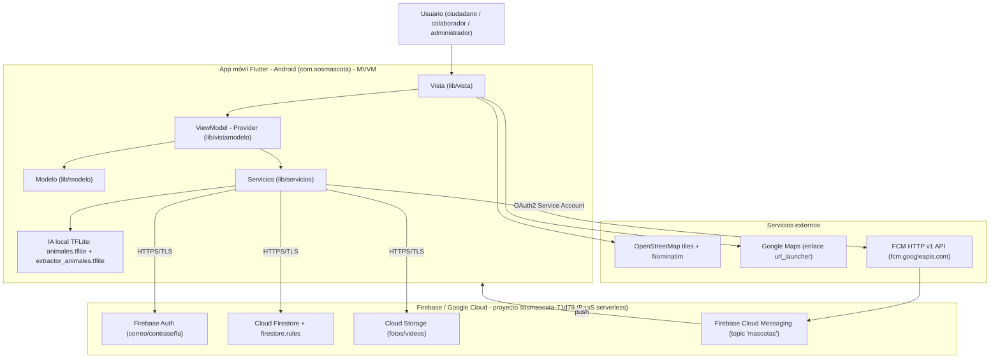
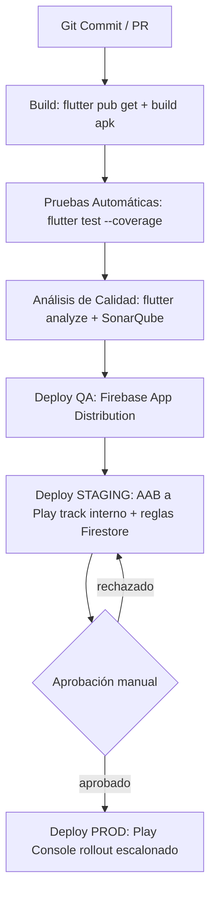

# INFORME DE CONFIGURACIÓN — SOS Mascota (entrega para Documento de Configuración de Ambientes y Procedimiento de Despliegue)

> Generado el **24/10/2026** sobre la rama `UNIDAD-I` (HEAD `feecec2`, con cambios locales sin commit). Todo dato lleva su ruta (relativa a `Código Fuente/`). Etiquetas: `NO ENCONTRADO`, `NO APLICA`, `RECOMENDACIÓN`, `PROPUESTA`, `PENDIENTE DE COMPLETAR POR EL USUARIO`. No se copió ningún secreto.
> Nota de repositorio: la raíz Git es `Repositorio_Proyecto_GitHub/` y el proyecto Flutter vive en la subcarpeta `Código Fuente/` (tiene espacio y tilde: afecta a CI/CD).

---

## A. Información general

| Campo | Valor |
|---|---|
| Proyecto | SOS Mascota (`sos_mascotas`) — app móvil Flutter + Firebase para reportar/buscar mascotas extraviadas en Tacna (`pubspec.yaml:1-2`) |
| Curso | Construcción de Software II — UPT |
| Versión del documento | 1.0 |
| Fecha | 24/10/2026 |
| Docente | Mag. Ricardo Eduardo Valcárcel Alvarado (`docs/PLAN_DE_DESPLIEGUE_SOS_MASCOTA.md:14`) |
| Grupo | G04 (`README.md` raíz) |
| Repositorio | https://github.com/David-Anampa/CONSTRUCCION_SOFTWARE_II_ANAMPA_CHITE.git |

**Integrantes** (docs + `git shortlog -sne --all`, `evidencias/git/git_shortlog.txt`):

| Integrante | Código | Commits en Git |
|---|---|---|
| Anampa Pancca David Jordan | 2022074268 | 18 (10 como "David Jordan Anampa Pancca" [GitHub noreply] + 8 como "David Anampa" [correo UPT]; misma persona) |
| Chite Quispe Brian Danilo | 2021070015 | 1 (usuario GitHub `Danilo314`: "Update team members in README.md") — *asumido por coincidencia de nombre; confirmar* |

> Hallazgo: la contribución en Git es casi totalmente de un solo integrante; el docente podría observarlo.

---

## B. Descripción del proyecto

- **Problema:** las mascotas extraviadas en Tacna no tienen un canal centralizado y geolocalizado para ser reportadas/encontradas.
- **Objetivo:** permitir reportar mascotas perdidas, registrar avistamientos, comunicarse con el dueño/rescatista, y notificar a la comunidad.
- **Alcance — funcionalidades realmente presentes en `lib/` (por existencia de pantalla/VM; no se ejecutó la app):**
  - Autenticación correo/contraseña con **verificación de correo obligatoria** (`servicios/auth_servicio.dart`), registro, recuperación de contraseña, registro especial (colaborador) y registro admin (`vista/auth`, `vista/admin/pantalla_registro_admin.dart`).
  - `AuthWrapper` expulsa cuentas desactivadas (`utils/auth_wrapper.dart:119-172`).
  - Reporte de mascota con foto/video, mapa OSM, mis reportes, ver reportes, detalle (`vista/reportes`).
  - Avistamientos (`vistamodelo/reportes/avistamiento_vm.dart`), comentarios y respuestas (`vista/usuario/pantalla_comentarios.dart`, `replies_page.dart`, `vista/reportes/pantalla_comentarios_reporte.dart`).
  - Mapa interactivo (`vista/mapa`), chat 1-a-1 (`vista/chat`), notificaciones (`vista/usuario/pantalla_notificacion.dart`), perfil.
  - Panel admin: usuarios, reportes, estadísticas, notificaciones (`vista/admin`).
  - IA local TFLite: detección gato/perro/otro (224×224) y embeddings de 1280 dim con similitud coseno (`servicios/servicio_tflite.dart`).
  - PDF (`pdf`, `share_plus`), QR (`qr_flutter`, `mobile_scanner`), recorte de video (`video_trimmer`).
  - **Validación por DNI: NO existe** (ver sección N).
- **Declarado pero NO usado en código:** `google_sign_in` (sin referencias en `lib/`; el README raíz afirma "login con Google"), `firebase_app_check` (sin inicializar), `responsive_framework`/`lottie`/`typed_data`: no verificado uso (`pubspec.yaml`).
- **Usuarios:** *usuario* (rol `usuario`), *colaborador* (colección `colaboradores`), *administrador* (rol `admin`) (`modelo/adminusuario_model.dart:110`, `vistamodelo/admin/admin_vm.dart:44`).
- **Plataformas:** solo **Android** está configurado en Firebase (`lib/firebase_options.dart`: iOS/macOS/Windows/Linux lanzan `UnsupportedError`). Existen carpetas `ios/ macos/ web/ windows/ linux/` generadas por Flutter.

**Tecnologías y versiones**

| Tecnología | Versión | Fuente |
|---|---|---|
| Flutter | 3.35.6 (stable) | `evidencias/pruebas/flutter_doctor.txt` |
| Dart | 3.9.2 (SDK requerido `^3.8.1`) | doctor / `pubspec.yaml:10` |
| JDK usado por la máquina | OpenJDK 21.0.6 (JBR Android Studio); código compila a **Java/JVM 17** | doctor / `android/app/build.gradle.kts:28-35` |
| Gradle | 8.12 | `android/gradle/wrapper/gradle-wrapper.properties` |
| Android Gradle Plugin | 8.9.1 | `android/settings.gradle.kts` |
| Kotlin | 2.1.0 | idem |
| google-services plugin | 4.3.15 | idem |
| Desugar JDK libs / MultiDex | 2.1.5 / 2.0.1 | `build.gradle.kts:81-82` |
| compileSdk/minSdk/targetSdk | los de Flutter (`flutter.*`) | `build.gradle.kts:19,39,40` |
| NDK | `flutter.ndkVersion` | idem |
| Android SDK | 36.1.0-rc1 (licencias **no** aceptadas) | doctor |
| applicationId / namespace | `com.sosmascota` | `build.gradle.kts:18,38` |
| Versión de app | `1.0.0+1` | `pubspec.yaml:7` |
| Firebase (pubspec) | firebase_core ^4.1.0, auth ^6.0.2, cloud_firestore ^6.0.1, storage ^13.0.1, messaging ^16.0.3, app_check ^0.4.1+1 (resueltas: core 4.15.0, auth 6.7.0, firestore 6.10.0, messaging 16.7.0, storage 13.6.0) | `pubspec.yaml`, `flutter_pub_outdated.txt` |
| Otras clave | provider ^6.1.5+1, tflite_flutter ^0.11.0, flutter_map ^8.2.2, latlong2 ^0.9.1, image ^4.0.0 (resuelta 4.11.0), http ^1.5.0, googleapis_auth ^2.0.0, flutter_local_notifications ^19.4.2, image_picker ^1.2.0, video_player/trimmer, pdf ^3.11.3, mobile_scanner ^7.1.3, qr_flutter ^4.1.0, url_launcher ^6.3.2, share_plus ^12.0.1 | `pubspec.yaml` |
| Dev/Test | flutter_test, flutter_lints ^5.0.0, mockito ^5.5.1, mocktail ^1.0.4, fake_cloud_firestore ^4.0.0, firebase_auth_mocks ^0.15.1 | `pubspec.yaml:52-59` |
| SO/IDE del equipo | Windows 10 Pro 22H2; VS Code (ext. Flutter 3.142.0) y Android Studio 2025.1.2 | doctor |

---

## C. Arquitectura de la solución

### C.1 Diagrama (también en `entrega/arquitectura.mmd`)



Equivalencia con el ejemplo del docente: *Usuario → App móvil → (API REST ⇒ **NO APLICA**: SDK de Firebase directo) → (BD relacional ⇒ Cloud Firestore NoSQL) → Servicios externos*.

### C.2 Componentes

| Componente | Ruta | Responsabilidad |
|---|---|---|
| Punto de entrada | `lib/main.dart`, `lib/app.dart` | Init Firebase, TFLite, FCM, rutas nombradas (`/login`, `/inicio`, `/inicioAdmin`, `/mapa`…) |
| Opciones Firebase | `lib/firebase_options.dart` | Config Android del proyecto `sosmascota-71d79` |
| Modelos | `lib/modelo/` | Usuario, ReporteMascota, Avistamiento, Comentario, Notificacion, Admin* |
| Vistas | `lib/vista/{auth,admin,usuario,reportes,chat,mapa}` | UI |
| ViewModels | `lib/vistamodelo/` | Lógica de presentación (Provider/ChangeNotifier) y accesos a Firestore/Storage |
| Servicios | `lib/servicios/` | `auth_servicio`, `firestore_servicio`, `notificacion_servicio` (FCM v1), `servicio_tflite` |
| Utilidades/Widgets | `lib/utils/`, `lib/widgets/` | `auth_wrapper`, `imagen_util`, fondos imagen/video |
| Modelos IA | `assets/model/*.tflite` | Detección y embeddings (empaquetados sin comprimir: `build.gradle.kts:22-24`) |
| Reglas/índices | `firestore.rules`, `firestore.indexes.json`, `firebase.json` | Seguridad y consultas Firestore |
| Pruebas | `test/` | 5 archivos (ver M) |

**Colecciones Firestore usadas:** `usuarios`, `reportes_mascotas` (+`comentarios`), `avistamientos` (+`comentarios`), `comentarios` (+`respuestas`), `chats` (+`mensajes`), `notificaciones`, `tokens`, `colaboradores`, `notificaciones_admin`. **Storage:** rutas p. ej. `usuarios/{uid}/perfil.jpg` (`vista/usuario/pantalla_perfil.dart:109`), medios de reportes/comentarios.

### C.3 Integraciones y servicios

| Servicio | Uso | Dónde se configura | Costo |
|---|---|---|---|
| Firebase Auth | Login/registro/verificación/recuperación | `google-services.json`, consola | Plan gratuito (Spark) para correo/contraseña — *plan real del proyecto: PENDIENTE (verificar)* |
| Cloud Firestore | BD principal, tiempo real | `firestore.rules`, `firestore.indexes.json` | Spark con cuotas / Blaze pago por uso |
| Cloud Storage | Fotos/video | consola; **sin `storage.rules` en repo** | Desde 2024 Storage exige plan **Blaze** para buckets nuevos (*verificar en consola*) |
| FCM | Push (topic `mascotas` + token individual) | `main.dart`, `notificacion_servicio.dart` | Gratuito |
| FCM HTTP v1 vía Service Account | Envío push **desde el cliente** | asset `assets/keys/service_account.json` | Gratuito (riesgo de seguridad, ver F) |
| OpenStreetMap (tiles) y Nominatim | Mapa y geocodificación inversa (`vista/reportes/pantalla_mapa_osm.dart:58,131`) | URL en código; User-Agent `sos_mascota_app/1.0` | Gratuito con política de uso justo (no apto para alto tráfico) |
| Google Maps (enlace) | Abrir ubicación (`pantalla_detalle_completo.dart:55`) | `url_launcher` | Gratuito (sin API key) |
| TensorFlow Lite | IA local | `assets/model` | Gratuito |
| Google Sign-In | **Declarado, sin uso** | — | — |
| Firebase App Check | **Declarado, sin uso** | — | — |

### C.4 Qué NO aplica de la plantilla
API REST propia, MySQL/PostgreSQL, servidor Linux/Docker, Jenkins, AWS/Azure: **NO APLICA** — arquitectura **serverless/BaaS** (Firebase); el "backend" es Firebase y la "BD" es Firestore. Equivalente de hosting: Firebase/Google Cloud + Google Play para distribución.

---

## D. Configuración de ambientes

### Matriz resumen por ambiente (estado real)

| Aspecto | DEV | INT | QA | STAGING | PROD |
|---|---|---|---|---|---|
| Existe como ambiente separado | **PARCIAL** (máquina local) | **NO EXISTE** | **NO EXISTE** | **NO EXISTE** | **PARCIAL** (único proyecto Firebase usado por todo) |
| Proyecto Firebase | `sosmascota-71d79` (el mismo para todos) | — | — | — | `sosmascota-71d79` |
| `google-services.json` | `android/app/google-services.json` (**rastreado en Git**, 1 solo) | — | — | — | el mismo |
| Flavors | **NO EXISTEN** (`build.gradle.kts` sin `productFlavors`) | — | — | — | — |
| applicationId | `com.sosmascota` (sin sufijo `.dev`) | — | — | — | `com.sosmascota` |
| Variables / inyección | No hay `--dart-define` ni `.env`; el token DNI ya no existe; `key.properties` (ignorado) para firma | — | — | — | idem |
| Canal de distribución | `flutter run` / APK debug | — | — (RECOMENDACIÓN: Firebase App Distribution) | — (RECOMENDACIÓN: Play track interno/cerrado) | Play Store (*¿cuenta Play Console?: pendiente*) |

### DEV
| Recurso | Configuración | Estado | Evidencia |
|---|---|---|---|
| SO | Windows 10 Pro 22H2 | EXISTE | `flutter_doctor.txt` |
| IDE | VS Code + Flutter ext. 3.142.0; Android Studio 2025.1.2 | EXISTE (no hay `.vscode/` ni `.idea/` en el repo) | doctor |
| Framework | Flutter 3.35.6 / Dart 3.9.2 | EXISTE | doctor |
| Base de datos | Cloud Firestore del proyecto real (no hay emulador: `firebase.json` sin sección `emulators`) | PARCIAL | `firebase.json` |
| Contenedores | **NO APLICA**: app móvil sin servidor propio; no hay `Dockerfile`/`docker-compose`. Equivalente: Firebase Emulator Suite (RECOMENDACIÓN) | NO EXISTE | búsqueda de archivos |
| Observación | `flutter doctor`: licencias Android sin aceptar (`flutter doctor --android-licenses`) | — | doctor |

### INT (Integración)
`NO EXISTE`. Hoy solo hay `main` (remota) y `UNIDAD-I/II/III`. **RECOMENDACIÓN:** rama `develop` + workflow CI que ejecute `flutter pub get`, `flutter analyze`, `flutter test` en cada PR (`entrega/pipeline_propuesto.yml`).

### QA
| Recurso | Configuración | Estado |
|---|---|---|
| Servidor | NO APLICA (app móvil); equivalente: dispositivos/emuladores Android + Firebase App Distribution | NO EXISTE |
| Herramientas QA | Postman: **NO ENCONTRADO** (sin `*.postman_collection.json`; no hay API REST propia ⇒ NO APLICA). Pruebas: `flutter_test` + mocks (`mockito`, `mocktail`, `fake_cloud_firestore`, `firebase_auth_mocks`); catálogo de casos en `docs/PLAN_DE_PRUEBAS_SOS_MASCOTA.md` | PARCIAL |
| Automatización | Jenkins/GitHub Actions: **NO ENCONTRADO** (no existe `.github/`) | NO EXISTE |
| BD QA | Proyecto Firebase separado: **NO ENCONTRADO** (RECOMENDACIÓN: crear `sosmascota-qa`) | NO EXISTE |

### STAGING
| Recurso | Configuración | Estado |
|---|---|---|
| Infraestructura | Cloud (Firebase) — pero sin proyecto de staging; RECOMENDACIÓN: proyecto `sosmascota-stg` + track interno/cerrado de Play | NO EXISTE |
| SSL/TLS | Firebase/Google sirven todo por HTTPS/TLS administrado; el código solo usa `https://` (OSM, FCM, Maps) | EXISTE (heredado del servicio) |
| Monitoreo | **Crashlytics/Analytics/Performance: NO ENCONTRADO** (no están en `pubspec.yaml`). Solo `debugPrint` y 12 `print()` | NO EXISTE |

### PROD
| Recurso | Configuración | Estado |
|---|---|---|
| Hosting | Firebase / Google Cloud (proyecto `sosmascota-71d79`, bucket `sosmascota-71d79.firebasestorage.app`). Plan Spark/Blaze: **no determinable desde el repo** | PARCIAL |
| Escalabilidad | Automática del servicio (Firestore/Auth/FCM serverless); sin config propia | EXISTE (implícita) |
| Backups | **NO ENCONTRADO**: sin exportaciones programadas de Firestore (`gcloud firestore export`) ni PITR evidenciado | NO EXISTE |
| Seguridad / hardening | R8/ProGuard activos en release (`isMinifyEnabled=true`, `isShrinkResources=true`, `proguard-rules.pro` solo mantiene TFLite); reglas Firestore deny-by-default (`firestore.rules:120-122`); **App Check no activado**; **sin ofuscación Dart** (`--obfuscate` no configurado); firma release depende de `key.properties` local | PARCIAL |

---

## E. Gestión de versiones

- **Ramas (`git branch -a -vv`, `evidencias/git/git_branch.txt`):** local `UNIDAD-I` (actual, = `origin/UNIDAD-I`), `UNIDAD-II` y `UNIDAD-III` (solo locales, apuntan a `3cc5031`), remotas `origin/main` (`3a67516`) y `origin/UNIDAD-I`. No existen `develop`, `feature/*`, `release/*`. Uso real: una rama por unidad académica; `main` solo tiene commits iniciales/uploads.
- **Propuesta (equivalencias):**
  ```text
  main (producción, protegida, solo tags vX.Y.Z)
  ├── develop (integración; ≈ UNIDAD-I/II/III actuales)
  │   ├── feature/login | feature/reportes | feature/chat | feature/admin
  └── release/v1.0.0 (estabilización → QA/STAGING)  → hotfix/v1.0.1
  ```
- **Convención de commits (`git log`)** — mixta, sin estándar:
  1. `feat: Unidad I - SOS Mascota (codigo fuente Flutter/Firebase + documentacion)`
  2. `docs y refactor: auditoria de codigo, refactorizaciones y documentacion tecnica Unidad I`
  3. `docs: README profesional - SOS Mascota (Construccion Software II)`
  4. `Update team members in README.md` (mensaje por defecto de GitHub)
  5. `Add files via upload` / `Delete Especificaciones funcionales directory` / `WIP on UNIDAD-I…` (stash)
  **RECOMENDACIÓN:** Conventional Commits (`feat|fix|docs|refactor|test|chore(scope): …`).
- **Versionado semántico:** `pubspec.yaml:7` = `1.0.0+1` (MAJOR.MINOR.PATCH+build; en Android `+N` = `versionCode`, `versionName` = `1.0.0`, tomados vía `flutter.versionCode/versionName`). Regla propuesta: PATCH = hotfix, MINOR = funcionalidad compatible, MAJOR = cambio incompatible; el `+build` debe subir en **cada** subida a Play. **Tags existentes: ninguno** (`git tag` vacío).
- **Flujo de aprobación:** **NO verificable desde el repo** (PR, revisores, protección de ramas) → pregunta al usuario (sección O). Propuesta: PR hacia `develop` con 1 revisor + CI verde; PR `release/*`→`main` aprobado por Líder/docente.
- **Estado de trabajo sin versionar (riesgo):** `git status` muestra ~130 archivos modificados (`M`; probablemente fin de línea/formato), `docs/` y 4 archivos de test nuevos sin rastrear (`??`), y `lib/servicios/api_dni_servicio.dart` y los .md de la raíz del proyecto como borrados (`D`, movidos a `docs/`). Nada de esto está commiteado (`evidencias/git/git_status.txt`).

---

## F. Seguridad de ambientes

| Control | Estado actual | Evidencia | Acción recomendada |
|---|---|---|---|
| **MFA** | No verificable desde repo; Firebase Auth solo correo/contraseña **sin MFA** para usuarios de la app | `servicios/auth_servicio.dart` | Activar 2FA/MFA en cuentas GitHub y Google Cloud/Firebase de los integrantes (captura); evaluar MFA Auth |
| **Gestión de accesos** | IAM del proyecto Firebase y colaboradores de GitHub: no verificable. Cuenta de servicio embebida en la app (asset) | `pubspec.yaml:71`, `notificacion_servicio.dart:19` | Revisar IAM (mínimo privilegio); eliminar la service account del cliente |
| **Firewall** | NO APLICA firewall de red (serverless). Equivalentes: reglas Firestore (existen), **Storage rules ausentes**, **App Check sin activar** | `firestore.rules`; no existe `storage.rules`; `firebase.json` sin sección `storage` | Crear/desplegar `storage.rules`; activar App Check (Play Integrity) |
| **Roles y permisos** | Roles `usuario/admin/colaborador` solo en cliente; **las reglas no validan rol admin**. Admin modifica/borra docs ajenos (`adminusuario_vm.dart:116,131,144`) y escribe `colaboradores`/`notificaciones_admin`, colecciones **sin regla** (caen en `allow … if false`, `firestore.rules:120`) → fallarían | `firestore.rules`, `vistamodelo/admin/*` | Claim `admin` (custom claims) y reglas para esas colecciones; Cloud Functions para acciones admin |
| **Cifrado TLS** | HTTPS en todos los endpoints del código; TLS administrado por Google | `lib/**` (solo `https://`) | Mantener; **falta** `INTERNET` en manifest principal (ver abajo) |
| **Respaldo de información** | NO ENCONTRADO | — | Exportación programada Firestore (`gcloud firestore export gs://…`) + PITR |
| **Gestión de vulnerabilidades** | 99 paquetes con versiones nuevas incompatibles con constraints; sin Dependabot/SCA; 137 avisos de `flutter analyze` (0 errores, 0 warnings) | `flutter_pub_outdated.txt`, `flutter_analyze.txt` | Dependabot, `flutter pub outdated` periódico, SonarQube |

**Hallazgos vigentes de seguridad:**
1. **Service account en el APK (CRÍTICO por diseño):** `pubspec.yaml:71` declara `assets/keys/service_account.json` y `notificacion_servicio.dart:19,58` lo carga para llamar a FCM v1. El archivo local actual pesa **4 bytes** (placeholder/vacío), está **ignorado por Git** (`.gitignore:10-11`), **no aparece en el historial** y **no está rastreado**. Consecuencias: (a) si se coloca la clave real, queda extraíble del APK; (b) si falta el archivo, `flutter build` **falla** (asset declarado inexistente) y en CI un clon limpio no compila; (c) con el archivo vacío el envío de push falla en tiempo de ejecución (capturado por `try/catch`, solo log). Solución: Cloud Function.
2. **`INTERNET` ausente en `android/app/src/main/AndroidManifest.xml`** (solo está en `debug/` y `profile/`). **Un APK/AAB release no tendría acceso a red** → Firebase, mapas y FCM fallarían. Tampoco hay `POST_NOTIFICATIONS` (Android 13+), `CAMERA`, ni permisos de ubicación declarados en el manifest principal (algunos los aportan los plugins por fusión de manifests — **verificar con el APK release**).
3. **Reglas Firestore permisivas en puntos concretos:** `usuarios` legible por cualquier autenticado (incluye `token` FCM del campo guardado en `main.dart:59`); `tokens` lectura/escritura por cualquier autenticado (`firestore.rules:116-118`); `notificaciones` `create` por cualquier autenticado para cualquier `usuarioId` (`:109`); actualizaciones con `hasOnly([...])` permiten a cualquier autenticado alterar `estado` de reportes ajenos. No hay `storage.rules`.
4. **`google-services.json` y `lib/firebase_options.dart` rastreados en Git** (contienen API key de cliente Firebase: identificador no secreto pero debe restringirse por package/SHA en Google Cloud). `oauth_client` vacío → Google Sign-In (si se usara) requeriría SHA-1.
5. **`.gitignore`:** protege `*.jks`, `*.keystore`, `key.properties`, `service_account.json`, `assets/keys/`, `.env`. Defecto: `*.lock` (línea 30) ignora `pubspec.lock` ⇒ builds no reproducibles (probablemente la causa del conflicto `image`/`archive`). Verificar con `git ls-files pubspec.lock`.
6. **Firma de release:** si no existe `key.properties`, `build.gradle.kts:59-61` no asigna firma ⇒ el release queda sin firma de producción. Keystore real: NO ENCONTRADO en repo (correcto), custodia pendiente.
7. `MainActivity.kt` declara `package com.sosmascota` pero reside en `kotlin/com/example/sos_mascotas/` (inconsistencia de carpeta; compila pero conviene mover).
8. `print()`/`debugPrint` registran email, rol y token FCM parcial en logs (`auth_wrapper.dart:122-124`, `main.dart:60`).

---

## G. Gestión de configuración

- **Gestión de versiones:** Git/GitHub (rama por unidad); `pubspec.yaml` versión `1.0.0+1`; sin tags.
- **Control de cambios:** sin issues/PR evidenciados en el repo (verificar en GitHub); sin plantillas (`.github/` no existe). Trazabilidad parcial vía documentos.
- **Baselines:** ninguna formal. **PROPUESTA:** baseline `v1.0.0` = commit de `main` tras merge de `release/v1.0.0`, etiquetado `git tag -a v1.0.0 -m "Baseline 1.0.0"`; commit de referencia actual de documentación: `feecec2` (informe técnico 23/10/2026).
- **Trazabilidad:** hay documentos de requisitos/pruebas en `docs/` (Plan de pruebas, Diccionario de datos, Planificación de sprints, Plan de iteración) y, según README raíz, `G04_Trazabilidad Implementación.xlsx` en `Especificaciones funcionales/` (ese directorio fue eliminado en commits `ae9ea00/3a67516` — **verificar ubicación actual**). Las pruebas se nombran `REQ01/REQ02/REQ03` (`test/req0*_…_test.dart`). **`CHANGELOG`: NO ENCONTRADO.** Falta el enlace commit↔issue↔versión.
- **Artefactos:** APK/AAB se generan en `build/` (ignorado); **no hay releases de GitHub ni repositorio de artefactos**; dependencias fijadas por `pubspec.lock` (hoy ignorado por `*.lock`). `reporte_auditoria_codigo.html/.txt` en la raíz del proyecto.

---

## H. DevOps, CI/CD y automatización

- **Estado actual:** **NO ENCONTRADO** — sin `.github/workflows`, Fastlane, Codemagic, Jenkinsfile, `sonar-project.properties`, `Dockerfile`.
- **Pipeline PROPUESTO** (borrador ejecutable en `entrega/pipeline_propuesto.yml`, **no activado**):

| Etapa | Comando/herramienta | Disparo | Ambiente | Secretos (nombres) | Aprobación |
|---|---|---|---|---|---|
| Git Commit | `git push` / PR con Conventional Commits | push/PR a `develop`, `release/**`, `main` | — | — | PR con revisor |
| Build | `flutter pub get`, `flutter build apk --release` (`appbundle` en release) | cada push | CI | `GOOGLE_SERVICES_JSON_*`, `KEYSTORE_BASE64`, `KEY_PROPERTIES` | — |
| Pruebas automáticas | `flutter test --coverage` | cada push | CI | — | falla = bloquea |
| Análisis de calidad | `flutter analyze --no-pub`; SonarQube (`sonarqube-scan-action`) | cada push | CI | `SONAR_TOKEN`, `SONAR_HOST_URL` | quality gate |
| Deploy QA | `firebase appdistribution:distribute` (acción Firebase Distribution) | merge a `develop` | QA | `FIREBASE_SERVICE_ACCOUNT`, `FIREBASE_APP_ID_QA` | automático |
| Deploy STAGING | `flutter build appbundle`; `firebase deploy --only firestore:rules,firestore:indexes`; Play track interno | rama `release/*` | STAGING | `GOOGLE_SERVICES_JSON_STG`, `PLAY_SERVICE_ACCOUNT_JSON` | revisor Líder |
| Deploy PROD | Play Console track producción, rollout escalonado | merge a `main` + tag | PROD | `PLAY_SERVICE_ACCOUNT_JSON` | **Environment "production" con Required reviewers** |

Requisitos previos: crear proyectos Firebase QA/STG, flavors o `google-services.json` por ambiente, resolver el asset `service_account.json` (el pipeline no puede compilar sin él o sin removerlo), commitear `pubspec.lock` y agregar `INTERNET` al manifest.

- **CI/CD/Continuous Deployment en este proyecto:** *CI* sí aplica (build+analyze+test por PR). *Continuous Delivery* sí aplica (artefacto listo y distribuido a QA/STAGING con un clic para PROD). *Continuous Deployment* **no** aplica a PROD: la publicación en Play pasa por revisión de Google y requiere aprobación manual y rollout controlado; solo Firestore rules/índices podrían desplegarse automáticamente a QA.

---

## I. Herramientas de despliegue

| Herramienta | ¿Se usa hoy? | Evidencia | ¿Aplica? | Uso recomendado / por qué no |
|---|---|---|---|---|
| Git | Sí | `.git`, 19 commits | Sí | Modelo de ramas propuesto + tags |
| GitHub | Sí | remoto `origin` | Sí | Repo, PR, Actions, Environments, Dependabot |
| GitLab | No | — | No | Redundante con GitHub |
| Azure DevOps | No | — | No | Redundante; opción si la UPT lo exige |
| Jenkins | No | — | Opcional | Innecesario: GitHub Actions cubre CI y no hay servidor propio |
| Docker | No | sin Dockerfile | No aplica | App móvil sin backend propio; solo útil para runners CI o Firebase Emulator |
| Kubernetes | No | — | No aplica | Sin servicios contenedorizados |
| SonarQube | No | sin `sonar-project.properties` | Sí (recomendado) | Análisis estático de Dart (SonarCloud gratuito para repos públicos) |
| Postman | No | sin colecciones | Parcial | No hay API REST propia; podría probar FCM v1 o REST de Firestore |

---

## J. Procedimiento de despliegue

**Objetivo:** desplegar SOS Mascota (APK/AAB + reglas e índices Firestore) de forma segura, repetible y reversible. **Alcance:** DEV, QA, STAGING y PROD (QA/STAGING hoy **por crear**; en la práctica actual todo apunta a `sosmascota-71d79`).

**Roles** (nombres reales donde se sabe; resto pendiente):

| Rol | Responsabilidad | Asignado |
|---|---|---|
| Scrum Master / Líder | Autorizar despliegues | PENDIENTE DE COMPLETAR POR EL USUARIO (propuesto: Brian Chite Quispe o David Anampa Pancca) |
| Desarrollador | Preparar versión | Anampa Pancca David Jordan (autor del 95% de commits) |
| Tester | Validar calidad | PENDIENTE (propuesto: Chite Quispe Brian Danilo) |
| DevOps | Ejecutar despliegue | Anampa Pancca David Jordan (`docs/INFORME_TECNICO_SOSMascota.md:540` lo designa así) |
| DBA (admin Firestore/Firebase) | Reglas, índices, backups | PENDIENTE |
| Cliente | Aceptación final | Docente Mag. Ricardo Valcárcel Alvarado / comité (o usuario final) — confirmar |

### Las 6 fases

**1. Preparación**
- Consolidar cambios: `git checkout develop && git pull`; crear `release/vX.Y.Z`; **commitear** el trabajo pendiente (hoy sin commit).
- Generar versión: editar `pubspec.yaml` (`version: 1.0.0+N`; `N` siempre mayor al último subido).
- Documentación: actualizar este documento/CHANGELOG.
- Verificaciones previas: existe `android/key.properties` (ignorado) y keystore; `android/app/google-services.json` del ambiente correcto; `assets/keys/service_account.json` presente (**o eliminado tras migrar FCM a Cloud Function**); `INTERNET` en manifest.
- Evidencia: rama `release/*`, diff de `pubspec.yaml`.

**2. Pruebas** (todos los ambientes)
```powershell
flutter pub get
flutter analyze --no-pub
flutter test            # hoy: 14 pasan, 1 archivo no compila (image/archive)
flutter test --coverage
```
Resolver observaciones; el ambiente **QA** añade pruebas manuales con los casos de humo.

**3. Aprobación:** revisión técnica (PR), evaluación de riesgos (sección O), aprobación formal del Líder (PR aprobado / acta). PROD: aprobación del Líder + Cliente.

**4. Despliegue**
| Ambiente | Acción |
|---|---|
| DEV | `flutter run` (debug) sobre dispositivo/emulador |
| QA | `flutter build apk --release` → Firebase App Distribution (`firebase appdistribution:distribute build\app\outputs\flutter-apk\app-release.apk --app <APP_ID_QA> --groups testers-qa`) |
| STAGING | `flutter build appbundle --release` → Play Console track interno/cerrado |
| PROD | Mismo AAB firmado → track producción con rollout escalonado (10 → 50 → 100 %) |

Configuración de servicios y "migración de datos": **Firestore no tiene migraciones de esquema**; lo que se despliega son reglas e índices:
```powershell
firebase deploy --only firestore:rules,firestore:indexes --project <ID_PROYECTO>
```
(Actual: `.firebaserc` → `default = sosmascota-71d79`.) **Antes de PROD** hacer export: `gcloud firestore export gs://<bucket>/backup-<fecha> --project <ID>`. Reglas de Storage: `NO APLICA` hasta crear `storage.rules`.

**5. Validación — Smoke Test (solo flujos existentes):**
1. Login con correo verificado → ruta `/inicio`; admin → `/inicioAdmin`.
2. Registro + correo de verificación; recuperar contraseña.
3. Cuenta desactivada es expulsada (`AuthWrapper`).
4. Crear reporte con foto (Storage) y verlo en lista y mapa OSM.
5. Registrar avistamiento.
6. Comentar y responder; chat entre 2 usuarios.
7. Recepción de notificación (topic `mascotas` y individual).
8. Panel admin: usuarios, reportes, estadísticas, notificaciones.
9. Arranque sin error de carga de modelos TFLite y detección gato/perro en foto.
10. Revisar logs (`adb logcat`, consola Firebase, Crashlytics si se instala).
(No se incluye DNI.)

**6. Cierre:** actualizar documentación, registrar evidencias (capturas, logs, hash del AAB), taggear `git tag -a vX.Y.Z -m "…" && git push origin vX.Y.Z`, merge de `release/*` a `main` y `develop`, lecciones aprendidas.

---

## K. Anexos obligatorios

### Anexo A. Matriz RACI (un solo **A** por fila)
| Actividad | Desarrollador | QA | DevOps | Líder | Cliente |
|---|---|---|---|---|---|
| Configuración | R | C | A | I | — |
| Pruebas | C | R | I | A | I |
| Aprobación | C | C | I | A | C |
| Despliegue | C | I | R | A | I |
| Validación | C | R | I | A | C |
| Rollback | C | C | R | A | I |

Asignación de personas: **PENDIENTE** (propuesta: Desarrollador/DevOps = David Anampa; QA = Brian Chite; Líder = a definir entre ambos; Cliente = docente).

### Anexo B. Checklist
**Pre-despliegue**
- ☐ Código aprobado → PR aprobado, CI verde, sin cambios sin commit (`git status` limpio).
- ☐ Pruebas completadas → `flutter test` sin fallos (corregir conflicto `image`/`archive`) y smoke QA.
- ☐ Backups realizados → export de Firestore + copia del keystore y `key.properties` en custodia.
- ☐ Documentación actualizada → versión, CHANGELOG, este documento.
- ☐ Riesgos identificados → sección O revisada; `INTERNET` en manifest; asset `service_account.json` resuelto.

**Post-despliegue**
- ☐ Aplicación disponible → instala y abre en Play/App Distribution.
- ☐ Servicios operativos → Auth, Firestore, Storage, FCM responden; mapa carga.
- ☐ Base de datos validada → reglas/índices desplegados coinciden con el repo; lecturas/escrituras de prueba.
- ☐ Usuario conforme → aceptación del Cliente.

### Anexo C. Plan de rollback

| Escenario | Responsable | Procedimiento de reversión | RTO (PROPUESTA) | Validación posterior |
|---|---|---|---|---|
| App con crash tras publicar | DevOps (A: Líder) | Play Console → **detener/pausar rollout**; hotfix con `versionCode` mayor sobre el tag anterior (`git checkout vX.Y.Z-1` → subir `+N`), publicar | 2–4 h | Smoke test completo |
| Reglas Firestore rotas | DBA/DevOps | `git checkout <tag_anterior> -- firestore.rules` y `firebase deploy --only firestore:rules --project <ID>` | 15–30 min | Login, crear reporte, chat, notificaciones |
| Fallo de notificaciones | DevOps | Revertir versión o revocar/rotar credencial FCM; verificar token/topic; con Remote Config (si se adopta) apagar la función | 1–2 h | Notificación de prueba al topic |
| Pérdida de integridad en Firestore | DBA | `gcloud firestore import gs://<bucket>/backup-<fecha> --project <ID>` (restaura sobre datos existentes; preferible a un proyecto temporal) o PITR | 2–6 h | Conteo de colecciones y muestreo |
| Fallo de firma / rechazo de tienda | Desarrollador/DevOps | Reconstruir con keystore correcto / Play App Signing; corregir política y reenviar; mantener versión previa publicada | 1–3 días (revisión Google) | Instalación desde track |

RTO marcados `PROPUESTA` — el equipo debe confirmarlos. Nota: sin backups programados hoy, el RTO de integridad **no es alcanzable** hasta crearlos.

### Anexo D. Pipeline CI/CD
Ver sección H y `entrega/pipeline_propuesto.yml`.



---

## L. Evidencias del repositorio Git (`entrega/evidencias/git/`)

| Evidencia | Archivo | Qué demuestra |
|---|---|---|
| `git remote -v` | `git_remote.txt` | Repo GitHub `David-Anampa/CONSTRUCCION_SOFTWARE_II_ANAMPA_CHITE` |
| `git status` | `git_status.txt` | Cambios sin commit y archivos sin rastrear |
| `git branch -a -vv` | `git_branch.txt` | Ramas `UNIDAD-I/II/III`, `main` |
| `git tag` | `git_tag.txt` | Vacío: sin tags |
| `git log --graph … -n 80` | `git_log_graph.txt` | Historial |
| `git shortlog -sne --all` | `git_shortlog.txt` | Autores/commits |
| `git log --stat -n 10` | `git_log_stat.txt` | Últimos cambios |
| `.gitignore` | `gitignore.txt` | Exclusión de secretos |
| Estructura (3 niveles) | `estructura_carpetas.txt` | Organización |
| Config de despliegue (sin secretos) | `pubspec.yaml`, `build.gradle.kts`, `firebase.json`, `firestore.rules`, `firestore.indexes.json`, `.firebaserc`, `AndroidManifest.xml`, `proguard-rules.pro`, `settings.gradle.kts`, `gradle-wrapper.properties` | Configuración. `google-services.json` **no** copiado (contiene clave) |

---

## M. Evidencias de pruebas (`entrega/evidencias/pruebas/`)

| Prueba | Comando | Resultado | Archivo |
|---|---|---|---|
| Entorno | `flutter doctor -v` | OK salvo licencias Android sin aceptar | `flutter_doctor.txt` |
| Dependencias | `flutter pub get` | OK; "99 packages have newer versions incompatible with constraints" | `flutter_pub_get.txt` |
| Análisis estático | `flutter analyze --no-pub` | **137 issues: 0 errores, 0 warnings, 136–137 infos** (lints de estilo, `depend_on_referenced_packages`, etc.) | `flutter_analyze.txt` |
| Pruebas | `flutter test` | **14 aprobadas, 1 archivo fallido** (`test/avistamiento_vm_test.dart` no compila) | `flutter_test.txt` |
| Cobertura | `flutter test --coverage` | **No ejecutado** (la suite falla; correr tras corregir) | — |
| Desactualizados | `flutter pub outdated` | Todas las dependencias directas con versiones nuevas | `flutter_pub_outdated.txt` |

**Causa del fallo:** `image-4.11.0` llama `ZLibDecoder().decodeLazy` que no existe en `archive-4.0.9` (conflicto de versiones transitivas). **Solución probable:** fijar `archive` compatible (p. ej. `archive: ^4.0.x` posterior) o actualizar `image` a 4.12.0; y versionar `pubspec.lock`.

**Inventario de pruebas existentes** (`test/`): `req01_autenticacion…` (PU-01 login común → `/inicio`, PU-02 login admin → `/inicioAdmin`, PU-04 cuenta desactivada, PU-05 perfil inexistente), `req02_registro_usuario…` (PU-01, PU-04 `AuthServicio.registrar`, PU-05 `FirestoreServicio.guardarUsuario`), `req03_recuperar_contrasena…` (PU-01 a PU-04), `avistamiento_vm_test.dart` (3 validaciones; **no ejecutable hoy**), `helpers/firebase_fakes.dart`. Cobertura funcional: solo autenticación/registro/recuperación y validaciones de avistamiento; **sin pruebas** de reportes, chat, mapa, notificaciones, admin ni TFLite.
**Casos de humo candidatos:** los 10 de la fase 5.

---

## N. Cambios respecto a la auditoría anterior y restos de DNI

| Hallazgo anterior (23/10/2026) | Estado hoy |
|---|---|
| Flavors dev/qa/prod | **Siguen sin existir** |
| Proyectos Firebase separados | **Siguen sin existir** (solo `sosmascota-71d79`) |
| `service_account.json` en `assets/` | Declarado en `pubspec.yaml:71`; archivo local de **4 bytes**, ignorado y no rastreado, sin historial en Git; el riesgo de diseño persiste |
| Token DNI hardcodeado | **Eliminado**: sin coincidencias en `lib/`, `test/`, `android/`, `pubspec.yaml`, `firestore.*`, README |
| Reglas de Firestore permisivas | **Mejoradas** (deny-by-default, dueño/participantes); persisten puntos laxos (F.3) |
| `storage.rules` ausente | **Sigue ausente** |
| Crashlytics | **Sigue ausente** |
| CI/CD | **Sigue ausente** |
| Suite de pruebas rota | **Parcialmente corregida**: 14 pruebas pasan (REQ01–03); `avistamiento_vm_test.dart` sigue sin compilar (image/archive) |
| Permisos del manifiesto | **Sin cambios**: falta `INTERNET` en manifest principal |

**Restos de DNI:**
- Código/config (`lib`, `test`, `android`, `pubspec.yaml`, `firestore.rules/indexes`, `README.md`, JSON de assets): **0 coincidencias** de `dni|miapi|DNI_TOKEN`.
- `lib/servicios/api_dni_servicio.dart`: **borrado en el árbol de trabajo pero aún presente en HEAD** (cambio sin commit) → commitear la eliminación.
- Documentación: `docs/INFORME_LABORATORIO_01_REVISION_CODIGO.md:418` conserva el fragmento `dniBearerToken` (histórico). Revisar también `docs/INFORME_TECNICO_SOSMascota.md` y `docs/*` (búsqueda en `.md` solo se hizo por "dni" en esa línea; el resto: ejecutar `Select-String -Path docs\*.md -Pattern 'dni|miapi'`). La carpeta `Revisión de Código/` del repo también puede citarlo.

---

## O. Hallazgos, riesgos y datos pendientes

| Riesgo | Impacto | Severidad | Mitigación |
|---|---|---|---|
| Falta `INTERNET` en manifest release | App release sin red; falla total | **Crítica** | Añadir `<uses-permission android:name="android.permission.INTERNET"/>` y probar APK release |
| Service account (FCM) en APK / asset ausente | Robo de credenciales o build roto en CI | **Crítica** | Migrar a Cloud Function; quitar asset de `pubspec.yaml` |
| Un único proyecto Firebase para todo | Pruebas contaminan producción | Alta | Proyectos QA/STG/PROD + flavors |
| Sin backups de Firestore | Pérdida irrecuperable de datos | Alta | Export programado / PITR |
| Reglas sin validación de rol admin; colecciones `colaboradores`/`notificaciones_admin` sin regla | Funciones admin fallan o se abre sobre-permiso | Alta | Custom claims + reglas |
| Sin `storage.rules` ni App Check | Subidas/descargas sin control; abuso de cuota | Alta | Reglas Storage + App Check |
| Sin CI/CD ni calidad automatizada | Regresiones al liberar | Alta | Activar pipeline propuesto |
| Suite de pruebas incompleta y 1 archivo no compila | Baja confianza | Media | Fijar `archive`/`image`, ampliar pruebas |
| `pubspec.lock` ignorado | Builds no reproducibles | Media | Quitar `*.lock` del `.gitignore` y versionar |
| Trabajo sin commit (~130 archivos) | Pérdida de cambios, baseline inexistente | Media | Commit ordenado y tag |
| Firma de release dependiente de archivo local | Release sin firmar / pérdida de keystore | Media | Play App Signing + custodia |
| Sin monitoreo (Crashlytics) | Fallos no detectados en producción | Media | Firebase Crashlytics/Analytics |
| Dependencias desactualizadas (99) | Vulnerabilidades | Media | Dependabot |
| Contribución desigual en Git | Observación académica | Baja | Commits de ambos integrantes |
| OSM/Nominatim bajo política de uso | Bloqueo por tráfico | Baja | Proveedor de tiles propio/alterno |

**Preguntas para el usuario:**
1. ¿Quién es Líder, Tester, DBA y Cliente de aceptación (nombres)? ¿Brian Chite es `Danilo314` en GitHub?
2. ¿Hay cuenta de Google Play Console? ¿Se publicará o solo se distribuirá por App Distribution/APK?
3. ¿El proyecto `sosmascota-71d79` está en plan Spark o Blaze?
4. ¿Las ramas están protegidas en GitHub? ¿Se usan Issues/PR?
5. ¿Existen otros proyectos Firebase (QA/STG)?
6. ¿Ventana de despliegue (fecha/hora)?
7. ¿El `service_account.json` real existe en tu equipo (tiene 4 bytes en el repositorio)?
8. ¿Las reglas desplegadas en consola coinciden con `firestore.rules`?
9. ¿Dónde está hoy `G04_Trazabilidad Implementación.xlsx` (carpeta eliminada del remoto)?
10. ¿Se usa realmente Google Sign-In? (dependencia sin código)

---

## Resumen ejecutivo
SOS Mascota es una app Flutter 3.35.6/Dart 3.9.2 para Android con backend serverless Firebase (Auth, Firestore, Storage, FCM) y IA local TFLite, organizada en MVVM. Existe **un solo ambiente efectivo** (proyecto `sosmascota-71d79`); no hay flavors, QA/STAGING, CI/CD, Crashlytics, backups ni `storage.rules`. La validación por DNI fue retirada del código (queda solo en documentación y un borrado sin commit). `flutter test`: 14 aprobadas y 1 archivo no compila (conflicto `image`/`archive`); `flutter analyze`: 137 infos, 0 errores. Bloqueantes de liberación: falta `INTERNET` en el manifest release y la service account de FCM en el cliente. Se entregan pipeline, diagrama, RACI, checklist y rollback propuestos.

## Lista de verificación de cobertura

| Apartado del PDF | Estado |
|---|---|
| Parte I Temas 1–5 (estado real aplicado) | PARCIAL — datos reales entregados; la teoría la redacta Claude |
| Parte II §1 Información general | COMPLETO (docente y códigos tomados de docs) |
| §2 Descripción | COMPLETO (funcionalidad verificada por código, no ejecutada) |
| §3 Arquitectura | COMPLETO |
| §4 Ambientes DEV/INT/QA/STG/PROD | COMPLETO (la mayoría `NO EXISTE`; propuestas incluidas) |
| §5 Gestión de versiones | PARCIAL — flujo de aprobación/protección requiere respuesta del usuario |
| §6 Seguridad | PARCIAL — MFA, IAM y planes requieren capturas |
| Parte III Procedimiento (6 fases) | COMPLETO |
| Anexo A RACI | PARCIAL — nombres por confirmar |
| Anexo B Checklist | COMPLETO |
| Anexo C Rollback | PARCIAL — RTO a confirmar (`PROPUESTA`) |
| Anexo D Pipeline | COMPLETO (`PROPUESTA`) |
| Entregable 1 Informe de investigación | PENDIENTE (Claude) |
| 2 Doc. configuración | PENDIENTE (Claude, con este material) |
| 3 Procedimiento | PENDIENTE (Claude) |
| 4 Diagrama arquitectura | COMPLETO (borrador) |
| 5 Pipeline CI/CD | COMPLETO (borrador) |
| 6 Matriz RACI | PARCIAL |
| 7 Plan de rollback | PARCIAL |
| 8 Evidencias Git | COMPLETO (+ capturas del usuario) |
| 9 Evidencias de pruebas | PARCIAL (sin cobertura; capturas pendientes) |
| 10 Presentación | PENDIENTE (Claude) |
